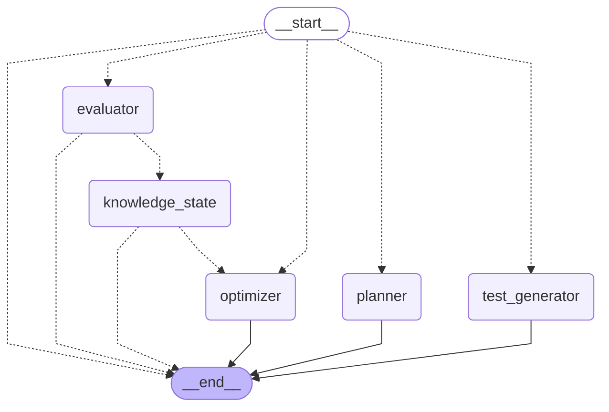

# ReadFocus 2.0 — architecture

How the pieces fit, written from the code at the end of the sprint (C15)
and brought up to date for phase 2 (C25.1). ReadFocus's quizzes, grading,
planning and scoring are algorithmic and run on our servers: every agent
decision is an algorithm or a local embedding model. The one generative
model is Google's Gemini, used only by Steve, the optional study assistant
(and his "Copy as LaTeX" for PDF equations), only through
`backend/steve/provider.py` and only after the reader's consent. No paid
API anywhere. File paths are given so each claim can be checked.

## Contents

- [System](#system)
- [Agents](#agents)
- [The agent graph](#the-agent-graph)
- [Event flows](#event-flows)
- [Ingestion](#ingestion)
- [Data model](#data-model)
- [Conversions](#conversions)
- [Region map](#region-map)
- [The original view](#the-original-view)
- [Word lookup](#word-lookup)
- [Annotations](#annotations)
- [Notes](#notes)
- [Steve](#steve)
- [Focus mode](#focus-mode)
- [XP, streaks, badges and leagues](#xp-streaks-badges-and-leagues)
- [Security](#security)

## System

```
 Browser (React + Vite, Vercel)
   │  Supabase Auth (sign-in, JWT)          ──►  Supabase Auth
   │  original view: PDF.js, foliate-js, tesseract.js (scanned pages), all served from our origin
   │  REST + bearer JWT
   ▼
 FastAPI (Python 3.11, Docker, Render Free)
   │  routers: /books /sessions /dashboard /mastery /lookup /auth /health
   │           /steve /focus /me /badges /leagues /internal + annotations, notes
   │  agents:  LangGraph workflow of five pure decide() agents
   │  nlp:     fastembed all-MiniLM-L6-v2 (ONNX, 384 dims, on the CPU)
   │  regions: region map (pdfplumber over pdfminer.six); convert: Markdown / notebook → EPUB
   │  service-role key (server side only)
   ▼
 Supabase (Postgres + pgvector, Storage, RLS)
   │
   ├── word lookup only: Free Dictionary API, Wikipedia (free, keyless)
   ├── covers only: Open Library (one search per book, at ingestion)
   └── Steve only, after consent: Google Gemini (backend/steve/provider.py; free tier or the reader's key)
```

| Layer | Where | Notes |
|---|---|---|
| Frontend | `frontend/src/` | React, React Router, Recharts, motion, @floating-ui/react; plain JavaScript; `originalview/`, `annotations/`, `notes/`, `steve/`, `gamification/` |
| API | `backend/routers/` | Every route but `/health` needs a Supabase JWT (`backend/dependencies.py`) |
| Agents | `backend/agents/` | LangGraph `StateGraph` in `graph.py`, run through `workflow.py` |
| Constants | `backend/agents/policy.py` | Every threshold, weight and bound the agents use |
| Local NLP | `backend/nlp/` | `embedder.py` (fastembed), `concepts.py` (YAKE + rapidfuzz), `text.py` |
| Services | `backend/services/` | ingestion, jobs, question bank, concepts, lookup, covers, retriever, region and prose jobs, OCR pages, note content, body start |
| Phase 2 | `backend/regions/`, `convert/`, `steve/`, `focus/`, `xp/` | region map, converters, Steve, focus scoring, XP and leagues; constants in `regions/policy.py`, `steve/policy.py`, `focus/policy.py` and (XP) `agents/policy.py` |
| Schema | `supabase/migrations/001`–`033` | additive only; 001-015 through `db push`, 016-033 applied by hand (C25.4 reconciles the history) |

## Agents

Every agent is a pure `decide(input) -> output` with no I/O, no clock and no
model call, wrapped by a LangGraph node that reads the state it needs,
calls `decide`, persists the result and appends one entry to the run's
`decisions` (stored in `agent_decisions`, so the app can say why it chose).
The shared state is `AgentState` (`backend/agents/state.py`); `decisions`
and `errors` are append-only.

| Agent | Pure decide | Input | Output |
|---|---|---|---|
| Planner | `planner/strategy.py` | `PlannerInput`: now, candidate chunks (index, words, concept keys, difficulty), concept states, last chunk read, re-read queue, recent percentages, wpm, pace hint | `SessionPlan`: mode (`new`, `review`, `re_read`, `finished`), rule, chunk indices, words, focus minutes, question mix, one-line reason, scored anchors |
| Test generator | `question_generation/assembler.py` | the session's chunks' question-bank rows and the planner's question mix | the session's questions; `public_question()` strips answer, evidence and key terms before anything reaches the client |
| Evaluator | `evaluation/grader.py` + `evaluation/feedback.py` | `GradeInput` per answer: question, answer, evidence, key terms, strategy, options, cosines | `Grade`: score 0–1, confidence (high, medium, low), matched and missing concepts, method, components, reasons; feedback from templates only |
| Knowledge state | `knowledge_state/mastery.py` | the reader's mastery rows and the test's grades with their concept keys | `MasteryUpdate` per concept: previous and new mastery, attempts, correct, days to the next review |
| Optimizer | `optimizer/pace.py` | `OptimizerInput`: this test's percentage, recent percentages, re-read queue, previous multiplier, abandonment, words and minutes, question outcomes, previous mix | `PaceRecommendation`: next multiplier, focus minutes, re-read mode and queue, question mix, band, reason |

What each one decides:

- **Planner** (dormant since C26: kept with its tests, but no route calls it; a book opens at the
  reader's place instead). It took the first section of the re-read queue, if any. Otherwise
  every candidate is scored on weak concepts, being unread, difficulty fit
  and reviews due (weights `PLANNER_WEIGHTS`); a new-reading anchor is
  extended with the following sections while the words stay within the
  optimizer's target. The reason names what drove the choice, for example
  "Re-reading section 1 before moving on — your last test on it was low."
- **Test generator.** Fills the mix (by default two multiple choice, one
  cloze, one definition or why/how, one main idea) from the bank,
  preferring questions used less, from chunks drawn on less, nearer the
  target difficulty and of higher quality; never the same sentence or
  answer twice.
- **Evaluator.** Closed questions are string matches (exact or a rapidfuzz
  ratio of 90 or more; 80–90 is a near miss for half marks at low
  confidence). Free text is `0.55 × meaning + 0.35 × key-term coverage +
  0.10 × relevance`, where meaning is the cosine between the answer and
  the evidence sentences from the local model. Free text is never graded
  above medium confidence: an answer that reverses the evidence in its own
  words scores like a right one (see Limitations in the README).
- **Knowledge state.** A rule-based knowledge-tracing update per concept:
  a correct answer moves mastery `m` to `m + 0.30 × (1 − m)`, a wrong one
  to `m × (1 − 0.25)` (`MASTERY_GAIN`, `MASTERY_LOSS`), a partial one in between; a low-confidence grade
  moves it half as much; the next review is sooner the lower the mastery.
  Applying the same test twice changes nothing (`last_event_id`). This is
  not Bayesian Knowledge Tracing: there is no fitted slip or guess model.
- **Optimizer.** The test's band (`grow` ≥ 80, `hold` ≥ 50, `reduce` ≥ 20,
  `fail`) decides re-reading; the rolling mean picks the multiplier factor
  (1.15, 1.0, 0.80, 0.50), damped so one test cannot swing it; recent
  abandonment caps it; focus minutes follow the measured reading speed;
  the worst failing question type gets one more place in the next mix.

The question bank itself is filled at ingestion by the question generation
agent (`question_generation/agent.py`, `strategies.py`, `quality.py`):
extractive cloze, definition, why/how, main-idea and multiple-choice
questions built from the chunk's own sentences, with YAKE concepts as
answers and distractors. Every question keeps its evidence verbatim.

## The agent graph

Generated from the compiled workflow by `scripts/export_agent_graph.py`
(`make agent-graph`); the source of truth is
[`docs/repo-graph/AGENT_GRAPH.md`](repo-graph/AGENT_GRAPH.md). Dotted arrows
are conditional edges.



Routing (`backend/agents/graph.py`):

| Edge | Condition |
|---|---|
| `__start__` → first node | `state["event"]`: `start_session` → planner, `finish_reading` → test_generator, `submit_answers` → evaluator, `abandon` → optimizer; anything else → end |
| evaluator → end | the evaluator recorded an error |
| knowledge_state → end | every grade of the test is low confidence: no adapting on unreliable evidence, the optimizer is skipped |
| knowledge_state → optimizer | otherwise |
| optimizer → end | always (C26: no next plan after a test) |

## Event flows

| Request | What runs |
|---|---|
| `POST /books/upload` | `.pdf`, `.epub`, `.md` / `.markdown`, `.zip` (Markdown with its images), `.ipynb`; Markdown and notebooks converted to EPUB first ([Conversions](#conversions)), and only the EPUB is kept; the file to Storage (`books/<user>/<book>.<ext>`) unless `storage_mode` is `device`; `books` row (`processing`), a `processing_jobs` row, then ingestion after the response (below), then the regions job |
| `POST /books/{id}/ocr` | one scanned PDF page's words from tesseract.js in the browser, cleaned (`services/ocr_pages.py`) into `page_ocr`; a fully read scanned book is ingested again from that text |
| `POST /steve/ask` | consent, off switch, open test or quiz (409), cache, breaker, daily limit, then the context builder and one Gemini call, streamed; see [Steve](#steve) |
| `POST /focus/start`, `/focus/{id}/event`, `/end`, `/quiz/answers` | see [Focus mode](#focus-mode); a passed quiz awards XP and badges ([XP](#xp-streaks-badges-and-leagues)) |
| `GET /books/{id}/open` | the book (title, author, contents, format, storage mode), its status, the pages-only flag of a scanned book with no text yet, the saved place, and (C34.3) the original file's signed URL, or null for a device-only book; makes the reader's `reading_progress` row on a first open (C26.4). No session, no plan |
| `PUT /books/{id}/position` | the reader's place, an anchor in the book's own format (its chunk when known), on every page turn, into `reading_progress.position`; asks for the Finished a book badge (C26.4) |
| `POST /focus/quiz-me` | a quiz on this chapter or since the last quiz, kept on a `sessions` row and graded by submit-answers with no points (C23.7b) |
| `POST /sessions/{id}/finish-reading` | (sessions made before C26) the public test; runs `finish_reading` (test generator) inline if the background run has not stored it yet; the first stored test wins |
| `POST /sessions/{id}/evaluate-single` | grades one answer while the reader moves on, cached on the session |
| `POST /sessions/{id}/submit-answers` | claims the session (graded once), then `submit_answers`: evaluator → knowledge state → optimizer; returns score, per-question feedback and confidence, and the pace (C26: no next session) |
| `POST /sessions/{id}/abandon` | marks the session; `abandon` (optimizer) after the response |
| `GET /dashboard`, `GET /mastery` | the reader's sessions, results and concept mastery, weakest first |
| `GET /lookup` | a word or phrase, see [Word lookup](#word-lookup) |

## Ingestion

`backend/services/book_ingestor.py` `run_job`, after the upload responds:

1. Extract text (pypdf for PDF, ebooklib + BeautifulSoup for EPUB) and
   cut it into chunks of about 600 words (`chunk_text`). `chunks.content`
   is never changed afterwards: questions quote it verbatim.
2. Build reader structure beside it (`book_structure.py`): blocks per chunk
   (`{id, type, text, marks}`) and a table of contents.
3. Per batch of chunks: embed locally (all-MiniLM-L6-v2, 384 dimensions),
   upsert the chunks, extract concepts (YAKE, merged with rapidfuzz and
   embedding similarity) and fill the question bank. After the first
   batch the book is marked `ready`, so reading can start while the rest
   is processed.
4. The job's cursor is saved after every batch (`processing_jobs`); a
   stopped server's jobs are picked up again by the startup sweep
   (`ingestion_worker.py`) or `POST /books/{id}/resume`.
5. Last, one Open Library lookup for a cover, copied into the public
   `covers` bucket so browsers never contact Open Library.

Measured: `sample.pdf` (13 pages, 7 chunks, 55 questions) is ready in about
5 s on a desktop and about 40 s in a 0.1-CPU, 512 MB container
(`docs/BENCHMARKS.md`, C9.5 and C14.1).

## Data model

All tables are in `public`, all have row-level security, and every row a
reader owns carries `user_id`. Deleting a book cascades to the rows about that book (chunks,
sessions, regions, annotations, notes, Steve threads, focus sessions); XP,
badges and league rows belong to the reader, not the book, and stay.

| Table | Migration | Holds |
|---|---|---|
| `profiles` | 001, 004, 023 | display name, reading speed, `is_calibrated`; Steve's switch, consent time and version, the reader's encrypted Gemini key and its last four characters (written only by the backend) |
| `books` | 001, 012, 013, 016, 021, 022, 028 | title, author, file type, `storage_path`, status, counts; `cover_url`, `cover_source`; `toc`; file hash, size and format, `storage_mode` (cloud or device), page count, `source_format` (converted books), `scanned_pages`, `body_start` |
| `chunks` | 001, 005, 013 | `chunk_index`, `content`, `word_count`, `embedding_local vector(384)`, `blocks` (the 1536-dimension column from 001 is unused) |
| `sessions` | 001, 003 | chunk range, assigned words, focus minutes, status, `test_questions` (with answers and evidence, never sent before submit) |
| `test_results` | 001 | the graded answers of a session |
| `reading_progress` | 001, 002, 014 | per book: last chunk, re-read queue, `pace_recommendation`, `position` |
| `question_bank` | 007 | precomputed questions per chunk: strategy, prompt, answer, evidence, key terms, distractors, difficulty, quality, use count |
| `concepts` | 008 | a book's concepts: key, label, chunk indices, weight |
| `user_concept_mastery` | 008 | per reader and concept: mastery 0–1, attempts, correct, last seen, next review, last event |
| `agent_decisions` | 009 | one row per node a run visited: agent, inputs and outputs summarised, reason, duration (read-only to readers) |
| `processing_jobs` | 010 | ingestion jobs: status, cursor, progress, attempts (read-only to readers) |
| `term_lookups` | 015 | shared cache of dictionary and Wikipedia answers; no personal data; readable by signed-in readers, written only by the backend |
| `annotations` | 026 | a reader's highlights and underlines (C21): `anchors` (ANCHORS A1, one per page or spine item), `position_start`/`position_end` (A4), `style`, `color` (five palette names), `text_snapshot`, `orphaned`; readers read their own, only the backend writes |
| `note_blocks` | 027 | a reader's note blocks (C22): `kind`, `scope`, `anchors` and A4 positions as `annotations`, `content` per kind, optional `annotation_id` / `region_id`, `thumbnail_path`, `version` (If-Match), `orphaned`, soft `deleted_at`; readers read their own, only the backend writes |
| `page_regions` | 018, 019 | the region map: per PDF page (box) or EPUB spine item (CFI `anchor`), `kind` prose / math / code / figure / table / unreadable, text and meta; read through the backend |
| `page_ocr` | 022 | a scanned PDF page's cleaned words and boxes from the reader's browser; `books.scanned_pages` lists the scanned pages |
| `steve_usage` | 023, 024 | questions asked per reader per local day on our key (`steve_take_quota`, `steve_refund_quota`) |
| `steve_threads`, `steve_messages` | 023 | a reader's Steve conversation per book: question, answer, anchor, citations, model, token counts; readers read their own |
| `equation_latex` | 025 | LaTeX for drawn PDF equations, keyed by file hash, page and box; returned only to a reader who owns a book with that file |
| `focus_sessions`, `focus_events` | 029, 030 | focus sessions (start and bookmark anchors, status, active seconds, points) and their server-timestamped events (append-only) |
| `xp_events`, `user_progress` | 031 | the XP ledger (append-only, unique per source) and each reader's total, daily goal, time zone, streak, freezes, display name and leaderboard opt-out |
| `user_badges` | 032 | badges earned, one row per reader and badge |
| `league_weeks`, `league_groups`, `league_members` | 033 | weekly leagues: weeks, groups per tier, each member's weekly XP, rank and outcome; readers read only their own memberships |

Search functions: `match_chunks_local` (pgvector, 005) and
`search_chunks_text` (Postgres full-text, 006), both `SECURITY INVOKER`, fused
by reciprocal rank in `backend/services/retriever.py`. Indexes for the
per-user reads are in 011. Storage: `books` (private, a reader's own folder
only), `covers` (public read) and `notes` (private, 027: note crops and drawing thumbnails in a reader's own folder).

## Conversions

Markdown and notebooks become EPUB 3 on the server at upload (C19,
`backend/convert/`), and only the EPUB is kept: `sources.py` picks the
converter (`.md`, a `.zip` holding Markdown and its images, `.ipynb`);
`markdown.py` (markdown-it-py) and `notebook.py` (a notebook's Markdown and
code cells and their image outputs) write XHTML, `texmath.py` turns `$...$`
math into MathML with the LaTeX kept (latex2mathml), raw HTML is escaped,
`assets.py` packs the images (`image_size.py` reads their pixel sizes from
the header bytes), and `epub_builder.py` packages the book.
Images are kept. Scanned PDFs are not converted: their pages are read in
the browser (below) and the words posted to `POST /books/{id}/ocr`.

## Region map

Each page is split into prose, math, code, figure, table and unreadable
regions (C18, `backend/regions/`, `docs/ANCHORS.md`), in the regions job
that runs after ingestion (`services/region_job.py`, resumable, a few pages
per batch):

```
PDF: pdfplumber characters ─► extract.py lines and blocks ─► classify.py math (fonts, symbols, raised characters)
       ─► code.py (monospace, language guessed) ─► figures.py / tables ─► garble.py (unreadable text) ─► page_regions (018)
EPUB: epub.py walks each spine document: <math>, <pre>/<code>, <figure>/, <table> with CFI anchors ─► page_regions (019)
then prose_job.py: each chunk's prose-only text and anchors (020); changed chunks re-embedded, their unused questions rebuilt
```

Questions, grading and Steve's context read `chunks.prose`, so an equation
or a listing is never quoted as a sentence. The body start (where chapter 1
begins, `services/body_start.py`, 028) comes from the contents, then the
region map's headings.

## The original view

Every book opens as published (C17; `frontend/src/originalview/`, at
`/read/:bookId` by `pages/ReadingSession.jsx`). The C12 book view, which
re-set the text in our own pages, is retired; `frontend/src/reader/` keeps
only the parts the original view still uses (word cards, the contents
drawer, the toolbar, the device file store and the place saver).

- **PDF** (`originalview/pdf/`): PDF.js, loaded only when a PDF opens, with
  its worker, fonts and decoders served from our origin (`pdfjs.js`); a
  canvas and a text layer per page, a page cache, Lamplight recolouring,
  and the region map's boxes for block actions. Scanned pages get a text
  layer from tesseract.js (English) running in the browser (`ocr.js`):
  math, code, table and figure boxes are painted out first, and the words
  go to the server once per page.
- **EPUB** (`originalview/epub/`): foliate-js, vendored and reached only
  through `engine.js`; sections sanitised (`sanitize.js`) and paginated two
  pages from 1024 px, one below.
- **The file** comes from a short-lived signed URL (`GET /books/{id}/file`)
  or, for a book kept on this device, from IndexedDB (`reader/fileStore.js`).
- **The place** (C26.5): the book opens with `GET /books/{id}/open` at the
  saved anchor (a new book at its first page), and every turn is saved with
  `PUT /books/{id}/position` (`reader/usePlaceSaver.js`, one a second);
  `originalview/place.js` compares places. The closing page is the end of
  the book; today's reading and its range are gone.

## Word lookup

```
hover (350 ms intent) or selection ─► wordAt / useWordAtPoint: the word or phrase under the pointer
   └─► lookup.js client: LRU of the session's answers; one request in flight, older ones aborted
         └─► GET /lookup?term=…&proper=0|1  (backend/routers/lookup.py)
               └─► services/lookup.py: in-process cache ─► term_lookups (90 days found, 7 not found)
                     └─► Free Dictionary API, then Wikipedia; one attempt each, 429/5xx backed off
   ◄── WordCard.jsx (floating-ui): definition, Wikipedia summary, "several meanings", or unavailable
```

The text is never wrapped in spans: the word is found from the caret
position (`caretPositionFromPoint`), highlighted with the CSS Highlight API
where available. Proper nouns and phrases of more than one word go to
Wikipedia first. Touch devices use a
long press and a Look up chip. Measured: about 360 ms from hover to card
when cached, which is the hover intent plus the answer (BENCHMARKS, C12.10).

## Annotations

Highlights and underlines in the original view (C21; `docs/ANCHORS.md` A10):

```
selection (PDF text layer / EPUB section) ─► useSelection: anchors + A4 positions (selectionPlace)
   └─► SelectionToolbar: colour, Underline, Ask Steve; H / U
         └─► useAnnotations: shown at once, POST /books/{id}/annotations (rolled back on refusal)
               └─► backend/routers/annotations.py: anchors and positions checked, owner only ─► annotations (026)
drawn: PDF boxes between canvas and text layer (darken / lighten) · EPUB CSS Custom Highlights in the section
lookup off: hover, tap or A ─► AnnotationChip: Ask Steve (explain_highlight), colour, Underline, Delete (PATCH, DELETE)
contents drawer ─► Annotations tab: reading order, colour filter, page, jump
```

The book's DOM is never changed: the PDF layer is ours, and an EPUB section
gets only `Highlight` objects and one `<style>` element. Steve's entry
points hide while he is switched off, and a question waits for consent.

## Notes

The notepad beside the book (C22; `docs/ANCHORS.md` A11). One `note_blocks`
row (migration 027) per block: `kind` (text, drawing, equation, code,
figure), `anchors` + A4 `position_start` / `position_end`, `scope`
(selection or view), `content` checked per kind by
`backend/services/note_content.py` (TipTap JSON from an allow-list, an
Excalidraw scene, fixed fields), optional `annotation_id` / `region_id`,
`version` for If-Match, soft `deleted_at`. Images (crops, drawing thumbnails)
live in the private `notes` bucket under `<user>/<book>/`, served by signed
URLs.

```
new note: Text / Drawing pills, N, selection toolbar Note ─► Reader.notePlace(): selection, else the pages shown
from the book: block actions Add to notes (PDF crop + LaTeX, code, figure; EPUB on the device), highlight chip
  Note (quote + annotation_id), Steve Save to notes (citations as text), a dragged equation or listing
   └─► NotesContext.add ─► crop to POST /books/{id}/note-files ─► useNotes.create (shown at once) ─► POST /books/{id}/notes
edits ─► autosave (800 ms, If-Match; 409 = "changed in another tab"; offline queue in IndexedDB, sent on reconnect)
book ─► notepad: relocate ─► shownRange (A4) ─► sync.js: marks the notes on it, scrolls to the first,
  or offers "Jump to notes for this page" while writing; filter This page / This chapter / All
notepad ─► book: a reference ─► Reader.goTo + flash (the passage pulses); margin markers (noteSpots) open notes
```

TipTap and Excalidraw are lazy chunks loaded only when a note is edited or a
drawing opened; the list draws notes with our own renderer (NoteDoc, KaTeX).
Nothing in the notepad calls Gemini; a PDF equation's LaTeX comes from
`/steve/latex` only while Steve is on (a cached result costs no call).

## Steve

The optional study assistant (C20; spec `docs/STEVE.md`). The only code
that reaches Gemini is `backend/steve/provider.py`; the browser never calls
Google.

```
Ask Steve (panel question, a selection, Explain this equation / code / figure)
   └─► POST /steve/ask (routers/steve_ask.py)
         consent at the current notice version? Steve on? no open test or quiz on the book (409)?
         └─► service.ask: cache (book, normalised question, context hash, model) ─► hit: no call
               └─► breaker (after a 429: paused for everyone on our key) ─► daily limit (steve_take_quota, 024)
                     └─► context.build_context: book card, reading text (around the place), highlight, 6 retrieved passages,
                         region or image; 12,000-token cap; every part inside its own delimited section
                           └─► prompts.build_prompt ─► provider.py ─► Gemini (our free-tier key, or the reader's own)
   ◄── streamed answer with [p. 44] / [sec. 4] citations ─► steve_threads / steve_messages (023)
```

- **Consent and off switch**: `profiles.steve_consent_at` and
  `steve_consent_version` (a changed notice asks again), `steve_enabled`;
  only the backend writes them (a trigger, 023).
- **Keys**: ours is `GEMINI_API_KEY` (server env). A reader's own key is
  checked with Google, Fernet-encrypted under `KEY_ENCRYPTION_SECRET`
  (`steve/keys.py`), never logged or returned (last four characters only),
  and skips our daily limit.
- **Paused, not broken**: the daily limit, the breaker, a timeout or an
  outage show "Steve is resting" with when he is back; reading, tests and
  grading never wait on him. No fallback provider.
- **Logs**: counts, sizes, latency, status and cache hits; never a prompt
  or an answer.
- **Copy as LaTeX** for a drawn PDF equation (`POST /steve/latex`, only
  while Steve is on and consented): one Gemini call with a crop of the
  page, cached by file, page and box in `equation_latex` (025), so each
  equation costs at most one call ever.
- Steve never writes a question, grades an answer or scores a session.

## Focus mode

A server-timed stopwatch with server-scored points (C23; rules
`docs/FOCUS_RULES.md`, code `backend/focus/`, `frontend/src/focus/`).

```
focus on, at or after the body start (028) ─► POST /focus/start ─► focus_sessions (029)
   heartbeats (30 s, had_input), page turns, hidden / visible, pause / resume, idle answer
   └─► POST /focus/{id}/event: timestamped by the server, duplicates and over-rate events ignored ─► focus_events (append-only)
bookmark (or the 3-hour cap) ─► POST /focus/{id}/end ─► quiz from the session's start to the bookmark (range_quiz.py)
   └─► POST /focus/{id}/quiz/answers ─► the algorithmic grader ─► scoring.decide():
         10 points per active minute (gaps over 45 s, over 30 min on one page and past 3 h not counted)
         + 20 per right answer (at most the time points); below 40% the session earns 0
         └─► focus_sessions.status = 'scored', points_total ─► award_focus_xp + badges (below)
```

The client never sends a number it computed. "Quiz me" outside focus mode
uses the same questions and grading and earns nothing.

## XP, streaks, badges and leagues

Gamification (C24; rules `docs/GAMIFICATION.md`, code `backend/xp/`,
`frontend/src/gamification/`, `pages/League.jsx`). Only the server writes
points and XP.

```
scored focus session ─► xp/award.py: one xp_events row per session (unique source, source_id; append-only, 031)
   └─► user_progress: total; the streak when the day's focus XP first meets the daily goal (reader's time zone)
   └─► xp/badge_award.py: the 14 badges (also after notes, Steve answers and place saves) ─► user_badges (032) + badge XP
weekly: POST /internal/leagues/rollover (CRON_SECRET; league-rollover.yml, Monday 00:05 UTC) or lazily on GET /leagues/current
   └─► league_store.roll_over: close last week (ranks, promoted / stayed / demoted), group this week's readers ─► 033
GET /me/progress, PUT /me/progress (goal, display name, time zone, opt-out), GET /badges, GET /leagues/current
```

Streak freezes are earned (one per 7 counted days, at most 2), never
bought. Boards show a chosen display name (or "Reader" and four letters)
and weekly XP, never an email or a book; a reader who opts out is left off
everyone else's board.

## Security

- The API runs with the Supabase service-role key, which bypasses RLS, so
  every handler filters by the caller's `user_id`; `GET /books/{id}/open`
  and `PUT /books/{id}/position` check book ownership first (issue 17 was
  `/sessions/start`, fixed in C15.2 and removed in C26.6c).
- RLS on every table keeps the browser's anon-key client to the reader's
  own rows; `agent_decisions` and `processing_jobs` are read-only to
  readers; `term_lookups` is read-only to signed-in readers.
- `frontend/scripts/live/check-isolation.mjs` (C15.2) proves both layers
  with two real test users: 92 probes through the API and supabase-js.
- CORS allows only `FRONTEND_URL` (plus local Vite origins in development);
  a raw user id is never accepted as a token.
- No secret is in git or the frontend bundle; `backend/tests/test_no_paid_ai.py`
  keeps every LLM or embedding API out of the backend except Gemini inside
  `backend/steve/`.
- Readers' own Gemini keys are encrypted at rest and never returned; the
  leaderboard API returns pseudonymous row ids, never user ids
  (`test_progress_api.py`); `check-xp-isolation.mjs` (C24.7) proves RLS on
  the six XP and league tables with two real test users.
