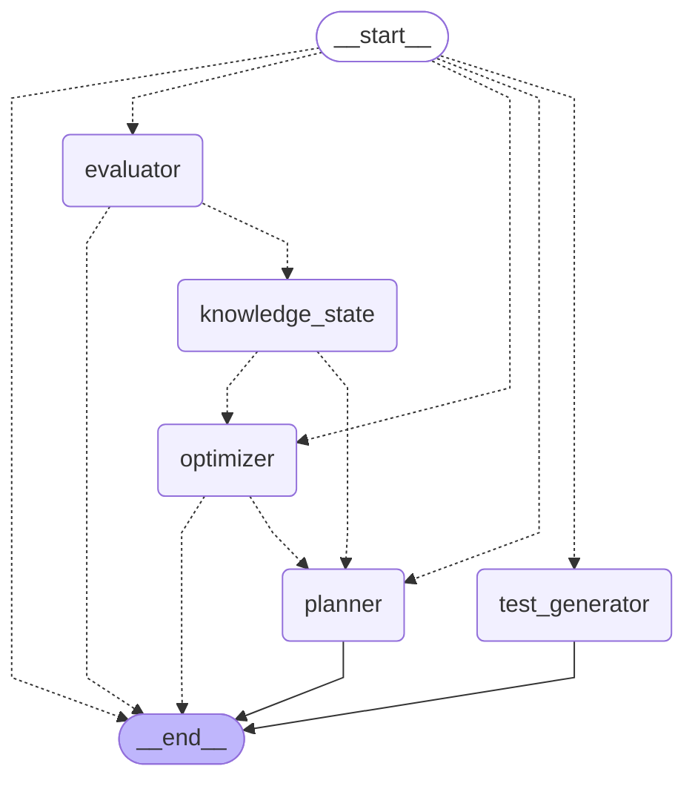

# ReadFocus 2.0 — architecture

How the pieces fit, written from the code at the end of the sprint (C15).
Every agent decision is an algorithm or runs on a local embedding model:
there is no LLM, no generative AI and no paid API anywhere in the stack.
File paths are given so each claim can be checked.

## Contents

- [System](#system)
- [Agents](#agents)
- [The agent graph](#the-agent-graph)
- [Event flows](#event-flows)
- [Ingestion](#ingestion)
- [Data model](#data-model)
- [The book reader](#the-book-reader)
- [Word lookup](#word-lookup)
- [Security](#security)

## System

```
 Browser (React + Vite, Vercel)
   │  Supabase Auth (sign-in, JWT)          ──►  Supabase Auth
   │  REST + bearer JWT
   ▼
 FastAPI (Python 3.11, Docker, Render Free)
   │  routers: /books /sessions /dashboard /mastery /lookup /auth /health
   │  agents:  LangGraph workflow of five pure decide() agents
   │  nlp:     fastembed all-MiniLM-L6-v2 (ONNX, 384 dims, on the CPU)
   │  service-role key (server side only)
   ▼
 Supabase (Postgres + pgvector, Storage, RLS)
   │
   └── word lookup only: Free Dictionary API, Wikipedia (free, keyless)
       covers only: Open Library (one search per book, at ingestion)
```

| Layer | Where | Notes |
|---|---|---|
| Frontend | `frontend/src/` | React, React Router, Recharts, motion, @floating-ui/react; plain JavaScript |
| API | `backend/routers/` | Every route but `/health` needs a Supabase JWT (`backend/dependencies.py`) |
| Agents | `backend/agents/` | LangGraph `StateGraph` in `graph.py`, run through `workflow.py` |
| Constants | `backend/agents/policy.py` | Every threshold, weight and bound the agents use |
| Local NLP | `backend/nlp/` | `embedder.py` (fastembed), `concepts.py` (YAKE + rapidfuzz), `text.py` |
| Services | `backend/services/` | ingestion, jobs, question bank, concepts, lookup, covers, retriever |
| Schema | `supabase/migrations/001`–`015` | additive only |

## Agents

Every agent is a pure `decide(input) -> output` with no I/O, no clock and no
model call, wrapped by a LangGraph node that reads the state it needs,
calls `decide`, persists the result and appends one entry to the run's
`decisions` (stored in `agent_decisions`, so the app can say why it chose).
The shared state is `AgentState` (`backend/agents/state.py`); `decisions`
and `errors` are append-only.

| Agent | Pure decide | Input | Output |
|---|---|---|---|
| Planner | `planner/strategy.py` | `PlannerInput`: now, candidate chunks (index, words, concept keys, difficulty), concept states, last chunk read, re-read queue, recent percentages, wpm, pace hint | `SessionPlan`: mode (`new`, `review`, `re_read`, `finished`), rule, chunk indices, words, focus minutes, question mix, one-line reason, scored anchors |
| Test generator | `question_generation/assembler.py` | the session's chunks' question-bank rows and the planner's question mix | the session's questions; `public_question()` strips answer, evidence and key terms before anything reaches the client |
| Evaluator | `evaluation/grader.py` + `evaluation/feedback.py` | `GradeInput` per answer: question, answer, evidence, key terms, strategy, options, cosines | `Grade`: score 0–1, confidence (high, medium, low), matched and missing concepts, method, components, reasons; feedback from templates only |
| Knowledge state | `knowledge_state/mastery.py` | the reader's mastery rows and the test's grades with their concept keys | `MasteryUpdate` per concept: previous and new mastery, attempts, correct, days to the next review |
| Optimizer | `optimizer/pace.py` | `OptimizerInput`: this test's percentage, recent percentages, re-read queue, previous multiplier, abandonment, words and minutes, question outcomes, previous mix | `PaceRecommendation`: next multiplier, focus minutes, re-read mode and queue, question mix, band, reason |

What each one decides:

- **Planner.** The first section of the re-read queue, if any. Otherwise
  every candidate is scored on weak concepts, being unread, difficulty fit
  and reviews due (weights `PLANNER_WEIGHTS`); a new-reading anchor is
  extended with the following sections while the words stay within the
  optimizer's target. The reason names what drove the choice, for example
  "Re-reading section 1 before moving on — your last test on it was low."
- **Test generator.** Fills the mix (by default two multiple choice, one
  cloze, one definition or why/how, one main idea) from the bank,
  preferring questions used less, from chunks drawn on less, nearer the
  target difficulty and of higher quality; never the same sentence or
  answer twice.
- **Evaluator.** Closed questions are string matches (exact or a rapidfuzz
  ratio of 90 or more; 80–90 is a near miss for half marks at low
  confidence). Free text is `0.55 × meaning + 0.35 × key-term coverage +
  0.10 × relevance`, where meaning is the cosine between the answer and
  the evidence sentences from the local model. Free text is never graded
  above medium confidence: an answer that reverses the evidence in its own
  words scores like a right one (see Limitations in the README).
- **Knowledge state.** A rule-based knowledge-tracing update per concept:
  a correct answer moves mastery `m` to `m + 0.30 × (1 − m)`, a wrong one
  to `m × (1 − 0.25)` (`MASTERY_GAIN`, `MASTERY_LOSS`), a partial one in between; a low-confidence grade
  moves it half as much; the next review is sooner the lower the mastery.
  Applying the same test twice changes nothing (`last_event_id`). This is
  not Bayesian Knowledge Tracing: there is no fitted slip or guess model.
- **Optimizer.** The test's band (`grow` ≥ 80, `hold` ≥ 50, `reduce` ≥ 20,
  `fail`) decides re-reading; the rolling mean picks the multiplier factor
  (1.15, 1.0, 0.80, 0.50), damped so one test cannot swing it; recent
  abandonment caps it; focus minutes follow the measured reading speed;
  the worst failing question type gets one more place in the next mix.

The question bank itself is filled at ingestion by the question generation
agent (`question_generation/agent.py`, `strategies.py`, `quality.py`):
extractive cloze, definition, why/how, main-idea and multiple-choice
questions built from the chunk's own sentences, with YAKE concepts as
answers and distractors. Every question keeps its evidence verbatim.

## The agent graph

Generated from the compiled workflow by `scripts/export_agent_graph.py`
(`make agent-graph`); the source of truth is
[`docs/repo-graph/AGENT_GRAPH.md`](repo-graph/AGENT_GRAPH.md). Dotted arrows
are conditional edges.



Routing (`backend/agents/graph.py`):

| Edge | Condition |
|---|---|
| `__start__` → first node | `state["event"]`: `start_session` → planner, `finish_reading` → test_generator, `submit_answers` → evaluator, `abandon` → optimizer; anything else → end |
| evaluator → end | the evaluator recorded an error |
| knowledge_state → planner | every grade of the test is low confidence: no adapting on unreliable evidence, the optimizer is skipped |
| knowledge_state → optimizer | otherwise |
| optimizer → planner | the event is `submit_answers` (the next plan is ready when Results opens) |
| optimizer → end | the event is `abandon` |

## Event flows

| Request | What runs |
|---|---|
| `POST /books/upload` | file to Storage (`books/<user>/<book>.<ext>`), `books` row (`processing`), a `processing_jobs` row, then ingestion after the response (below) |
| `POST /sessions/start` | ownership check (404 otherwise), `start_session` run (planner), then the chunks read and the session row created at once; after the response: decisions stored and the test assembled from the bank |
| `PUT /sessions/{id}/position` | the reader's place `{chunk_index, block_id, char_offset}`, checked against the caller's session and the book's chunks, into `reading_progress.position` |
| `POST /sessions/{id}/finish-reading` | the public test; runs `finish_reading` (test generator) inline if the background run has not stored it yet; the first stored test wins |
| `POST /sessions/{id}/evaluate-single` | grades one answer while the reader moves on, cached on the session |
| `POST /sessions/{id}/submit-answers` | claims the session (graded once), then `submit_answers`: evaluator → knowledge state → optimizer → planner; returns score, per-question feedback and confidence, the pace and the next session's plan |
| `POST /sessions/{id}/abandon` | marks the session; `abandon` (optimizer) after the response |
| `GET /dashboard`, `GET /mastery` | the reader's sessions, results and concept mastery, weakest first |
| `GET /lookup` | a word or phrase, see [Word lookup](#word-lookup) |

## Ingestion

`backend/services/book_ingestor.py` `run_job`, after the upload responds:

1. Extract text (pypdf for PDF, ebooklib + BeautifulSoup for EPUB) and
   cut it into chunks of about 600 words (`chunk_text`). `chunks.content`
   is never changed afterwards: questions quote it verbatim.
2. Build reader structure beside it (`book_structure.py`): blocks per chunk
   (`{id, type, text, marks}`) and a table of contents.
3. Per batch of chunks: embed locally (all-MiniLM-L6-v2, 384 dimensions),
   upsert the chunks, extract concepts (YAKE, merged with rapidfuzz and
   embedding similarity) and fill the question bank. After the first
   batch the book is marked `ready`, so reading can start while the rest
   is processed.
4. The job's cursor is saved after every batch (`processing_jobs`); a
   stopped server's jobs are picked up again by the startup sweep
   (`ingestion_worker.py`) or `POST /books/{id}/resume`.
5. Last, one Open Library lookup for a cover, copied into the public
   `covers` bucket so browsers never contact Open Library.

Measured: `sample.pdf` (13 pages, 7 chunks, 55 questions) is ready in about
5 s on a desktop and about 40 s in a 0.1-CPU, 512 MB container
(`docs/BENCHMARKS.md`, C9.5 and C14.1).

## Data model

All tables are in `public`, all have row-level security, and every row a
reader owns carries `user_id`. Deleting a book cascades to everything
below it.

| Table | Migration | Holds |
|---|---|---|
| `profiles` | 001, 004 | display name, reading speed, `is_calibrated` |
| `books` | 001, 012, 013 | title, author, file type, `storage_path`, status, counts; `cover_url`, `cover_source`; `toc` |
| `chunks` | 001, 005, 013 | `chunk_index`, `content`, `word_count`, `embedding_local vector(384)`, `blocks` (the 1536-dimension column from 001 is unused) |
| `sessions` | 001, 003 | chunk range, assigned words, focus minutes, status, `test_questions` (with answers and evidence, never sent before submit) |
| `test_results` | 001 | the graded answers of a session |
| `reading_progress` | 001, 002, 014 | per book: last chunk, re-read queue, `pace_recommendation`, `position` |
| `question_bank` | 007 | precomputed questions per chunk: strategy, prompt, answer, evidence, key terms, distractors, difficulty, quality, use count |
| `concepts` | 008 | a book's concepts: key, label, chunk indices, weight |
| `user_concept_mastery` | 008 | per reader and concept: mastery 0–1, attempts, correct, last seen, next review, last event |
| `agent_decisions` | 009 | one row per node a run visited: agent, inputs and outputs summarised, reason, duration (read-only to readers) |
| `processing_jobs` | 010 | ingestion jobs: status, cursor, progress, attempts (read-only to readers) |
| `term_lookups` | 015 | shared cache of dictionary and Wikipedia answers; no personal data; readable by signed-in readers, written only by the backend |

Search functions: `match_chunks_local` (pgvector, 005) and
`search_chunks_text` (Postgres full-text, 006), both `SECURITY INVOKER`, fused
by reciprocal rank in `backend/services/retriever.py`. Indexes for the
per-user reads are in 011. Storage: `books` (private, a reader's own folder
only) and `covers` (public read).

## The book reader

`frontend/src/reader/`, opened at `/read/:bookId` by
`pages/ReadingSession.jsx`:

- **Pagination.** Today's chunks render as one CSS multi-column flow whose
  column is one page (`BookFlow.jsx`, `geometry.js`); a spread from 1024 px,
  one page below. Pages are moved with `translateX`; a turn animates a leaf
  (`PageTurn.jsx`), an instant swap under reduced motion.
- **Place.** The reader's place is an anchor `{block_id, char_offset}`
  (`anchor.js`), not a page number, so a resize, text size, theme or font
  load re-paginates and shows the same passage. It is saved with
  `PUT /sessions/{id}/position`, debounced to one request a second and sent
  with `keepalive` when the page is hidden (`usePlaceSaver.js`). The
  closing page with Start test sits after the text, outside the flow.
- **Keys and pointer.** Arrows, Page Up/Down, Space, Home, End, the turn
  buttons, the outer page edges and swipes; a live region announces the
  page.
- **Pacing.** The planner's reason as a note on the first page, "N pages
  left", a session timer, and the next chunk fetched ahead
  (`readAhead.js`) within the last two views.

## Word lookup

```
hover (350 ms intent) or selection ─► wordAt / useWordAtPoint: the word or phrase under the pointer
   └─► lookup.js client: LRU of the session's answers; one request in flight, older ones aborted
         └─► GET /lookup?term=…&proper=0|1  (backend/routers/lookup.py)
               └─► services/lookup.py: in-process cache ─► term_lookups (90 days found, 7 not found)
                     └─► Free Dictionary API, then Wikipedia; one attempt each, 429/5xx backed off
   ◄── WordCard.jsx (floating-ui): definition, Wikipedia summary, "several meanings", or unavailable
```

The text is never wrapped in spans: the word is found from the caret
position (`caretPositionFromPoint`), highlighted with the CSS Highlight API
where available. Proper nouns and phrases of more than one word go to
Wikipedia first. Touch devices use a
long press and a Look up chip. Measured: about 360 ms from hover to card
when cached, which is the hover intent plus the answer (BENCHMARKS, C12.10).

## Security

- The API runs with the Supabase service-role key, which bypasses RLS, so
  every handler filters by the caller's `user_id`; `POST /sessions/start`
  checks book ownership first (issue 17, fixed in C15.2).
- RLS on every table keeps the browser's anon-key client to the reader's
  own rows; `agent_decisions` and `processing_jobs` are read-only to
  readers; `term_lookups` is read-only to signed-in readers.
- `frontend/scripts/live/check-isolation.mjs` (C15.2) proves both layers
  with two real test users: 92 probes through the API and supabase-js.
- CORS allows only `FRONTEND_URL` (plus local Vite origins in development);
  a raw user id is never accepted as a token.
- No secret is in git or the frontend bundle; `backend/tests/test_no_paid_ai.py`
  keeps any LLM or embedding API out of the backend.
