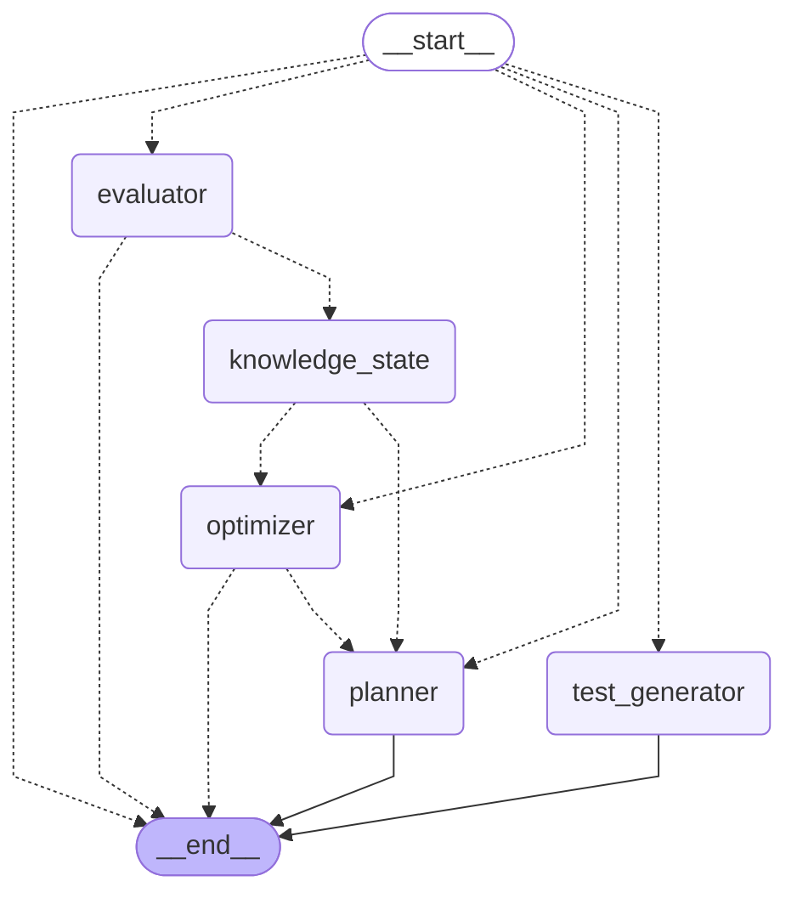

# Agent graph

Generated by `scripts/export_agent_graph.py` from the compiled workflow in
`backend/agents/graph.py` (`workflow.get_graph().draw_mermaid()`). Do not
edit by hand; regenerate it instead. Dotted arrows are conditional edges.

| Event | First node |
|---|---|
| `start_session` | `planner` |
| `finish_reading` | `test_generator` |
| `submit_answers` | `evaluator` |
| `abandon` | `optimizer` |

Any other event goes straight to `__end__`. Runs go through
`backend/agents/workflow.py`, which sets the recursion limit, and each run's
decisions are stored in `agent_decisions` (migration 009).

