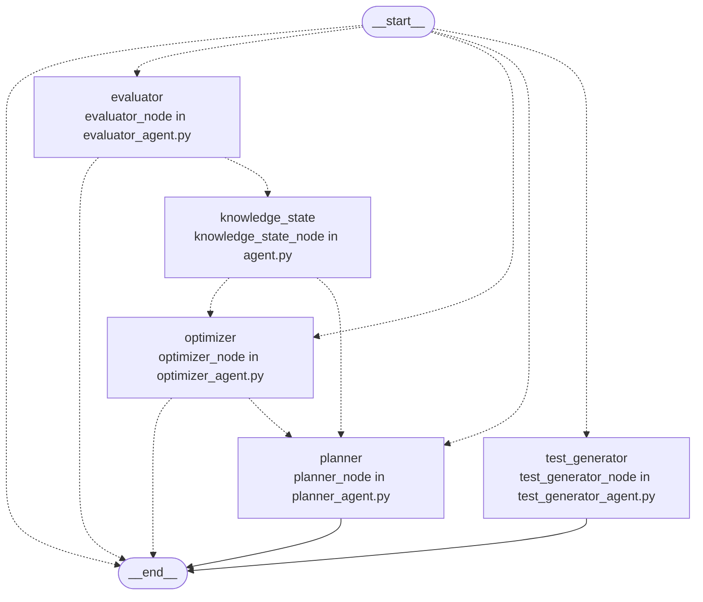

# Repository map

Generated by `tools/repo_graph/render.py` from `inventory.json` and
`graph.json`. Do not edit by hand; regenerate it instead.

453 files inventoried, 141 excluded, 523 graph nodes, 846 edges, 0 unresolved references.

## Layers

How a request travels. An arrow means the left file imports or calls the
right one. Files with no such link are left out.

```mermaid
flowchart LR
  subgraph caller["Pages and components"]
    file_frontend_src_components_CalibrationFlow_jsx["CalibrationFlow.jsx"]
    file_frontend_src_components_dashboard_MasteryList_jsx["MasteryList.jsx"]
    file_frontend_src_originalview_bookFile_js["bookFile.js"]
    file_frontend_src_pages_ComprehensionTest_jsx["ComprehensionTest.jsx"]
    file_frontend_src_pages_Dashboard_jsx["Dashboard.jsx"]
    file_frontend_src_pages_Library_jsx["Library.jsx"]
    file_frontend_src_pages_ReadingSession_jsx["ReadingSession.jsx"]
    file_frontend_src_pages_Results_jsx["Results.jsx"]
    file_frontend_src_reader_usePlaceSaver_js["usePlaceSaver.js"]
  end
  subgraph api["API client"]
    file_frontend_src_lib_api_js["api.js"]
  end
  subgraph router["Routers"]
    file_backend_routers_auth_py["auth.py"]
    file_backend_routers_books_py["books.py"]
    file_backend_routers_dashboard_py["dashboard.py"]
    file_backend_routers_lookup_py["lookup.py"]
    file_backend_routers_mastery_py["mastery.py"]
    file_backend_routers_sessions_py["sessions.py"]
  end
  subgraph agent["Agents"]
    file_backend_agents_evaluation_feedback_py["feedback.py"]
    file_backend_agents_evaluation_grader_py["grader.py"]
    file_backend_agents_evaluator_agent_py["evaluator_agent.py"]
    file_backend_agents_graph_py["graph.py"]
    file_backend_agents_knowledge_state_agent_py["agent.py"]
    file_backend_agents_knowledge_state_mastery_py["mastery.py"]
    file_backend_agents_optimizer_pace_py["pace.py"]
    file_backend_agents_optimizer_agent_py["optimizer_agent.py"]
    file_backend_agents_planner_strategy_py["strategy.py"]
    file_backend_agents_planner_agent_py["planner_agent.py"]
    file_backend_agents_policy_py["policy.py"]
    file_backend_agents_question_generation_agent_py["agent.py"]
    file_backend_agents_question_generation_assembler_py["assembler.py"]
    file_backend_agents_question_generation_quality_py["quality.py"]
    file_backend_agents_question_generation_strategies_py["strategies.py"]
    file_backend_agents_state_py["state.py"]
    file_backend_agents_test_generator_agent_py["test_generator_agent.py"]
    file_backend_agents_workflow_py["workflow.py"]
  end
  subgraph service["Services and shared"]
    file_backend_dependencies_py["dependencies.py"]
    file_backend_nlp_concepts_py["concepts.py"]
    file_backend_nlp_embedder_py["embedder.py"]
    file_backend_nlp_text_py["text.py"]
    file_backend_services_book_ingestor_py["book_ingestor.py"]
    file_backend_services_book_structure_py["book_structure.py"]
    file_backend_services_concept_store_py["concept_store.py"]
    file_backend_services_covers_py["covers.py"]
    file_backend_services_ingestion_worker_py["ingestion_worker.py"]
    file_backend_services_lookup_py["lookup.py"]
    file_backend_services_processing_jobs_py["processing_jobs.py"]
    file_backend_services_question_bank_py["question_bank.py"]
    file_backend_services_retriever_py["retriever.py"]
    file_backend_services_supabase_client_py["supabase_client.py"]
  end
  subgraph sink["Supabase and external"]
    external_langgraph["langgraph"]
    supabase[("Supabase: tables, RPC, auth")]
  end
  file_backend_agents_evaluation_feedback_py --> file_backend_agents_evaluation_grader_py
  file_backend_agents_evaluation_feedback_py --> file_backend_agents_policy_py
  file_backend_agents_evaluation_grader_py --> file_backend_agents_policy_py
  file_backend_agents_evaluation_grader_py --> file_backend_nlp_concepts_py
  file_backend_agents_evaluation_grader_py --> file_backend_nlp_text_py
  file_backend_agents_evaluator_agent_py --> file_backend_agents_evaluation_feedback_py
  file_backend_agents_evaluator_agent_py --> file_backend_agents_evaluation_grader_py
  file_backend_agents_evaluator_agent_py --> file_backend_agents_policy_py
  file_backend_agents_evaluator_agent_py --> file_backend_agents_state_py
  file_backend_agents_evaluator_agent_py --> file_backend_nlp_embedder_py
  file_backend_agents_evaluator_agent_py --> file_backend_nlp_text_py
  file_backend_agents_evaluator_agent_py --> file_backend_services_supabase_client_py
  file_backend_agents_evaluator_agent_py --> supabase
  file_backend_agents_graph_py --> external_langgraph
  file_backend_agents_graph_py --> file_backend_agents_evaluator_agent_py
  file_backend_agents_graph_py --> file_backend_agents_knowledge_state_agent_py
  file_backend_agents_graph_py --> file_backend_agents_optimizer_agent_py
  file_backend_agents_graph_py --> file_backend_agents_planner_agent_py
  file_backend_agents_graph_py --> file_backend_agents_state_py
  file_backend_agents_graph_py --> file_backend_agents_test_generator_agent_py
  file_backend_agents_knowledge_state_agent_py --> file_backend_agents_knowledge_state_mastery_py
  file_backend_agents_knowledge_state_agent_py --> file_backend_agents_state_py
  file_backend_agents_knowledge_state_agent_py --> file_backend_services_supabase_client_py
  file_backend_agents_knowledge_state_agent_py --> supabase
  file_backend_agents_knowledge_state_mastery_py --> file_backend_agents_policy_py
  file_backend_agents_optimizer_pace_py --> file_backend_agents_policy_py
  file_backend_agents_optimizer_agent_py --> file_backend_agents_optimizer_pace_py
  file_backend_agents_optimizer_agent_py --> file_backend_agents_policy_py
  file_backend_agents_optimizer_agent_py --> file_backend_agents_state_py
  file_backend_agents_optimizer_agent_py --> file_backend_services_supabase_client_py
  file_backend_agents_optimizer_agent_py --> supabase
  file_backend_agents_planner_strategy_py --> file_backend_agents_policy_py
  file_backend_agents_planner_agent_py --> file_backend_agents_planner_strategy_py
  file_backend_agents_planner_agent_py --> file_backend_agents_policy_py
  file_backend_agents_planner_agent_py --> file_backend_agents_state_py
  file_backend_agents_planner_agent_py --> file_backend_services_supabase_client_py
  file_backend_agents_planner_agent_py --> supabase
  file_backend_agents_question_generation_agent_py --> file_backend_agents_question_generation_quality_py
  file_backend_agents_question_generation_agent_py --> file_backend_agents_question_generation_strategies_py
  file_backend_agents_question_generation_agent_py --> file_backend_nlp_concepts_py
  file_backend_agents_question_generation_agent_py --> file_backend_nlp_embedder_py
  file_backend_agents_question_generation_agent_py --> file_backend_services_concept_store_py
  file_backend_agents_question_generation_agent_py --> file_backend_services_supabase_client_py
  file_backend_agents_question_generation_agent_py --> supabase
  file_backend_agents_question_generation_assembler_py --> file_backend_agents_policy_py
  file_backend_agents_question_generation_quality_py --> file_backend_agents_policy_py
  file_backend_agents_question_generation_quality_py --> file_backend_agents_question_generation_strategies_py
  file_backend_agents_question_generation_quality_py --> file_backend_nlp_text_py
  file_backend_agents_question_generation_strategies_py --> file_backend_agents_policy_py
  file_backend_agents_question_generation_strategies_py --> file_backend_nlp_concepts_py
  file_backend_agents_question_generation_strategies_py --> file_backend_nlp_text_py
  file_backend_agents_test_generator_agent_py --> file_backend_agents_state_py
  file_backend_agents_test_generator_agent_py --> file_backend_services_question_bank_py
  file_backend_agents_workflow_py --> file_backend_agents_graph_py
  file_backend_agents_workflow_py --> file_backend_agents_planner_strategy_py
  file_backend_agents_workflow_py --> file_backend_agents_state_py
  file_backend_agents_workflow_py --> file_backend_services_supabase_client_py
  file_backend_agents_workflow_py --> supabase
  file_backend_dependencies_py --> file_backend_nlp_embedder_py
  file_backend_dependencies_py --> file_backend_services_supabase_client_py
  file_backend_nlp_concepts_py --> file_backend_nlp_embedder_py
  file_backend_nlp_concepts_py --> file_backend_nlp_text_py
  file_backend_routers_auth_py --> file_backend_dependencies_py
  file_backend_routers_auth_py --> file_backend_services_supabase_client_py
  file_backend_routers_auth_py --> supabase
  file_backend_routers_books_py --> file_backend_agents_policy_py
  file_backend_routers_books_py --> file_backend_dependencies_py
  file_backend_routers_books_py --> file_backend_services_book_ingestor_py
  file_backend_routers_books_py --> file_backend_services_processing_jobs_py
  file_backend_routers_books_py --> file_backend_services_supabase_client_py
  file_backend_routers_books_py --> supabase
  file_backend_routers_dashboard_py --> file_backend_dependencies_py
  file_backend_routers_dashboard_py --> file_backend_services_supabase_client_py
  file_backend_routers_dashboard_py --> supabase
  file_backend_routers_lookup_py --> file_backend_dependencies_py
  file_backend_routers_lookup_py --> file_backend_services_lookup_py
  file_backend_routers_mastery_py --> file_backend_dependencies_py
  file_backend_routers_mastery_py --> file_backend_services_supabase_client_py
  file_backend_routers_mastery_py --> supabase
  file_backend_routers_sessions_py --> file_backend_agents_evaluator_agent_py
  file_backend_routers_sessions_py --> file_backend_agents_question_generation_assembler_py
  file_backend_routers_sessions_py --> file_backend_agents_workflow_py
  file_backend_routers_sessions_py --> file_backend_dependencies_py
  file_backend_routers_sessions_py --> file_backend_services_supabase_client_py
  file_backend_routers_sessions_py --> supabase
  file_backend_services_book_ingestor_py --> file_backend_agents_question_generation_agent_py
  file_backend_services_book_ingestor_py --> file_backend_nlp_embedder_py
  file_backend_services_book_ingestor_py --> file_backend_services_book_structure_py
  file_backend_services_book_ingestor_py --> file_backend_services_covers_py
  file_backend_services_book_ingestor_py --> file_backend_services_processing_jobs_py
  file_backend_services_book_ingestor_py --> file_backend_services_supabase_client_py
  file_backend_services_book_ingestor_py --> supabase
  file_backend_services_concept_store_py --> file_backend_nlp_concepts_py
  file_backend_services_concept_store_py --> file_backend_services_supabase_client_py
  file_backend_services_concept_store_py --> supabase
  file_backend_services_covers_py --> file_backend_services_supabase_client_py
  file_backend_services_covers_py --> supabase
  file_backend_services_ingestion_worker_py --> file_backend_services_book_ingestor_py
  file_backend_services_ingestion_worker_py --> file_backend_services_processing_jobs_py
  file_backend_services_ingestion_worker_py --> file_backend_services_supabase_client_py
  file_backend_services_ingestion_worker_py --> supabase
  file_backend_services_lookup_py --> file_backend_services_supabase_client_py
  file_backend_services_lookup_py --> supabase
  file_backend_services_processing_jobs_py --> file_backend_services_supabase_client_py
  file_backend_services_question_bank_py --> file_backend_agents_question_generation_agent_py
  file_backend_services_question_bank_py --> file_backend_agents_question_generation_assembler_py
  file_backend_services_question_bank_py --> file_backend_services_concept_store_py
  file_backend_services_question_bank_py --> file_backend_services_supabase_client_py
  file_backend_services_question_bank_py --> supabase
  file_backend_services_retriever_py --> file_backend_nlp_embedder_py
  file_backend_services_retriever_py --> file_backend_nlp_text_py
  file_backend_services_retriever_py --> file_backend_services_supabase_client_py
  file_backend_services_retriever_py --> supabase
  file_backend_services_supabase_client_py --> supabase
  file_frontend_src_components_CalibrationFlow_jsx --> file_frontend_src_lib_api_js
  file_frontend_src_components_dashboard_MasteryList_jsx --> file_frontend_src_lib_api_js
  file_frontend_src_lib_api_js --> file_backend_routers_auth_py
  file_frontend_src_lib_api_js --> file_backend_routers_books_py
  file_frontend_src_lib_api_js --> file_backend_routers_dashboard_py
  file_frontend_src_lib_api_js --> file_backend_routers_mastery_py
  file_frontend_src_lib_api_js --> file_backend_routers_sessions_py
  file_frontend_src_originalview_bookFile_js --> file_frontend_src_lib_api_js
  file_frontend_src_pages_ComprehensionTest_jsx --> file_frontend_src_lib_api_js
  file_frontend_src_pages_Dashboard_jsx --> file_frontend_src_lib_api_js
  file_frontend_src_pages_Library_jsx --> file_frontend_src_lib_api_js
  file_frontend_src_pages_ReadingSession_jsx --> file_frontend_src_lib_api_js
  file_frontend_src_pages_Results_jsx --> file_frontend_src_lib_api_js
  file_frontend_src_reader_usePlaceSaver_js --> file_frontend_src_lib_api_js
  classDef banned stroke:#c0392b,stroke-width:2px
```

## LangGraph wiring

Dotted arrows are conditional edges.

## Endpoints

| Endpoint | Handler | Defined in | Frontend callers |
|---|---|---|---|
| `DELETE /books/{book_id}` | `delete_book` | `backend/routers/books.py` | `frontend/src/pages/Library.jsx` |
| `GET /auth/profile` | `get_profile` | `backend/routers/auth.py` | `frontend/src/pages/ReadingSession.jsx` |
| `GET /books` | `get_books` | `backend/routers/books.py`, `backend/tests/test_cors.py` | `frontend/src/pages/Library.jsx` |
| `GET /books/{book_id}` | `get_book_details` | `backend/routers/books.py` | `frontend/src/pages/Results.jsx` |
| `GET /books/{book_id}/file` | `get_book_file` | `backend/routers/books.py` | `frontend/src/originalview/bookFile.js` |
| `GET /books/{book_id}/pages` | `get_pages` | `backend/routers/books.py` | `frontend/src/pages/ReadingSession.jsx` |
| `GET /books/{book_id}/status` | `get_book_status` | `backend/routers/books.py` | `frontend/src/pages/Library.jsx` |
| `GET /dashboard` | `get_dashboard` | `backend/routers/dashboard.py` | `frontend/src/pages/Dashboard.jsx` |
| `GET /health` | `health_check` | `backend/main.py` | none |
| `GET /lookup` | `look_up` | `backend/routers/lookup.py` | none |
| `GET /mastery` | `get_mastery` | `backend/routers/mastery.py` | `frontend/src/components/dashboard/MasteryList.jsx` |
| `GET /sessions/{session_id}` | `get_session` | `backend/routers/sessions.py` | `frontend/src/pages/ComprehensionTest.jsx`, `frontend/src/pages/Results.jsx` |
| `POST /auth/profile/calibrate` | `calibrate_profile` | `backend/routers/auth.py` | `frontend/src/components/CalibrationFlow.jsx` |
| `POST /books/upload` | `upload_book` | `backend/routers/books.py` | `frontend/src/pages/Library.jsx` |
| `POST /books/{book_id}/resume` | `resume_book` | `backend/routers/books.py` | none |
| `POST /sessions/start` | `start_session` | `backend/routers/sessions.py` | `frontend/src/pages/ReadingSession.jsx` |
| `POST /sessions/{session_id}/abandon` | `abandon_session` | `backend/routers/sessions.py` | none |
| `POST /sessions/{session_id}/evaluate-single` | `evaluate_single` | `backend/routers/sessions.py` | `frontend/src/pages/ComprehensionTest.jsx` |
| `POST /sessions/{session_id}/finish-reading` | `finish_reading` | `backend/routers/sessions.py` | `frontend/src/pages/ReadingSession.jsx` |
| `POST /sessions/{session_id}/submit-answers` | `submit_answers` | `backend/routers/sessions.py` | `frontend/src/pages/ComprehensionTest.jsx` |
| `PUT /sessions/{session_id}/position` | `save_position` | `backend/routers/sessions.py` | `frontend/src/reader/usePlaceSaver.js` |

## Database tables

| Table | Defined in | Altered by | Readers | Writers |
|---|---|---|---|---|
| `agent_decisions` | `supabase/migrations/009_agent_decisions.sql` | none | none | `backend/agents/workflow.py` |
| `books` | `supabase/migrations/001_initial.sql` | `supabase/migrations/012_book_covers.sql`, `supabase/migrations/013_structured_content.sql`, `supabase/migrations/016_book_files.sql` | `backend/routers/books.py`, `backend/routers/dashboard.py`, `backend/routers/sessions.py`, `backend/services/book_ingestor.py`, `scripts/backfill_book_files.py`, `scripts/backfill_covers.py`, `scripts/backfill_structure.py` | `backend/routers/books.py`, `backend/services/book_ingestor.py`, `backend/services/covers.py`, `backend/services/ingestion_worker.py`, `scripts/backfill_book_files.py`, `scripts/backfill_structure.py`, `scripts/dev/check_retriever.py`, `scripts/manual/test_ingest.py` |
| `chunks` | `supabase/migrations/001_initial.sql` | `supabase/migrations/005_local_embeddings.sql`, `supabase/migrations/013_structured_content.sql` | `backend/agents/evaluator_agent.py`, `backend/agents/planner_agent.py`, `backend/agents/question_generation/agent.py`, `backend/mcp_server.py`, `backend/routers/books.py`, `backend/routers/sessions.py`, `backend/services/question_bank.py`, `scripts/backfill_local_embeddings.py`, `scripts/backfill_structure.py`, `scripts/dev/check_retriever.py` | `backend/services/book_ingestor.py`, `scripts/backfill_local_embeddings.py`, `scripts/backfill_structure.py`, `scripts/dev/check_retriever.py` |
| `concepts` | `supabase/migrations/008_concept_mastery.sql` | none | `backend/agents/planner_agent.py`, `backend/routers/mastery.py`, `backend/services/concept_store.py` | `backend/services/concept_store.py` |
| `processing_jobs` | `supabase/migrations/010_processing_jobs.sql` | none | none | none |
| `profiles` | `supabase/migrations/001_initial.sql` | `supabase/migrations/004_add_is_calibrated.sql` | `backend/agents/optimizer_agent.py`, `backend/agents/planner_agent.py`, `backend/routers/auth.py` | `backend/routers/auth.py` |
| `question_bank` | `supabase/migrations/007_question_bank.sql` | none | `backend/agents/planner_agent.py`, `backend/services/question_bank.py` | `backend/agents/question_generation/agent.py`, `backend/services/question_bank.py`, `backend/tests/test_ingest_embeddings.py` |
| `reading_progress` | `supabase/migrations/001_initial.sql` | `supabase/migrations/002_add_pace.sql`, `supabase/migrations/014_reading_position.sql` | `backend/agents/evaluator_agent.py`, `backend/agents/optimizer_agent.py`, `backend/agents/planner_agent.py`, `backend/routers/books.py`, `backend/routers/dashboard.py`, `backend/routers/sessions.py` | `backend/agents/evaluator_agent.py`, `backend/agents/optimizer_agent.py`, `backend/agents/planner_agent.py`, `backend/routers/sessions.py` |
| `sessions` | `supabase/migrations/001_initial.sql` | `supabase/migrations/003_session_questions.sql` | `backend/agents/optimizer_agent.py`, `backend/routers/dashboard.py`, `backend/routers/sessions.py`, `backend/services/question_bank.py` | `backend/routers/sessions.py`, `backend/services/question_bank.py` |
| `term_lookups` | `supabase/migrations/015_term_lookups.sql` | none | `backend/services/lookup.py` | `backend/services/lookup.py` |
| `test_results` | `supabase/migrations/001_initial.sql` | none | `backend/agents/evaluator_agent.py`, `backend/mcp_server.py`, `backend/routers/dashboard.py`, `backend/routers/sessions.py` | `backend/agents/evaluator_agent.py` |
| `user_concept_mastery` | `supabase/migrations/008_concept_mastery.sql` | none | `backend/agents/knowledge_state/agent.py`, `backend/agents/planner_agent.py`, `backend/routers/mastery.py` | `backend/agents/knowledge_state/agent.py` |

## Database functions

| Function | Defined in | Called by |
|---|---|---|
| `handle_new_user` | `supabase/migrations/001_initial.sql` | none |
| `match_chunks` | `supabase/migrations/001_initial.sql` | none |
| `match_chunks_local` | `supabase/migrations/005_local_embeddings.sql` | `backend/services/retriever.py` |
| `search_chunks_text` | `supabase/migrations/006_chunk_text_search.sql` | `backend/services/retriever.py` |

## External services

Each use is the file and line of the first import of that service.

| Service | Banned by CLAUDE.md | Used at |
|---|---|---|
| `google_fonts` | no | `design/handoff-phase2/extracted/Study.dc.html:11`, `design/handoff/foundations-style-guide/Main.dc.html:13` |
| `langgraph` | no | `backend/agents/graph.py:14`, `backend/tests/test_agent_state.py:9`, `backend/tests/test_graph.py:6` |
| `mcp` | no | `backend/mcp_server.py:28` |
| `supabase` | no | `backend/mcp_server.py:29`, `backend/services/supabase_client.py:16`, `backend/tests/conftest.py:22`, `frontend/src/lib/supabase.js:1`, `scripts/dev/create_test_users.py:23` |

## Environment variables

| Variable | Declared in | Read by |
|---|---|---|
| `CRON_SECRET` | `.env.example` | none |
| `DEV` | none | `frontend/src/App.jsx`, `frontend/src/gallery/IllustrationGallery.jsx` |
| `EMBED_PRELOAD` | none | `backend/nlp/embedder.py` |
| `EMBED_THREADS` | none | `backend/nlp/embedder.py` |
| `EMBED_WAIT_SECONDS` | none | `backend/dependencies.py` |
| `ENV` | `.env.example`, `render.yaml` | `scripts/backfill_book_files.py`, `scripts/backfill_covers.py`, `scripts/backfill_local_embeddings.py`, `scripts/backfill_structure.py`, `scripts/dev/check_retriever.py`, `scripts/dev/create_test_users.py` |
| `FASTEMBED_CACHE` | `.env.example`, `render.yaml` | `backend/nlp/embedder.py` |
| `FRONTEND_URL` | `.env.example`, `render.yaml` | none |
| `GEMINI_API_KEY` | `.env.example` | none |
| `GEMINI_MODEL_CHAT` | `.env.example` | none |
| `GEMINI_MODEL_VISION` | `.env.example` | none |
| `INGEST_STALE_MINUTES` | none | `backend/services/processing_jobs.py` |
| `INGEST_SWEEP` | none | `backend/services/ingestion_worker.py` |
| `KEY_ENCRYPTION_SECRET` | `.env.example` | none |
| `STEVE_DAILY_LIMIT_PER_USER` | `.env.example` | none |
| `SUPABASE_ANON_KEY` | `.env.example`, `render.yaml` | `backend/mcp_server.py` |
| `SUPABASE_SERVICE_KEY` | `.env.example`, `render.yaml` | `backend/mcp_server.py`, `backend/services/supabase_client.py`, `scripts/dev/create_test_users.py` |
| `SUPABASE_URL` | `.env.example`, `render.yaml` | `backend/mcp_server.py`, `backend/services/supabase_client.py`, `scripts/dev/create_test_users.py` |
| `VITE_API_URL` | `frontend/.env.example` | `frontend/src/lib/api.js` |
| `VITE_SITE_URL` | `frontend/.env.example` | none |
| `VITE_SUPABASE_ANON_KEY` | `frontend/.env.example` | `frontend/src/lib/supabase.js` |
| `VITE_SUPABASE_URL` | `frontend/.env.example` | `frontend/src/gallery/Gallery.jsx`, `frontend/src/lib/supabase.js` |

## Files

### entry (5)

| File | Lines | Purpose |
|---|---|---|
| `backend/main.py` | 48 | FastAPI app: CORS through backend/cors.py, the seven routers and /health (status, model_ready, timestamp; never waits on the model); its lifespan preloads the embedding model on a background thread unless EMBED_PRELOAD=0 and starts the ingestion sweep (backend/services/ingestion_worker.py) unless INGEST_SWEEP=0. Starts no other process. |
| `backend/mcp_server.py` | 100 | Standalone FastMCP server with three Supabase tools (reading history, comprehension trend, chunk context); not started by the app since C3.4 and not called by any agent; kept for manual use. |
| `frontend/index.html` | 59 | HTML entry: an inline script applies the stored theme and accent (or the OS scheme) to <html> before first paint; mounts main.jsx. C13.10e: full title, description, theme-color for both schemes, Open Graph and Twitter tags (og.png); the inline script also hides the prerendered landing ([data-prerendered]) off / and when a Supabase session is stored. |
| `frontend/src/App.jsx` | 141 | Route table and AuthGuard: /login, /read/:bookId, /test/:sessionId, and Library, Dashboard and Results inside Layout; ThemeProvider, MotionRoot and ToastProvider around the router; AnimatedRoutes for fade-and-rise route transitions (screen level, and page level inside Layout so the nav stays put); dev-only /__illustrations and /__reader routes (import.meta.env.DEV, lazy) for the illustration gallery and the paginated reader; BackendGate around the routes (C13.8a); RouteErrorBoundary inside it and a catch-all NotFound route inside Layout. Since C13.10: PublicHome renders Landing for signed-out visitors at / outside BackendGate; every other page is React.lazy with its own Suspense (fallback null); the dev-only /__pdf gallery (C17.2); the dev-only /__epub gallery (C17.3); the dev-only /__book gallery (C17.4). |
| `frontend/src/main.jsx` | 10 | React entry: renders App in StrictMode and loads index.css. |

### router (8)

| File | Lines | Purpose |
|---|---|---|
| `backend/routers/__init__.py` | 1 | Package marker for backend.routers. |
| `backend/routers/agent.py` | 3 | Empty APIRouter mounted at /agent; defines no endpoints. |
| `backend/routers/auth.py` | 49 | GET /auth/profile and POST /auth/profile/calibrate: read the profile and save the calibrated reading speed. |
| `backend/routers/books.py` | 244 | Book endpoints: upload (read 1 MB at a time to the per-file limit, sha256 and size stored, the per-reader cap on cloud-kept bytes, a device-only mode that stores no file) to Storage, record a processing_jobs row and ingest after the response; list (with cover_url and the caller's reading progress, null before a first session); details with progress; pages (GET, read-only: chunks start..end of the caller's book, at most four, index, content, word count and blocks; no session touched); status poll with the job's status, progress and cursor; resume a failed or stuck book's ingestion from its cursor; delete. GET /books/{id}/file: a short-lived signed URL for the owner's stored original (404 for device-only books); resume refuses a device-only book. |
| `backend/routers/dashboard.py` | 174 | GET /dashboard: aggregates book progress, scores over time, reading streak, words this week and recent feedback; its five reads run at once, only the needed columns are selected, and test answers are read a page of the newest results at a time until three feedback quotes are found. |
| `backend/routers/lookup.py` | 28 | GET /lookup?term=&lang=en&proper=: auth required; normalises the term (422 if it is not a word or a phrase of up to 5 words), applies the per-user rate limit (60 a minute, a friendly 429 with Retry-After) and answers with lookup.look_up's compact payload. |
| `backend/routers/mastery.py` | 49 | GET /mastery?book_id=&limit=&offset=: the caller's concept mastery rows with their labels, weakest first, one page per call with the total; a page past the last row is empty. |
| `backend/routers/sessions.py` | 351 | Session lifecycle endpoints (evaluate-single and submit-answers wait for the embedding model through require_model), through backend/agents/workflow.py: start (only on the caller's own book: 404 otherwise, 503 when ownership cannot be read (C15.2, issue 17); the start_session flow plans; it also sends each chunk's reader blocks, the book's title, author and toc and the chapter in effect before the first chunk, read alongside; the session row is created here and the finish_reading flow assembles the test in the background, warming the grading model), finish-reading (returns the public part of the test, running finish_reading inline if it is not ready), evaluate-single (grades one answer inline and caches it; tells the client nothing), submit-answers (claims the session first, so it is graded once; a resubmit gets the stored result rebuilt from test_results; one submit_answers run: grades, mastery, pace and the next plan; returns score, feedback, confidence, the pace recommendation and the next session), position (PUT: the reader's place {chunk_index, block_id, char_offset}, validated against the caller's session and the book's chunks, stored in reading_progress.position only, never creating the row; start returns it, a failed read giving none), abandon (marks the session, then runs the abandon flow after the response), get; every run's decisions are stored after the response; no answer or evidence is sent to the client before the test is submitted. |

### agent (24)

| File | Lines | Purpose |
|---|---|---|
| `backend/agents/__init__.py` | 1 | Package marker for backend.agents. |
| `backend/agents/evaluation/__init__.py` | 1 | Package marker for backend.agents.evaluation, answer grading with no LLM. |
| `backend/agents/evaluation/feedback.py` | 105 | Feedback for a graded answer, pure: render(grade, evidence) builds one or two sentences from fixed templates, the question's key terms and a verbatim evidence snippet; low confidence gives no verdict, closed questions name the expected answer, free text says what was captured and missed and never 'correct'. |
| `backend/agents/evaluation/grader.py` | 225 | Answer grader: pure decide(GradeInput) gives a 0..1 score, a high, medium or low confidence, matched and missing key terms, the rule used and its components; cloze and multiple choice by exact or rapidfuzz match, free text by a weighted sum of evidence cosine, key-term coverage and a relevance check; grade_all embeds a test's free-text answers in one call with the embedder it is given. |
| `backend/agents/evaluator_agent.py` | 175 | Evaluator node, no LLM: turns stored session questions into grader inputs, grades a test with the local grader in one embedding call on a worker thread (reusing a pre-graded answer whose text is unchanged), writes feedback from templates, inserts test_results with score 0-10, feedback and confidence per answer, updates the rolling average in reading_progress and returns grades and one decisions entry; the first node of the submit flow; a question with no evidence is graded against the passage at low confidence. |
| `backend/agents/graph.py` | 69 | Builds the LangGraph workflow: event-driven flows from __start__ routed on state['event']: start_session -> planner; finish_reading -> test_generator; submit_answers -> evaluator -> knowledge_state -> optimizer -> planner (the optimizer is skipped when every grade is low-confidence, and an evaluator error ends the run); abandon -> optimizer. |
| `backend/agents/knowledge_state/__init__.py` | 1 | Package marker for backend.agents.knowledge_state, per-concept mastery from graded answers with no LLM. |
| `backend/agents/knowledge_state/agent.py` | 74 | The I/O around mastery.decide: record_test reads the reader's mastery rows for the concepts a graded test's questions name, moves them and upserts them with last_seen and next_review, once per session id (no round trip when no question names a concept); knowledge_state_node wraps it as the submit flow's second node, a failure being an errors entry. |
| `backend/agents/knowledge_state/mastery.py` | 104 | Mastery update, pure: decide(current_rows, grades, event_id) moves each concept a graded question names (correct closes 30% of the gap to 1, wrong takes 25% away, partial interpolates by score, low confidence at half weight), clamps to 0..1, sets the review interval by mastery band, counts attempts and correct, and skips rows already updated by the same event. |
| `backend/agents/optimizer/__init__.py` | 1 | Package marker for backend.agents.optimizer, the bounded learning optimizer with no LLM. |
| `backend/agents/optimizer/pace.py` | 181 | Learning optimizer, pure: decide(OptimizerInput) sets the next pace multiplier from the rolling score band (80/50/20%, the old optimizer's thresholds), never grows after a low test or recent abandonment, keeps it in the planner's range; queues or prioritises the session's sections for re-reading by this test's band; derives focus minutes from a bounded measured reading speed; and moves one question place to the worst failing type. Keeps the keys Results.jsx reads. |
| `backend/agents/optimizer_agent.py` | 84 | Optimizer node, no LLM: reads progress and the stored pace recommendation (previous multiplier, recent percentages, recent question outcomes, question mix), the book's recent sessions (this one's words and minutes, earlier abandonments) and the profile speed; calls optimizer.pace.decide; stores the recommendation with its history and the re-read queue (creating the progress row for older books); returns it with one decisions entry. On abandon there is no test: the stopped session counts as abandoned and no score is recorded. |
| `backend/agents/planner/__init__.py` | 1 | Package marker for backend.agents.planner, the rule-based reading strategy with no LLM. |
| `backend/agents/planner/strategy.py` | 210 | Reading strategy, pure: decide(PlannerInput) serves the re-read queue first, otherwise scores the next unread section and every read section with a weak or due concept on weak-concept coverage, unread, difficulty fit and due-for-review (weights in policy.py), extends new reading within the optimizer's word and time target, and returns sections, minutes, a question mix per mode and a one-line reason naming the concept and how often it was missed. |
| `backend/agents/planner_agent.py` | 98 | Planner node, no LLM: reads progress (creating it on a first session with nothing read), candidate sections, their concepts, the reader's mastery, question difficulty per section and the optimizer's last pace; calls planner.strategy.decide; pops a re-read from the queue only when a session starts with it (after a submit the plan is a preview); returns plan, session_plan and one decisions entry. |
| `backend/agents/policy.py` | 312 | Policy constants for the agents: every threshold, weight and limit in one place; so far question generation, test assembly, grading, feedback, the knowledge state's mastery update, the reading strategy planner and the learning optimizer; and the original-file limits (per-reader shelf cap, per-file limit, signed URL lifetime). |
| `backend/agents/question_generation/__init__.py` | 1 | Package marker for backend.agents.question_generation, questions built from a chunk's own sentences with no LLM. |
| `backend/agents/question_generation/agent.py` | 138 | QuestionGenerationAgent.run(book_id, chunk_ids): builds, filters and scores questions for chunks with the local embedder only and upserts them into question_bank (on conflict do nothing); hands each chunk's concepts to the concept store; returns a GenerationReport. |
| `backend/agents/question_generation/assembler.py` | 138 | Pure test assembly: picks a session's questions from bank rows by a mix of strategies, preferring unused, difficulty-matched questions; builds the stored form (with answers) and the public form (question, type, options only). |
| `backend/agents/question_generation/quality.py` | 163 | Pure quality filter for generated questions: rejects stopword answers, short evidence and prompts that contain the answer, scores the rest 0..1, and drops the weaker of two near-duplicate prompts. |
| `backend/agents/question_generation/strategies.py` | 288 | Pure extractive question strategies over one chunk's sentences and concepts; every question carries evidence that appears verbatim in the chunk. |
| `backend/agents/state.py` | 67 | AgentState TypedDict shared by all agent nodes: identity, the event (start or submit), one output key per agent (plan, grades, mastery_updates, policy_adjustments), the append-only decisions audit trail (agent, inputs_summary, output_summary, reason, duration_ms, built by decision()) and errors (operator.add reducers), and the older keys the current nodes and routers still use. |
| `backend/agents/test_generator_agent.py` | 28 | Test generator node, no LLM: assembles the session's test from the question bank (question_bank.assemble_session_test) in the planner's question mix and returns it with one decisions entry; run by the finish_reading flow. |
| `backend/agents/workflow.py` | 95 | The only callers of the compiled graph: run_start, run_finish, run_submit and run_abandon invoke one event flow each with a recursion limit of 10 and return the final state; save_decisions stores a run's decisions entries in agent_decisions in one insert, numbered under one run id, logging any failure. |

### service (11)

| File | Lines | Purpose |
|---|---|---|
| `backend/services/__init__.py` | 1 | Package marker for backend.services. |
| `backend/services/book_ingestor.py` | 259 | Extracts text from PDF and EPUB, chunks it by paragraph to about 600 words, and runs a claimed ingestion job from its cursor in bounded batches (five, then 16): embeds each batch with the local model, upserts it on (book_id, chunk_index), has the question generation agent fill the bank (and concepts) for the batch, marks the book ready once the first batch and its questions are stored, and saves the cursor; stores each chunk's reader blocks beside its unchanged content and the book's toc when it becomes ready (book_structure.build, once per job, never failing it); a failure is recorded on the job. Reads the file from Storage when resuming. Reads the file's own title and author (PDF info, EPUB OPF) and, once a job finishes, looks up the book's cover through covers.py unless it was looked up before; a failed lookup never fails the job. |
| `backend/services/book_structure.py` | 363 | Structured blocks and a table of contents for the book reader (C12.1), pure apart from parsing the file: EPUB documents (in ingestion's order) walked into chapter, heading, paragraph, quote and list_item blocks with em and strong marks, plain text only, the top repeated heading level as chapters, then cut at the chunk boundaries by counting non-space characters (a text mismatch falls back to text blocks); PDF and fallback text rebuilt into paragraphs (wrapped lines joined, hyphenation mended, page numbers dropped, page and chunk breaks continued) with chapter headings guessed from short lines ("Chapter N", standard Roman numerals under 100, Latin ALL CAPS followed by prose), running heads found across the book dropped from the text (the first one naming an unseen chapter becomes it), each chapter listed once; blocks are {id, type, text, marks[, continued]}; the toc lists chapter blocks; build never raises. chunks.content is untouched. |
| `backend/services/concept_store.py` | 76 | The concepts of a book in the concepts table: save upserts one row per (user, book, concept key) for a batch of chunks, keeping the first label, growing chunk_indices and taking the highest weight; concepts_for_chunks reads the concepts some chunks mention; link_key_terms (pure) ties a question's key terms to concept keys. |
| `backend/services/covers.py` | 147 | Book covers from Open Library (C11.2), backend only: title search (first author, no edition notes) for a cover ID, the image by ID through archive.org redirects (https, Open Library and archive.org hosts only), copied unchanged (at most 150 KB, the C11.5 image budget) into the public covers bucket once per cover ID; the outcome (cover_url, cover_source openlibrary/none/error) saved on the book; 3 s timeout, one attempt, descriptive User-Agent; never raises. |
| `backend/services/ingestion_worker.py` | 61 | The ingestion sweep: at startup and once per stale window, claims queued or running processing_jobs not updated within INGEST_STALE_MINUTES and runs them again from their cursor one at a time, or fails them (and a never-ready book) after MAX_ATTEMPTS; INGEST_SWEEP=0 turns it off. |
| `backend/services/lookup.py` | 270 | Word and phrase lookup (C12.6), backend only: normalise, then the shared term_lookups cache (an in-process LRU in front; 90 days found, 7 days not found), then the Free Dictionary API with simple base-form retries and Wikipedia's page summary (first for proper nouns and phrases; disambiguation pages reported as ambiguous); compact payload of up to 3 meanings x 2 definitions and a 2-sentence extract and Wikipedia's short description; 2.5 s timeout, one attempt per source; a failed source is skipped and the other still asked, an answer after a failure is not cached, a busy source (429, 502-504) is skipped for its Retry-After, and both failing returns 'couldn't look this up'; app User-Agent; per-user sliding-window rate limit. |
| `backend/services/processing_jobs.py` | 100 | processing_jobs rows for book ingestion: create one queued job per book, the pure claimable rule (done, fresh running, attempt cap), claim with an optimistic update on attempts and updated_at so only one caller runs a job, advance the cursor and progress after each batch, finish, fail, and list stale queued or running jobs for the startup sweep. |
| `backend/services/question_bank.py` | 83 | assemble_session_test: reads the bank rows of a session's chunks, generates them on demand for chunks that have none, gives each picked question the concept_keys its key terms name, stores the questions with the session only if it has none yet (otherwise returns the stored test; issue 34) and increments times_used for the run that stored. |
| `backend/services/retriever.py` | 92 | Hybrid retrieval over one book's chunks: local-embedding vector search (match_chunks_local) and Postgres full-text search (search_chunks_text) merged with reciprocal rank fusion; get_similar_chunks keeps its signature. |
| `backend/services/supabase_client.py` | 45 | Creates the shared service-role Supabase client with its own HTTP/1.1 httpx pool (thread-safe; the default single HTTP/2 connection broke under threads, issue 29); fetch_all runs independent queries at once on worker threads; raises at import if the URL or key is missing. |

### migration (16)

| File | Lines | Purpose |
|---|---|---|
| `supabase/migrations/001_initial.sql` | 165 | Initial schema: pgvector, six tables, the new-user profile trigger, RLS policies, the books bucket, and match_chunks. |
| `supabase/migrations/002_add_pace.sql` | 1 | Adds reading_progress.pace_recommendation (jsonb). |
| `supabase/migrations/003_session_questions.sql` | 1 | Adds sessions.test_questions (jsonb). |
| `supabase/migrations/004_add_is_calibrated.sql` | 1 | Adds profiles.is_calibrated (boolean, default false). |
| `supabase/migrations/005_local_embeddings.sql` | 46 | Adds chunks.embedding_local vector(384) with an HNSW cosine index and match_chunks_local, which runs as the caller so RLS applies; the 1536 column and match_chunks are untouched. |
| `supabase/migrations/006_chunk_text_search.sql` | 42 | Adds a GIN full-text index on chunks.content and search_chunks_text (websearch_to_tsquery, ranked), which runs as the caller so RLS applies. |
| `supabase/migrations/007_question_bank.sql` | 51 | Adds the question_bank table (one precomputed question per row, tied to a user, book and chunk) with row-level security, a (user_id, book_id, chunk_index) index and a unique (chunk_id, strategy, prompt_hash) rule. |
| `supabase/migrations/008_concept_mastery.sql` | 70 | Adds the concepts table (a book's concepts, unique per user, book and concept key) and user_concept_mastery (a reader's 0..1 mastery, attempts and next review per concept), both with row-level security, and indexes on (user_id, book_id) and (user_id, next_review). |
| `supabase/migrations/009_agent_decisions.sql` | 47 | Adds agent_decisions: one row per node of each agent workflow run (user, book, session, run id, event, step, agent, inputs and output summaries, reason, duration), unique per run and step, indexed by session and by user and book, readable only by its own user under RLS and written by the service role. |
| `supabase/migrations/010_processing_jobs.sql` | 49 | Adds processing_jobs (user, book, kind, status queued/running/done/failed, progress, cursor, error, attempts, updated_at), unique per book and kind, indexed on (status, updated_at) for the sweep and readable only by its own user under RLS; adds a unique index on chunks (book_id, chunk_index) so re-run batches upsert. |
| `supabase/migrations/011_query_indexes.sql` | 25 | Adds indexes for the per-user reads: sessions (user_id, status, completed_at) and (user_id, book_id), test_results (session_id) and (user_id, created_at), books (user_id, status). Indexes only. |
| `supabase/migrations/012_book_covers.sql` | 20 | Adds books.cover_url and books.cover_source (text, nullable) and the public covers Storage bucket (service role writes). Additive. |
| `supabase/migrations/013_structured_content.sql` | 17 | Adds chunks.blocks and books.toc (jsonb, nullable) for the book reader. Additive. |
| `supabase/migrations/014_reading_position.sql` | 13 | Adds reading_progress.position (jsonb, nullable): the reader's place as {chunk_index, block_id, char_offset}. Additive; RLS unchanged. |
| `supabase/migrations/015_term_lookups.sql` | 40 | Creates term_lookups (term, lang primary key; kind, payload jsonb, source, found, fetched_at): a shared, non-personal lookup cache. RLS on: signed-in users may read; no write policy, so only the service role writes. Additive. |
| `supabase/migrations/016_book_files.sql` | 24 | Adds to books: file_sha256, file_bytes, file_format ('pdf'\|'epub'), storage_mode ('cloud' default \| 'device'), page_count, and an index on (user_id, storage_mode) for the per-reader cap. RLS and the private books bucket unchanged. Additive. |

### page (25)

| File | Lines | Purpose |
|---|---|---|
| `frontend/src/pages/ComprehensionTest.css` | 194 | Test styles: three-part chrome (Leave test, label and dots, timer), 44 px dot targets, a 672 px question column with the Lora question, the hint, Back and Next or Submit, the grading veil, the leave dialog; icon-only Leave and hidden label under 640 px. |
| `frontend/src/pages/ComprehensionTest.jsx` | 298 | Comprehension test (handoff screen 07): GET /sessions/{id}, one question per screen (the prompt without its appended options), multiple choice as OptionCards sent as '(b) <option>', written answers in a TextArea, progress dots with answered names, keys 1-n and Enter, answers kept in localStorage until submitted, evaluate-single when leaving a changed answer, the 5-minute TimerPill warning in the last 30 s and submitting itself at zero with the latest answers, submit-answers then /results with router state, a grading veil, toasts on failure, and a Leave test dialog. Motion (moment 4): each new question slides in 32 px from the side it comes from (--dur-4) after the last slips away; the first question does not move; fades only under reduced motion; the new question takes focus as it mounts. |
| `frontend/src/pages/Dashboard.css` | 284 | Dashboard styles: header with the streak pill, the four-figure row with hairlines (2 x 2 under 640 px), two columns (one under 1024 px), the trend's token colours for Recharts' grid, axis, area, line and dots, cards, book rows, the feedback quote on paper-2, the hidden table, skeleton shapes, the For tonight card, the candle's flicker (2 x 2.4 s). |
| `frontend/src/pages/Dashboard.jsx` | 240 | Dashboard (handoff screen 09) from one GET /dashboard: greeting by the reader's clock, the streak with the Candle, four figures (words this week, last test score, tests this week, books in progress), the last eight test scores as a Recharts area on token colours with a table alternative, a 'For tonight' card (ReadingLamp, the started book with the most read, Begin reading), the books in progress with read progress, recent feedback with its quoted passage; the MasteryList under the trend; skeleton, a new reader's empty state and a failed load with Try again. Motion (moment 6): the trend draws in over --dur-6 (off under reduced motion), the streak candle flickers twice and rests. |
| `frontend/src/pages/Landing.css` | 646 | Styles for the landing page (C13.10): masthead, skip link, hero grid and illustration scene, the book spread (pages, spine shade, flyleaf, caption, one page under 640 px), the contents page (numerals, leaders), the word demo (marked words, page, pointer/touch hints), the features, the honesty note, the questions and the colophon (44 px theme toggle), on the project tokens. |
| `frontend/src/pages/Landing.jsx` | 76 | Public landing page for signed-out visitors at / (C13.10): static, no backend wait; fires one fire-and-forget GET /health on mount; masthead with Sign in; hero with headline, positioning lead, Start reading (to /login?tab=signup) and See how it works (scrolls and moves focus), DuskWindow and ReadingLamp behind the BookSpread; then Contents, WordDemo, Features and Faq, and the LandingFooter. |
| `frontend/src/pages/Library.css` | 333 | Library styles: header, the next-book card, 160 px cover grid (three across under 640 px with the remove button under the caption), captions, skeleton shapes, the error banner on warn-soft, the empty-state action row, the page-wide drop target, the upload and remove dialogs. |
| `frontend/src/pages/Library.jsx` | 398 | Library (handoff screens 03-05): 'Your shelf' with the count, the next book to open (read most recently, else newest ready) with Begin reading, a grid of BookCovers linking to /read for ready books with title, author, read progress (MasteryBar) and a caption per status, remove; skeleton while loading, the empty shelf, a load error with Try again; upload (file picker, or a file dropped anywhere in the window over a page-wide drop target; title and author in a modal with inline errors), toasts for added, ready, refused and failed books, a confirm dialog before removing, and the 3 s poll while a book is processing (GET /books plus GET /books/{id}/status for each processing book's percent). Motion: the shelf's tiles rise in 60 ms apart on a first load (a nested AnimatePresence), a book that turns ready remounts and plays shelfArrive; fades only under reduced motion. C17.1: a 'Keep the file on this device only' choice in the upload modal (the file saved to IndexedDB, forgotten on remove) and 'This book is only on this device' under such a book. |
| `frontend/src/pages/Login.css` | 174 | Sign-in styles (handoff screen 01): split 50/50 with the scene on paper-2 (four drawings on one ground line, sized per breakpoint), the form column at 400 px; one column under 1024 px, icon-only mark and smaller drawings under 640 px. |
| `frontend/src/pages/Login.jsx` | 158 | Sign in and create account (handoff screen 01): scene with the tagline, segmented tabs over one tabpanel, labelled fields validated before sending (errors inline, focus to the first), Supabase errors mapped to the field or a form alert, loading label on submit, inbox message after sign-up; the display name is collected and never sent, as before. The drawings fade in and the form rises 12 px without fading (text paints at once); a nested AnimatePresence lets them play on a first load; under reduced motion the form does not move. Opens on Create account when the URL has ?tab=signup (the landing page's Start reading). |
| `frontend/src/pages/NotFound.jsx` | 17 | 404 page inside Layout: ErrorScreen with "This page isn't on the shelf.", Back to your shelf and "404 · <path>". |
| `frontend/src/pages/ReadingSession.css` | 58 | Styles for the reading page: a fixed-height column of the toolbar row (its space kept while it fades) and the book area, the countdown in tabular figures, and the loading state; the leave dialog's text and actions. |
| `frontend/src/pages/ReadingSession.jsx` | 319 | Reading page: checks calibration, starts a session and shows today's text as the paginated book under the fading reader toolbar (back, book and chapter, text size kept in localStorage, theme, and the session's countdown with start/pause, Done reading and abandon); the planner's reason as a note on the first page, a closing 'That's today's reading' page with Start test, pacing by pages left; the contents drawer (today's chapters jump in place, a later chapter opens read-only beyond today with a way back) and the ribbon bookmark with its 'Place saved at page N.' toast; resumes and saves the place, reads the next chunk ahead; timing (auto-pause at zero, minutes sent at finish) and the abandon modal as before; one lookup client for the visit and the per-user hover lookup setting behind the toolbar's 'Look up' switch (C12.8); C13.4: the first-page note carries a small ReadingLamp, the closing page a larger one whose glow pulses once, failures are toasts, and leaving asks in a Modal (Leave / Keep reading). |
| `frontend/src/pages/Results.css` | 261 | Results styles: two columns (one under 1024 px), the 112 px Playfair score, summary pill and verdict, the question list with outcome icons, the evidence quote on paper-2 (no side rule), the concept and next-session cards, the message and skeleton states. |
| `frontend/src/pages/Results.jsx` | 247 | Results (handoff screen 08): the score, summary and verdict, a note when answers were not judged confidently; each question with its outcome in words and an icon, the reader's answer (without the '(b) ' the grader reads), the feedback and its quoted passage; concept chips strengthened and to revisit; the next session (planner mode, minutes and reason, or the pace's re-read) with Start next session and the dashboard; from router state after the test (GET /sessions/{id} for the questions) or rebuilt after a refresh from GET /sessions/{id} and GET /books/{id}; skeleton, not-graded and failed (Try again) states. Motion (moment 5): the score counts up with useCountUp and the chips pop in 60 ms apart under their own AnimatePresence; the final score at once and no movement under reduced motion. |
| `frontend/src/pages/landing/BookSpread.jsx` | 59 | Landing hero's open book (C13.10b) in the reader's typography (running heads, justified Lora, old-style folios) with a source caption; a blank flyleaf turns once after load via pageTurn/turnShade, none under reduced motion; one page at phone width. |
| `frontend/src/pages/landing/Contents.jsx` | 44 | How it works as a book's contents page (C13.10b): four steps with roman numerals in the margin and dotted leaders, staggered rise on first scroll into view (fade only under reduced motion); target of See how it works. |
| `frontend/src/pages/landing/Faq.jsx` | 22 | Landing questions (C13.10d) as native details/summary: which files work, is it free, where definitions come from, why the first load is slow, deleting books; answers checked against the code. |
| `frontend/src/pages/landing/Features.jsx` | 50 | Landing features (C13.10d): Feels like a book, Understand every word, Reading that adapts as three editorial sections with text and an illustration alternating sides (one plain sentence on rule-based agents and one small embedding model on the server), then the What ReadFocus isn't note. |
| `frontend/src/pages/landing/LandingFooter.jsx` | 26 | Landing colophon (C13.10d): closing line with Start reading, credits for Wiktionary/Free Dictionary, Wikipedia and Project Gutenberg with licences, the GitHub source link (REPO_URL) and the ThemeToggle. |
| `frontend/src/pages/landing/WordDemo.jsx` | 114 | Landing's Try it section (C13.10c): Meditations Book I.XV with seven marked words (buttons) that open the reader's real WordCard through useWordCard and a bundled client; mouse hover after HOVER_MS, touch long-press (createLongPress), click or tap, Enter opens and focuses, Esc returns focus; polite live announcement; no network calls. |
| `frontend/src/pages/landing/demoDefinitions.json` | 143 | Bundled GET /lookup answers for the landing demo (six Free Dictionary/Wiktionary entries, one Wikipedia summary), fetched once with backend/services/lookup.py; sources and licences in _sources. |
| `frontend/src/pages/landing/passages.js` | 20 | Public-domain text for the landing page: Marcus Aurelius, Meditations (Casaubon, 1634, Project Gutenberg #2680), Book IV.III for the hero spread (soft hyphens in long words), with its source. |
| `frontend/src/pages/landing/wake.js` | 20 | wakeBackend(): one fire-and-forget GET /health per page load from the landing page (no retries, errors ignored). |
| `frontend/src/pages/landing/wake.test.js` | 18 | Node test (npm run test:unit): wakeBackend sends one GET /health per load, swallows failures, and does nothing without fetch. |

### component (51)

| File | Lines | Purpose |
|---|---|---|
| `frontend/src/components/AccountMenu.css` | 198 | Account button and panel styles: 44 px round initials with a field border, a raised surface panel with a lift shadow (full width under 640 px), segmented radio rows on paper-2 with the checked one raised, accent swatches, the theme row only under 640 px, Sign out. |
| `frontend/src/components/AccountMenu.jsx` | 142 | AccountMenu (D4): the initials button and a disclosure panel (aria-expanded, aria-controls; not an ARIA menu, as it holds form controls) with name and email, reading settings (text size in the book via reader/textSize, theme, accent) and Sign out; Esc closes and returns focus, a press outside closes; the panel slides down as it opens (pop) and fades out, opacity only under reduced motion. |
| `frontend/src/components/BackendGate.jsx` | 38 | Holds every route but /login and the dev galleries until GET /health is ready (useBackendReady): nothing for 1.5 s, then WarmingUp, or after 90 s with no answer the ErrorScreen with Try again and Back to sign in. |
| `frontend/src/components/BookCover.css` | 115 | BookCover styles: 2:3 box in container units, the five cover tokens by data-color, frame, title and author, image cross-fade over --dur-3, spine band and its 1.6 s processing shimmer (stopped under reduced motion), author hidden below 80 px. |
| `frontend/src/components/BookCover.jsx` | 74 | BookCover (C11.3, D5): 2:3 cover; typographic face always drawn (D5 colour from coverColor, Playfair italic title, spaced-caps author over a short rule, hairline frame, spine shading); a real cover (coverUrl) fades in over it once loaded and is dropped on error; lazy, async decoding, explicit width and height; processing shimmer on the spine; one image named 'Cover of <title> by <author>' unless decorative. |
| `frontend/src/components/CalibrationFlow.css` | 44 | Reading pace layout on tokens: one column, the passage at the reading size and measure. |
| `frontend/src/components/CalibrationFlow.jsx` | 60 | First-session reading pace: an intro, then a 200-word passage timed to words per minute (clamped 50-1000) and posted to /auth/profile/calibrate; a failed save is a warning toast and the session goes on at 200. |
| `frontend/src/components/ErrorScreen.css` | 66 | Error screen layout: cup left, words right, stacked under 768 px; centred in the window when standalone. |
| `frontend/src/components/ErrorScreen.jsx` | 27 | Error screen (handoff screen 10): cooled TeaCup, eyebrow, h1, body, actions, monospace code line; `standalone` renders it as the page's main. |
| `frontend/src/components/Layout.css` | 136 | Top bar styles: sticky, 72 px (60 on phones), hairline below, 44 px targets, the 2 px accent rule under the current link, the skip link shown on focus; under 640 px the mark is its icon and the theme toggle moves into the account panel; the main column at 1120 px of content. |
| `frontend/src/components/Layout.jsx` | 44 | The quiet top bar (handoff screens 03 and 09) around every page but sign in, reading and the test: a skip link, the mark, Library and Dashboard (current one marked by aria-current and an accent rule), the theme toggle from 640 px, and the account button; main is the skip target. |
| `frontend/src/components/RouteErrorBoundary.jsx` | 52 | Error boundary keyed by the address: a page that throws while rendering shows the standalone ErrorScreen (Reload the page, Back to your shelf, the error's name); moving to another address clears it. |
| `frontend/src/components/ThemeToggle.css` | 45 | Theme toggle styles: 44 px pill, three 40 px options, accent knob sliding over --dur-3, accent-ink icon on the knob. |
| `frontend/src/components/ThemeToggle.jsx` | 53 | Theme control: Paper, Lamplight or Match system as a radio group in the handoff's pill style; arrow keys move and choose. |
| `frontend/src/components/WarmingUp.css` | 125 | Warm-up layout (stacked under 768 px), lamp brightening keyframes, hairline fill, pause state, reduced-motion hairline. |
| `frontend/src/components/WarmingUp.jsx` | 56 | Warm-up screen (handoff screen 02, moment 7): ReadingLamp brightening over 6 s, TeaCup steam, a line that changes every 2.6 s, a 60 s hairline, a pause control (WCAG 2.2.2); role=status body. |
| `frontend/src/components/dashboard/MasteryList.css` | 79 | Mastery list styles: heading row, rows of concept, bar and percentage on hairlines (the bar under the name on phones), 'Needs revisiting' in accent text, the empty and error notes. |
| `frontend/src/components/dashboard/MasteryList.jsx` | 90 | MasteryList (handoff screen 09): underline SegmentedTabs per book in progress, that book's concepts weakest first from GET /mastery?book_id=&limit=10&offset=, kept per book, Show more, 'Needs revisiting' by the planner's rule, empty and failed (Try again) states. |
| `frontend/src/components/test/OptionCards.css` | 87 | Option card styles: 60 px cards with a field border and radius 12, a lettered badge, Lora answer text; checked: accent border, accent-soft wash, letter filled with --accent and --accent-ink; the focus ring on the card; a chosen card settles from 0.985 to 1 over --dur-3. |
| `frontend/src/components/test/OptionCards.jsx` | 34 | OptionCards (handoff option card): native radios in a radiogroup named by the question, each a card with letter A-H and the option text; LETTERS. |
| `frontend/src/components/test/TimerPill.css` | 35 | Timer pill styles: a 44 px surface pill with a field border, --warn on --warn-soft in the last 30 s, tabular figures; the hidden notice line. |
| `frontend/src/components/test/TimerPill.jsx` | 33 | TimerPill: role=timer with a spoken label, m:ss face, warn styling at 30 s or less, and a polite line that speaks only at one minute, 30 seconds and zero. |
| `frontend/src/components/ui/Button.css` | 97 | Button styles on tokens: primary (accent fill, accent-ink text, Lamplight glow), secondary (surface, field border), ghost, danger; 44 px target, press scale 0.98, disabled and loading states, spinner; the children's span keeps the button's gap, so an icon sits apart from the label. |
| `frontend/src/components/ui/Button.jsx` | 32 | Button: variant (primary, secondary, ghost, danger), loading with spinner and loadingLabel, disabled; type defaults to button. |
| `frontend/src/components/ui/Card.css` | 25 | Card surfaces on tokens: raised (surface with hairline), sunken (paper-2), interactive hairline on hover. |
| `frontend/src/components/ui/Card.jsx` | 24 | Card surface: raised or sunken, optional interactive hover, any element via `as`; not used by any page yet. |
| `frontend/src/components/ui/ConceptChip.css` | 53 | Concept chip styles: strengthened (accent wash, check icon) and revisit (dashed field border, turn-back icon); group layout; the quiet kind word. |
| `frontend/src/components/ui/ConceptChip.jsx` | 43 | ConceptChip (strengthened or revisit, told apart by fill, border, icon and words) and ConceptChipGroup, a labelled list that pops chips in 60 ms apart (fade only under reduced motion); quiet hides the kind's word visually under a heading that says it. |
| `frontend/src/components/ui/EmptyState.css` | 40 | Empty state styles: raised card, illustration beside the text, stacks on narrow screens. |
| `frontend/src/components/ui/EmptyState.jsx` | 20 | Empty state: illustration slot, Playfair title (heading level configurable), one line of copy, one action. |
| `frontend/src/components/ui/MasteryBar.css` | 30 | Mastery bar styles: 3 px accent fill on a --line-2 track (3.58:1 or more between them), filled by scaleX from the left; the grow-from-zero animation over --dur-6. |
| `frontend/src/components/ui/MasteryBar.jsx` | 22 | MasteryBar: an accent bar for a 0-100 value (reading progress on the shelf, concept mastery on the dashboard); decorative unless given a label, as the caller prints the figure; grow draws it from zero when it appears. |
| `frontend/src/components/ui/Modal.css` | 35 | Modal scrim and raised panel on tokens, width capped to the screen. |
| `frontend/src/components/ui/Modal.jsx` | 88 | Modal dialog: role dialog, aria-modal, named by title, label or its first heading; focus moves in and Tab is trapped, Esc and the scrim close, page scroll locked, focus returns on close; pop animation, opacity only under reduced motion. |
| `frontend/src/components/ui/ProgressRing.css` | 35 | Progress ring styles: hairline track, accent arc from the top, centred value. |
| `frontend/src/components/ui/ProgressRing.jsx` | 39 | Concept-mastery ring: SVG accent arc drawn with drawIn (instant under reduced motion), value in the middle, one image named '<label>: <value>%'. |
| `frontend/src/components/ui/ScoreBadge.css` | 35 | Score pill styles on tokens: filled wash, outlined hairline, figure and label. |
| `frontend/src/components/ui/ScoreBadge.jsx` | 18 | Score pill: Playfair percentage and a DM Sans label, filled (accent wash) or outlined; meaning from the number, not colour. Imported by Library but not rendered. |
| `frontend/src/components/ui/SegmentedTabs.css` | 64 | Segmented tabs styles: a paper-2 pill track, the selected tab a raised surface pill with a field border, 44 px tabs; the underline variant: text tabs on a hairline, the selected one over a 2 px accent rule. |
| `frontend/src/components/ui/SegmentedTabs.jsx` | 49 | SegmentedTabs: a tablist with roving tabindex (Left/Right, Home, End select), the caller's panel named by the selected tab; variant 'underline' for the dashboard's book tabs. |
| `frontend/src/components/ui/Skeleton.css` | 30 | Skeleton on paper-2, radius 6, 1.6 s shimmer moved by transform. |
| `frontend/src/components/ui/Skeleton.jsx` | 21 | Skeleton placeholder, aria-hidden: a block sized by props or className, or `lines` of text with a shorter last line. |
| `frontend/src/components/ui/TextArea.jsx` | 13 | TextArea: the Field frame around a resizable textarea for written answers. |
| `frontend/src/components/ui/TextInput.css` | 90 | Field and input styles: label above, --line-field border (A1), radius 8, 44 px, warn border and error line, read-only and disabled on paper-2, the text area in Lora resizing vertically. |
| `frontend/src/components/ui/TextInput.jsx` | 41 | Field (visible label, optional hint, the control, an always-mounted polite error line with an alert icon; hint and error wired by aria-describedby, aria-invalid on error) and TextInput on it. |
| `frontend/src/components/ui/Toast.css` | 83 | Toast styles: bottom-left stack; success and neutral on an ink fill, warning on warn-soft with a warn border; action and dismiss buttons. |
| `frontend/src/components/ui/Toast.jsx` | 82 | ToastProvider: bottom-left toasts (success, neutral, warning) in an always-mounted polite live region, 5 s each with the timer paused on hover or focus, action and dismiss buttons, pop animation (fade only under reduced motion). |
| `frontend/src/components/ui/Tooltip.css` | 41 | Tooltip styles: inverted pill above the trigger with a pointer; visually-hidden helper. |
| `frontend/src/components/ui/Tooltip.jsx` | 53 | Tooltip: opens on hover after 200 ms and on focus, closes on Esc, blur or leaving, stays open while hovered; the trigger is described by a persistent hidden copy, the visible bubble is aria-hidden. |
| `frontend/src/components/ui/tabIds.js` | 4 | tabId(idBase, value) and panelId(idBase): the ids that tie SegmentedTabs to the caller's panel. |
| `frontend/src/components/ui/toastContext.js` | 14 | ToastContext and useToast(), which returns { toast, dismiss } and throws without a ToastProvider. |

### hook (1)

| File | Lines | Purpose |
|---|---|---|
| `frontend/src/hooks/useAuth.jsx` | 43 | AuthProvider and useAuth: Supabase session state plus signIn, signUp and signOut. |

### lib (20)

| File | Lines | Purpose |
|---|---|---|
| `backend/__init__.py` | 1 | Package marker for backend. |
| `backend/cors.py` | 52 | CORS policy (C14.3): allowed_origins() is FRONTEND_URL (comma-separated, trimmed, trailing slash dropped), plus the local Vite origins only when ENV is exactly development; add_cors() installs CORSMiddleware with no credentials (bearer tokens) and warns when no origin is allowed. |
| `backend/dependencies.py` | 45 | FastAPI dependencies: get_current_user resolves a Supabase JWT to a user id through supabase.auth.get_user (anything else is a 401); require_model waits up to EMBED_WAIT_SECONDS for the embedding model, starting a load if none is running, and answers 503 with Retry-After before the endpoint runs. |
| `backend/nlp/__init__.py` | 1 | Package marker for backend.nlp, the local NLP building blocks (no API calls). |
| `backend/nlp/concepts.py` | 129 | Concepts of a chunk: YAKE key phrases, normalised (lower case, stopwords stripped, plurals reduced), near-duplicates merged by rapidfuzz, embedding cosine or shared words, each with a stable concept key slug and a 0..1 weight. |
| `backend/nlp/embedder.py` | 130 | Local embeddings: one thread-safe fastembed model (all-MiniLM-L6-v2, 384 dimensions, cache in FASTEMBED_CACHE), preloaded and warmed on a daemon thread at startup unless EMBED_PRELOAD=0, or loaded on first use; a ready event that requests wait on and /health reports, and the load error if any; embed and embed_one return unit-length float32 vectors. |
| `backend/nlp/text.py` | 134 | Pure text utilities, standard library only: normalize (PDF hyphenation, line breaks, quotes), split_sentences with an abbreviation guard, tokenize, STOPWORDS, content_words, and informativeness, a 0..1 sentence score. |
| `frontend/src/lib/api.js` | 40 | fetchApi: adds the Supabase bearer token, calls VITE_API_URL, signs out on 401, throws on a non-OK response; exports API_BASE_URL for the /health poll. |
| `frontend/src/lib/backendReady.js` | 49 | Backend readiness state machine, pure: checking (first 1.5 s), warming (the warm-up screen), ready (/health model_ready, or answering but still loading after 90 s), down (no answer in 90 s); the error line. |
| `frontend/src/lib/backendReady.test.js` | 43 | Node test (npm run test:unit): warm start, warm-up then ready, down after 90 s with its error line, reachable but loading after 90 s, Try again starts warm. |
| `frontend/src/lib/coverColor.js` | 20 | coverColor(title, author): D5's deterministic cover colour, FNV-1a 32-bit of the trimmed, lower-cased title and author joined by U+001F, modulo 5, into moss, oxblood, ink, ochre, slate. |
| `frontend/src/lib/dashboard.js` | 63 | Dashboard helpers, pure: part of the day and the greeting, the streak in words, the last eight scores numbered oldest first, the latest score, tests since Monday, needsRevisiting (tested and under the planner's 0.5), nextBook (started and unfinished with the most read, else the first not started). |
| `frontend/src/lib/dashboard.test.js` | 43 | Node test (npm run test:unit): parts of the day and the greeting, the streak line, the last eight scores and the latest, tests this week from Monday, needs revisiting. |
| `frontend/src/lib/initials.js` | 20 | displayName(user) and initials(user) for the account button (D4): a Supabase user_metadata name first, else the email's local part split on . _ - +; first and last letters, at most two, '?' when there are none. |
| `frontend/src/lib/initials.test.js` | 23 | Node test (npm run test:unit): initials from a display name, from email local parts with separators and accents, and the fallbacks. |
| `frontend/src/lib/results.js` | 51 | Results page helpers, pure: splitFeedback (the sentence and the curly-quoted passage it rests on), outcome per grade (right 80%+, partial 40%+, wrong, unsure when low-confidence) and OUTCOME_LABEL, the summary line, concept chips (missed anywhere means to revisit) and the verdict sentence. |
| `frontend/src/lib/results.test.js` | 43 | Node test (npm run test:unit): feedback split, outcome bands and low confidence, the summary line, concept chips, verdict bands. |
| `frontend/src/lib/supabase.js` | 6 | Creates the browser Supabase client; falls back to a hard-coded project URL and publishable key when the env vars are unset. |
| `frontend/src/lib/useBackendReady.js` | 64 | Hook: polls GET /health every 2 s (10 s timeout) from app start through lib/backendReady.js; returns the phase and retry. |
| `frontend/src/lib/useDocumentTitle.js` | 8 | useDocumentTitle(title): the tab title '<title> · ReadFocus' while a page is shown (audit U11); used by every routed page. |

### config (54)

| File | Lines | Purpose |
|---|---|---|
| `.dockerignore` | 8 | Docker build context allowlist: only requirements.txt and backend/ (without backend/tests/ and caches), so .env, .venv and frontend/ stay out of the image. |
| `.env.example` | 35 | Backend environment template: Supabase keys, FRONTEND_URL (one or more comma-separated CORS origins), ENV (only development adds the localhost origins), FASTEMBED_CACHE and the optional EMBED_THREADS; no AI provider key (since C8.8). |
| `.github/workflows/ci.yml` | 162 | CI on every push (C14.5): backend on Python 3.11 from requirements-dev.txt (ruff no worse than its baseline, offline pytest, import); frontend on Node 22 (ESLint no worse than its baseline, build, unit, contrast and image checks); repo graph freshness and tooling tests; on main only, after all three, the Render deploy hook for the tested commit. |
| `.gitignore` | 28 | Root ignore rules: env files, node_modules, Python caches and virtualenvs, .cache/, the Impeccable binary, OS files. |
| `Dockerfile` | 39 | Backend image for Render Free: python:3.11-slim, pinned requirements, a non-root user, the embedding model baked into FASTEMBED_CACHE at build time (then HF_HUB_OFFLINE), runs uvicorn with one worker on ${PORT:-8000}. |
| `Makefile` | 24 | Targets: dev-backend (uvicorn with reload), dev-frontend (Vite), dev (both via concurrently), graph (regenerate docs/repo-graph/), agent-graph (regenerate docs/repo-graph/AGENT_GRAPH.md from the compiled workflow; needs .env). |
| `design/handoff-phase2/design_phase_2.html` | 683 | Claude Design export, kept unchanged: one self-contained page that unpacks the phase-1 and phase-2 boards (original view, Steve, highlights, notes, focus, quiz, points, progress, league; components; prototype) from an embedded gzipped manifest; reference mockup, not app code. |
| `design/handoff-phase2/extracted/PhaseTwoComponents.dc.html` | 984 | Decoded byte for byte from design_phase_2.html: the phase-2 components board (highlight tokens, selection toolbar, block affordances, Steve states, note blocks, focus stopwatch and ribbon, points, badges, league rows) for Paper and Lamplight; reference mockup, not app code. |
| `design/handoff-phase2/extracted/Study.dc.html` | 1254 | Decoded byte for byte from design_phase_2.html: the phase-2 Design Component behind the prototype and screen boards, whose stage prop picks one of 18 screens (original view, Steve, highlight, notes, focus, bookmark, quiz, results, progress, league, celebrate); reference mockup, not app code. |
| `design/handoff/foundations-style-guide/Main.dc.html` | 291 | Claude Design export, kept unchanged: the foundations style guide artboard (accents, colour palettes, type, spacing, radii, surfaces, motion tokens and signature moments) as a Design Component page; reference mockup, not app code. |
| `design/handoff/foundations-style-guide/support.js` | 48 | Claude Design export, kept unchanged: generated dc-runtime that renders Main.dc.html in a browser; not part of the design or the app. |
| `design/handoff/foundations-style-guide/vendor/react-dom.js` | 267 | Claude Design export, kept unchanged: React DOM production build used by the dc-runtime viewer; not used by the app. |
| `design/handoff/foundations-style-guide/vendor/react.js` | 31 | Claude Design export, kept unchanged: React production build used by the dc-runtime viewer; not used by the app. |
| `frontend/.env.example` | 25 | Frontend environment template: VITE_SUPABASE_URL, VITE_SUPABASE_ANON_KEY, VITE_API_URL, VITE_SITE_URL; C14.2: the production variables for Vercel (required and optional, format rules), the Vercel build check, Root Directory and the rewrite. |
| `frontend/.gitignore` | 28 | Vite template ignore rules: logs, node_modules, dist, editor files. |
| `frontend/e2e/calibration.spec.js` | 60 | E2E: an uncalibrated reader gets the pace check (intro, passage, one POST with a clamped wpm, then today's reading); a failed save shows a toast and no native dialog; 375 without sideways scroll. |
| `frontend/e2e/dashboard.spec.js` | 168 | Playwright e2e for the dashboard (C13.7) with GET /dashboard answered here and GET /mastery (DASHBOARD, mockDashboard): greeting, streak, figures, the trend's dots and its table, books, feedback quote; a new reader's empty state; a failed load with Try again; 2 x 2 figures at 375; concept mastery (tabs by keyboard, weakest first, Show more, the weak rule, the exact /mastery requests) and a failed mastery load; For tonight; the candle, bar and trend motion with and without reduced motion. |
| `frontend/e2e/errors.spec.js` | 37 | E2E: an unknown address gets the 404 inside the shell (one main, title, link home); a dashboard payload that cannot render shows the error boundary, and Back to your shelf clears it. |
| `frontend/e2e/fixtures.js` | 162 | E2E fixtures (C12.10): an automatic fixture that stores a never-expiring Supabase session (unless a spec sets signedIn: false) and answers every backend call from the Walden fixture (profile, an empty book list and dashboard, session start with the saved position, position saves, contents, pages, lookup), aborts Supabase and fails on unmocked calls; helpers to open the reader, read the page announcement, find a word on screen and time hover-to-card inside the page; /health answers ready. |
| `frontend/e2e/fixtures/books/fixed.epub` | 6 | Generated EPUB fixture (tools/make_reader_fixtures.py): pre-paginated, two full-page images, viewport metas, rendition:spread auto. |
| `frontend/e2e/fixtures/books/hostile.epub` | 9 | Generated EPUB fixture (tools/make_reader_fixtures.py): a script, event handlers, a javascript: link, a form, an iframe, a meta refresh, remote images, stylesheets and imports, plus one local image that must still show. |
| `frontend/e2e/fixtures/books/reflow.epub` | 20 | Generated EPUB fixture (tools/make_reader_fixtures.py): three chapters with every kind of image (img PNG/GIF/SVG, inline SVG image by xlink:href and href, CSS background, figure and caption, srcset, cover), MathML and a code block. |
| `frontend/e2e/journey.spec.js` | 229 | Live Playwright journey (C15.1), not in test:e2e: waits for /health model_ready, signs in as test user A from .env.test, uploads sample.pdf, waits for ready, turns pages (position PUT), opens a word card (real /lookup), takes the test with wrong answers, checks Results, the Dashboard's mastery for the book and that the next session's reason reacts to the test, then removes the book (API delete in finally if not); fails on any host outside the site, the API and the Supabase project. |
| `frontend/e2e/landing.spec.js` | 254 | Playwright e2e for the landing page (C13.10): signed-out / shows it with exactly one GET /health and no warm-up even when the backend never answers, Start reading opens Create account, deep links still go to sign in, signed-in / is still the shelf. Hero: the spread cites Project Gutenberg and its flyleaf ends turned (m11 = -1); See how it works focuses the four-step contents; under reduced motion no flyleaf and the steps never offset. Demo: hover opens the real card below the word's line and pointer-leave closes it with no lookup sent; Quadi shows the Wikipedia summary and link; Enter focuses the card and Esc returns to the word; a touch long-press opens the compact card. Features: the three sections and the isn't note; the five questions open with Enter and close with Space; the footer links GitHub, credits CC BY-SA sources, switches the theme and Start reading opens Create account. |
| `frontend/e2e/library.spec.js` | 322 | Playwright e2e for the library (C13.3a) with GET /books answered in the spec (SHELF: read, unread, processing, failed, one stored cover): skeleton while loading, the next-book card and its link, covers, progress and captions per status, the empty shelf, a failed load with Try again, three across at 375 with no sideways scroll; adding a book (inline errors, the same multipart fields, toast, processing tile), a failed upload, a dropped file and a refused one, live ingestion percent then the ready toast, remove with Keep it and Remove; with and without reduced motion, the first-load stagger (first tile settles before the last) and the arrival of a book that turns ready; mockShelf for later specs. |
| `frontend/e2e/login.spec.js` | 106 | Playwright e2e for sign in (C13.1b), signed out with Supabase Auth answered in the spec: empty fields explained inline with nothing sent, a wrong password with the loading label and the error on the field, a correct one opening the library, and create account by keyboard (tab, short password, inbox message, back). Under reduced motion neither the form nor the drawings have a transform in any frame. |
| `frontend/e2e/reader.spec.js` | 250 | Playwright e2e for the reader (C12.10): page turns by keys, button and edge; place saved and restored after reload; the same paragraph in view across resizes; no animated leaf under reduced motion; a mouse click on the last page's Start test finishing reading (C13.4 regression); a cached word's card within 600 ms and Esc; a proper noun's Wikipedia summary and link; the compact sheet from a long-press at 375; page-turn frame rate (also at 4x CPU) and lookup timings written to test-results. |
| `frontend/e2e/reading.spec.js` | 91 | Playwright e2e for the reading page's polish (C13.4): the first-page note with its 40 px lamp, the closing page's lamp pulse (rf-lamp-pulse, 1.4 s, once) and Start test calling finish-reading once before /test, the leave dialog (Leave, Keep reading; Leave to the shelf), and no pulse under reduced motion; a re-pagination (theme, resize) on the closing page keeps it (C15.1 regression). |
| `frontend/e2e/results.spec.js` | 169 | Playwright e2e for results (C13.6): from the test (score, summary, verdict, outcomes, answer without the letter, feedback and quote, chips, next session and Start next session), a low-confidence grade, opened fresh (rebuilt from GET /sessions/{id} and GET /books/{id}, in that order), not graded yet, a failed load with Try again, and 375 px; with and without reduced motion, the count-up and the chips. |
| `frontend/e2e/shell.spec.js` | 133 | Playwright e2e for the app shell (C13.2a): the current page marked and every page titled, the skip link first and leading to main, the account panel (initials, text size and accent saved, Esc returning focus, a press outside), sign out to /login, and at 375 px the links in the bar, no sideways scroll, 44 px targets and the theme inside the panel; with and without reduced motion, the account panel and a page change carry a transform only when motion is allowed. |
| `frontend/e2e/test.spec.js` | 162 | Playwright e2e for the comprehension test (C13.5) with GET /sessions/{id}, evaluate-single and submit-answers answered by e2e/testSession.js: when time runs out the typed answers and 300 s are submitted; one question at a time (prompt without options, key 2 and Enter, evaluate-single body, written answer, dots, Back, submit body and route, storage cleared), answers kept across a reload, the timer warning at 30 s, the leave dialog, a failed submit tried again, and 375 px with 44 px targets; with and without reduced motion, the question slide and the option settle. |
| `frontend/e2e/testSession.js` | 28 | Shared e2e data, not a spec: QUESTIONS (one multiple choice, one written) and mockTest, which answers GET /sessions/t1, evaluate-single and submit-answers and records what was sent. |
| `frontend/e2e/warmup.spec.js` | 83 | E2E: warm start, slow /health (warm-up, pause, then the shelf), sign in never held back, no answer in 90 s (Playwright clock) then Try again, 375 reduced motion. |
| `frontend/eslint.config.js` | 27 | ESLint flat config: JS recommended, react-hooks and react-refresh rules for .js and .jsx; skips src/vendor (vendored foliate-js). |
| `frontend/gallery.html` | 14 | Dev-only component gallery entry served by Vite at /gallery.html; not built or routed. |
| `frontend/package.json` | 49 | Frontend dependencies and scripts (dev, build, lint, preview, check:contrast, check:images, test:unit with Node's built-in test runner over src/**/*.test.js); Tailwind v4 through @tailwindcss/vite; Playfair Display, Lora and DM Sans through @fontsource-variable; Motion (motion/react) for animation. |
| `frontend/playwright.config.js` | 24 | Playwright config (C12.10): e2e/ on the installed Microsoft Edge (channel msedge, no browser download), headless at 1440x900, against a production build served by vite preview on port 4174; one worker; ignores journey.spec.js (live, opt-in, C15.1). |
| `frontend/playwright.live.config.js` | 39 | Playwright config for the live journey (C15.1, npm run test:live): only journey.spec.js on Edge; BASE_URL unset starts Vite dev on 5175 (backend on 8000 started separately), set targets that site with the API on Render (API_URL overrides); action 60 s, navigation 120 s, test 20 min. |
| `frontend/public/robots.txt` | 9 | robots.txt (C13.10e): only / (plus its /assets/, og.png and favicon) is open to crawlers; every app route is disallowed. |
| `frontend/scripts/check-contrast.mjs` | 84 | WCAG contrast check of every text, boundary and cover pair in styles/tokens.css for the four theme x accent combinations; exit 1 on a failure (npm run check:contrast). |
| `frontend/scripts/check-images.mjs` | 97 | Image budgets (npm run check:images, a standard check since C11.5): each raster under src/ and public/ at most 150 KB, all together at most 400 KB, illustration SVGs at most 8 KB, every  with width, height, decoding and loading (lazy, or eager with fetchPriority high for the LCP image), and the backend cover cap within budget; optional root argument for scratch trees; exit 1 on any failure. |
| `frontend/scripts/live/check-isolation.mjs` | 261 | Live cross-user isolation check (C15.2, npm run test:isolation; writes to the shared project, approval only): test user A uploads sample.pdf and reads, finishes and submits a session through the API; test user B then probes every id-taking API endpoint and, with supabase-js and the anon key, selects, updates and deletes in every per-user table, inserts a book as A, calls both search RPCs and probes A's Storage folder; term_lookups is readable by signed-in users and writable by none; no token and a raw user id are 401. Rows of B's own are reported but only A's count; A's row counts are compared before and after; A deletes the book and the rows and PDF left are reported. Exit 1 on any probe not denied. |
| `frontend/scripts/make-og.mjs` | 84 | npm run make:og (C13.10e): lays out the 1200 x 630 share card in HTML with the app's tokens, bundled fonts and illustrations, renders it in installed Edge via Playwright and encodes public/og.png with sharp (palette PNG, fails over 150 KB). |
| `frontend/scripts/prerender.mjs` | 20 | Build step (npm run build, C13.10e): imports dist-ssr/prerender.js, writes the landing markup into dist/index.html's #root inside a [data-prerendered] wrapper, removes dist-ssr. |
| `frontend/vercel.json` | 11 | Vercel config: npm run build into dist, and a rewrite of every path except /assets/ to index.html (C14.2: a missing hashed chunk 404s instead of returning HTML). |
| `frontend/vite.config.js` | 156 | Vite config: React and Tailwind v4 plugins, a build-only plugin that preloads the Latin Lora and DM Sans font files, an /api dev proxy to port 8000, and a vendor chunk that leaves Motion out so its features load on demand. C13.10e: preloads Playfair Display too; siteUrls() adds canonical and og:url and makes share images absolute when VITE_SITE_URL is set; vendor chunk limited to React, the router and Supabase. C14.2: deployEnv() stops a Vercel build (VERCEL=1, production mode) whose VITE_ variables fail src/deploy/deployEnv.js, and prints its warnings; pdfjsAssets serves PDF.js's standard fonts, wasm decoders and ICC profiles under /pdfjs/ in dev and copies them into the build (not quickjs-eval or the JS fallbacks); contentSecurityPolicyMeta puts the CSP (src/deploy/csp.js) first in the built page's head (C17.3). |
| `package.json` | 5 | Root package with one dev dependency, the Supabase CLI. |
| `pyrightconfig.json` | 5 | Pyright config pointing at .venv with pythonVersion 3.14. |
| `pytest.ini` | 3 | Limits a bare pytest run to backend/tests and tools/repo_graph/tests, so scripts/manual/ is never collected. |
| `render.yaml` | 29 | Render blueprint: one Docker web service on the Free plan, health check /health, auto-deploy off (CI deploys); Supabase keys and FRONTEND_URL entered in the dashboard (sync: false), FASTEMBED_CACHE and ENV=production fixed; no AI provider key. |
| `requirements-dev.txt` | 12 | Development and CI dependencies: -r requirements.txt plus pinned pytest, ruff (its version fixes the rule set) and psutil (scripts/bench.py); not in the Docker image (C14.5 fix). |
| `requirements.txt` | 36 | The only backend dependency list, used by the Dockerfile and CI: every package backend/ imports, pinned, including fastembed, numpy, yake and rapidfuzz for backend/nlp/, langgraph with its langchain-core, and no LLM or embedding API package (since C8.8). |
| `supabase/.gitignore` | 8 | Ignores Supabase CLI branch and temp folders and local env key files. |
| `supabase/config.toml` | 408 | Supabase CLI local-development config (ports, auth, storage), close to the generated defaults. |

### test (60)

| File | Lines | Purpose |
|---|---|---|
| `backend/tests/__init__.py` | 1 | Package marker for backend.tests. |
| `backend/tests/conftest.py` | 94 | Offline test setup: dummy environment (ingestion sweep and model preload off), a fake Supabase client, a guard that blocks non-loopback connections, and an autouse fixture that marks the embedding model ready. |
| `backend/tests/fixtures/answers.json` | 40 | Labelled answers for calibrating the grader: 34 cases over five questions, each with question, type, evidence, key terms, an answer, a category (correct, paraphrase, partial, wrong, off-topic, empty, copy of the question) and a hand-given human_score from 0 to 1. |
| `backend/tests/memory_db.py` | 145 | Test helper: an in-memory stand-in for the Supabase client (select, insert, update, upsert with on_conflict and ignore_duplicates, eq, in_, lt, is_, order, limit, range, Storage upload, download and get_public_url per bucket), recording each select's columns and window and able to delay every call, for the ingestion, job and dashboard tests. |
| `backend/tests/test_agent_nodes.py` | 241 | Pytest on the in-memory database, each node alone: the planner creates the progress row once, continues after the last section, uses the optimizer's pace and speed, pops a re-read only when a session starts with it, brings a weak concept's section back, reads difficulty from the bank; the test generator stores a test in the plan's mix; the knowledge state reports the rows it moved, moves nothing for a test that names no concept and turns a failure into an errors entry; the optimizer stores its recommendation with history, creates a missing progress row, counts abandoned sessions and moves the mix; one decisions entry each; no LLM. |
| `backend/tests/test_agent_state.py` | 93 | Pytest: AgentState declares the pipeline keys and keeps the old ones, decisions and errors are append-only through a compiled graph, event takes only start or submit, every key a node returns is declared, and the evaluator returns only its own decision. |
| `backend/tests/test_answer_fixtures.py` | 61 | Pytest: the labelled answer fixtures have every field, unique ids, every category and type, scores inside their category's band, key terms taken from the evidence, and truly empty and copied answers. |
| `backend/tests/test_api_books_list.py` | 68 | GET /books (C13.3a) on the in-memory database: only the caller's books, the old fields plus cover_url and progress, progress the caller's own and null before a first session, the selected columns, an empty shelf. |
| `backend/tests/test_api_dashboard.py` | 138 | Pytest on the in-memory database with a frozen clock: GET /dashboard returns the response recorded from the pre-C9.4 endpoint, reads answers only for a page of the newest results, pages on until it has three feedback quotes, and issues its reads at once. |
| `backend/tests/test_api_mastery.py` | 125 | Pytest on the in-memory database: record_test writes one row per concept with review dates, weighs low confidence, applies an event once and makes no round trip without concepts; GET /mastery needs a token and returns only the caller's rows, weakest first, with labels, paginated, empty past the end. |
| `backend/tests/test_api_pages.py` | 63 | Pytest on the in-memory database: GET /books/{id}/pages returns chunks start..end in order with only index, content, word count and blocks, one chunk without end, nothing past the end, refuses a bad or over-four range (422) and another reader's book (404), and writes nothing. |
| `backend/tests/test_api_position.py` | 107 | Pytest on the in-memory database through TestClient: PUT /sessions/{id}/position stores the place on the progress row and the next start returns it, a later save replaces it, malformed places and chunks outside the book are 422, another reader's session 404, no progress row 409 without creating one, the submit flow keeps the place, 401 without a reader, and a failed read never fails the start. |
| `backend/tests/test_api_sessions.py` | 632 | Pytest on an in-memory database through TestClient, with a bag-of-words fake embedder: tests come from the question bank in one round trip and leak nothing; answers are graded inline with confidence and feedback, pre-grades are cached and reused, a failing embedder or a question with no evidence gives low confidence, test_results keeps the shape the results page and dashboard read, stored questions carry concept_keys, and a submitted test moves the mastery of the concepts it names, once; each workflow run's decisions are stored in order under one run id, a failing decisions insert changes no response, the responses keep the keys the pages read, and abandon runs the optimizer; a resubmitted session returns the stored result and runs nothing again, a failed grading releases the session, and a completed session with no stored result is a conflict; start reads the chunks and creates the session at the same time. |
| `backend/tests/test_api_start_reader.py` | 58 | Pytest on the in-memory database: /sessions/start sends each chunk's blocks, the book's title, author and contents (an empty list when none), the chapter in effect before the first chunk (from books.toc), copes with a book without toc or blocks, and still starts when the book read fails. |
| `backend/tests/test_auth.py` | 73 | Pytest: get_current_user rejects a raw UUID token with 401 and returns the user id for a token Supabase accepts (supabase.auth mocked). |
| `backend/tests/test_backfill.py` | 74 | Pytest on a fake table: the backfill embeds only rows with no local embedding, is idempotent and resumable, writes nothing on --dry-run, can be limited to one book, and refuses to run outside development. |
| `backend/tests/test_backfill_book_files.py` | 65 | Pytest for scripts/backfill_book_files.py on the in-memory database: pending books (no file_sha256) in id order, hash, size, format and pages stored, format only without a stored file, dry run writes nothing, the dev-only guard. |
| `backend/tests/test_backfill_covers.py` | 84 | Pytest for scripts/backfill_covers.py on the in-memory database: pending books (ready, never looked up or failed) in id order, one book at a time with a pause between, dry run, the dev-only guard, a failing book not stopping the run, and a book without a readable file looked up by its typed title. |
| `backend/tests/test_backfill_structure.py` | 95 | Pytest for scripts/backfill_structure.py on the in-memory database: pending books (ready, no toc) in id order, blocks and toc stored and the book then done, dry run writes nothing, blocks from the stored text when the file now extracts differently, a PDF needs no file, a failing book does not stop the run, the dev-only guard. |
| `backend/tests/test_bench.py` | 108 | Pytest: percentile, duration formatting, table rows including 'not measurable', and the Baseline section update in scripts/bench.py. |
| `backend/tests/test_book_files.py` | 115 | Pytest for C17.1 original files: sha256, size, format and mode stored on upload; the per-reader cap (only the caller's cloud books count, 413 before any storage write); the per-file limit; device-only uploads never stored; signed URL only for the owner, none for device-only books; device-only books cannot be resumed. |
| `backend/tests/test_book_structure.py` | 280 | Pytest on EPUBs built in memory, text snippets and sample.pdf: EPUB tags to typed blocks and marks with scripts and styles skipped, blocks cut at chunk boundaries covering each chunk exactly with marks kept, the chapter level, fallbacks for a mismatched or unreadable EPUB; PDF line joining, hyphenation, page numbers, paragraph breaks, chapter detection and its false positives, title lines, continuation across chunks, the stored block shape and toc, build never raising; regressions for running heads, print slugs, formulas, maths letters, Roman-looking variables, repeated chapter numbers and an opener after a page ending mid-sentence. |
| `backend/tests/test_concept_store.py` | 150 | Pytest on an in-memory concepts table: one row per concept of a book, later batches add their chunks and keep the first label, a repeated batch writes nothing, other books are untouched, and key terms link to concept keys by key or by the words of the key. |
| `backend/tests/test_concepts.py` | 124 | Pytest: plural reduction, phrase normalisation, concept key slugs, merging of identical, fuzzy, overlapping and embedding-close phrases, and extract_concepts on a fixed passage without the real model. |
| `backend/tests/test_cors.py` | 85 | Pytest, C14.3: production allows only FRONTEND_URL, localhost only under ENV=development, trimming and several origins, none when unset; preflights from the frontend pass without credentials, localhost and other sites get no allow-origin in production; the app installs this policy. |
| `backend/tests/test_covers.py` | 230 | Pytest with httpx.MockTransport and the in-memory database: cover hit stored in the bucket with its URL, misses, missing or non-image covers, timeouts and network, server and storage errors stored as null, archive.org redirects followed and others refused, the client's 3 s timeout and User-Agent, lookup terms, and title/author metadata from PDF info and EPUB OPF. |
| `backend/tests/test_deploy_config.py` | 89 | Pytest, C14.1: the Dockerfile is python:3.11-slim, bakes the model through the app's embedder before going offline, binds ${PORT:-8000} with one worker; .dockerignore is an allowlist; render.yaml is a free Docker service with /health, auto-deploy off, secrets unset and no AI key; /health exists. |
| `backend/tests/test_embedder.py` | 216 | Pytest: embedder output shape, unit length, batching, lazy single load across threads and env settings on a fake model; the startup preload loads and warms once on a daemon thread, a caller's wait times out while it loads, a failed load is recorded and retried by the next ensure_loading, ensure_loading never waits for a load in progress, a lazy load also marks it ready, EMBED_PRELOAD; similar sentences beat unrelated ones on the real model when it is cached. |
| `backend/tests/test_eval_grader.py` | 29 | Tests for scripts/eval_grader.py's pure helpers (C15.3): candidate constants apply to one grading call only, and the best combination is chosen by agreements, then error. |
| `backend/tests/test_feedback.py` | 141 | Pytest: each feedback template and its conditions, term lists, the evidence snippet, and over the labelled fixtures that feedback holds only template words, key terms and verbatim evidence. |
| `backend/tests/test_grader.py` | 247 | Pytest: closed-question matching, the free-text formula and its components, every confidence rule and its boundary, grade_all's single embedding call and its failure path, on hand-made numbers; plus agreement with the labelled answer fixtures on the real model when it is cached. |
| `backend/tests/test_graph.py` | 254 | Pytest: each router function of the graph, the exact set of compiled edges, the recursion limit, and on the in-memory database the submit chain in order, the low-confidence skip of the optimizer, an evaluator error ending the run, the plan after submit as a preview that does not pop the re-read queue, and the start, finish-reading, abandon and unknown-event flows; the exact node visit order of every event from astream(stream_mode='updates'), including the low-confidence branch and an evaluator error; the same submit twice moving mastery once; and the recursion limit enforced, with the four-node submit flow needing five steps. |
| `backend/tests/test_graph_doc.py` | 17 | Pytest: the committed docs/repo-graph/AGENT_GRAPH.md equals what scripts/export_agent_graph.py renders now, and the diagram has every node and edge of the compiled workflow. |
| `backend/tests/test_health.py` | 30 | Pytest: /health returns 200 with exactly status, model_ready and timestamp, and answers at once while the model is still loading. |
| `backend/tests/test_ingest_embeddings.py` | 274 | Pytest on the in-memory database: bounded batches from the cursor, every chunk stored once with a local embedding and the job done, the book ready only once the first batch and its questions are stored, ready even if those questions fail, a crash keeps the cursor and a resume from Storage finishes without duplicate chunks or questions, a batch stored but not recorded is safe to rerun, error before the first batch, an empty book, a failing question agent; the cover lookup after ingestion (typed title as fallback, metadata preferred, skipped once checked, never failing the job, not run when ingestion fails); reader blocks stored with every chunk and the toc with the book, an empty toc without chapters, no structure never failing the job, blocks for every chunk after a resume. |
| `backend/tests/test_ingestion_worker.py` | 120 | Pytest on the in-memory database: the sweep resumes an abandoned job, leaves a live one and gives up at the attempt cap; a failing sweep does not raise; INGEST_SWEEP; upload creates and runs a job and /status reports it, including a running job's cursor and progress; /resume finishes a failed job, starts a job for a stuck book, refuses a done or live job (409) and another user's book (404). |
| `backend/tests/test_ingestor.py` | 86 | Pytest: chunk_text chunk counts, word bounds, paragraph integrity and content preservation. |
| `backend/tests/test_lookup.py` | 318 | Pytest with httpx.MockTransport and the in-memory database through TestClient: normalisation and base forms, dictionary hit payload and User-Agent, base-form retry, dictionary miss to Wikipedia, proper noun and phrase to Wikipedia, disambiguation, timeout answered gracefully and not cached, cache hit with no request, 90-day and 7-day expiry, a broken cache table, the per-user 429, 422 for non-terms, 401 without a user. |
| `backend/tests/test_mastery.py` | 151 | Pytest on hand-made rows and grades: the correct, wrong and partial rules and their boundaries, bounds and monotonicity, low-confidence half weight, the prior for untested concepts, counters, review intervals by band, idempotency per event, and that decide is pure. |
| `backend/tests/test_migrations.py` | 370 | Pytest: no migration has a destructive statement, and 005 adds embedding_local vector(384) with an HNSW cosine index and an RLS-respecting match_chunks_local, 006 adds the full-text index and search_chunks_text, 007 adds question_bank, 008 adds concepts and user_concept_mastery with their keys, indexes and own-rows policies, and 009 adds agent_decisions with its columns, indexes and a read-only own-rows policy, and 010 adds processing_jobs with its columns, sweep index, read-only own-rows policy and the unique chunks (book_id, chunk_index) index, and 011 adds only the five per-user read indexes on sessions, test_results and books, and 012 adds books.cover_url and cover_source and a public covers bucket, and 013 adds chunks.blocks and books.toc as nullable jsonb, and 014 adds reading_progress.position as nullable jsonb. |
| `backend/tests/test_model_ready.py` | 50 | Pytest: submit-answers and evaluate-single answer 503 with a clear message and Retry-After while the model loads, before touching the session; require_model returns at once when the model is ready and starts a load when none runs. |
| `backend/tests/test_no_paid_ai.py` | 88 | Pytest, hard constraint 1, with the deny-list from tools/no_paid_ai.py: no backend file imports a banned SDK or the LangChain chat-model stack (AST scan), reads a provider key or names a provider at all (Gate G3's grep), requirements.txt lists no banned package and keeps langgraph, .env.example and render.yaml declare no provider key, and the old llm.py and embeddings.py are gone. |
| `backend/tests/test_offline.py` | 44 | Pytest: the suite uses the dummy environment and the fake Supabase client, outbound connections are blocked, loopback works, and a protected endpoint answers 401. |
| `backend/tests/test_optimizer_pace.py` | 238 | Pytest on hand-made scores, sessions and answers: every score band at its boundaries, the re-read queue rules and bound, rolling damping, no growth after a low test, compounding within bounds, abandonment and its window, focus minutes and speed bounds, question-mix moves and their bounds, reason wording, the Results keys, and that decide is pure. |
| `backend/tests/test_planner_strategy.py` | 220 | Pytest on hand-made chunks and concept states: cold start, a finished book, a weak concept brought back with its reason, re-read queue priority, the score formula and its boundaries, difficulty fit, the optimizer's multiplier and minutes, size and duration bounds, question mixes, and that decide is pure. |
| `backend/tests/test_processing_jobs.py` | 87 | Pytest on the in-memory database: one queued job per book, the claimable rule at each boundary, a racing second claim gets nothing, advance records cursor and progress, finish and fail, which jobs the sweep sees as stale, and the stale window from INGEST_STALE_MINUTES. |
| `backend/tests/test_question_assembler.py` | 125 | Pytest on hand-made bank rows: the default mix, unused and difficulty preferences, no repeated sentence or answer, spread over chunks, option order, and the public form of a question. |
| `backend/tests/test_question_generation_agent.py` | 204 | Pytest on an in-memory database and a fake embedder: stored rows are grounded in their chunk, the report matches them, a second run adds nothing, questions per chunk are capped, each chunk's concepts go to the concept store (whose failure loses no question), and no LLM is used. |
| `backend/tests/test_question_quality.py` | 170 | Pytest on hand-made questions and vectors: each reject reason and its boundary, the quality score's range and ranking, near-duplicate handling and the filter's edge cases. |
| `backend/tests/test_question_strategies.py` | 251 | Pytest on fixed text: verbatim sentence spans and each question strategy's prompt, answer and evidence, with no model or database. |
| `backend/tests/test_requirements.py` | 84 | Pytest: every third-party package imported under backend/ is in requirements.txt, every line is pinned, and backend/ has no second requirements file. |
| `backend/tests/test_retriever.py` | 134 | Pytest on a mocked database: reciprocal rank fusion, the OR text query, both searches called and fused, one search or the embedder failing, and the unchanged get_similar_chunks signature. |
| `backend/tests/test_startup.py` | 22 | Pytest: starting and stopping the app through TestClient spawns no subprocess. |
| `backend/tests/test_supabase_client.py` | 20 | Pytest: the shared Supabase client is built with an httpx client that has HTTP/2 off and postgrest's 120 s timeout. |
| `backend/tests/test_text.py` | 110 | Pytest, table-driven: sentence splitting (abbreviations, quotes, lists, hyphenated line breaks), normalisation, tokens, stopwords, and informativeness rankings. |
| `tools/repo_graph/tests/__init__.py` | 0 | Package marker for tools.repo_graph.tests. |
| `tools/repo_graph/tests/test_build.py` | 263 | Pytest: graph edges on a tiny in-memory fixture repo, and coverage of routers and pages in the real graph. |
| `tools/repo_graph/tests/test_inventory.py` | 87 | Pytest: role, language and exclusion rules, CRLF-safe measuring, purpose checks, and completeness of the real inventory. |
| `tools/repo_graph/tests/test_query.py` | 77 | Pytest: file, endpoint and table queries, path forms, unknown targets, and the importers of llm.py in the real graph. |
| `tools/repo_graph/tests/test_render.py` | 72 | Pytest: diagram links, lookup table rows and the file list of the rendered map, on the fixture repo and the real one. |

### doc (27)

| File | Lines | Purpose |
|---|---|---|
| `.claude/skills/atomic-commit/SKILL.md` | 190 | Project skill: commit size limit, pre-commit checklist, explicit staging, and the commit message format with types and scopes. |
| `.claude/skills/debug-protocol/SKILL.md` | 204 | Project skill: the ten-step failure procedure and the docs/DEBUG_LOG.md entry template. |
| `.claude/skills/design-review/SKILL.md` | 157 | Project skill: the gate for UI changes; chains the three design skills, then a checklist and a before/after commit note. |
| `.claude/skills/free-intelligence/SKILL.md` | 226 | Project skill: banned providers, approved local libraries and free APIs, the memory rule, and the pure decide() agent pattern. |
| `.claude/skills/repo-graph/SKILL.md` | 122 | Project skill: query the repo graph before an edit, regenerate it after a structural change, and what the graph does not see. |
| `.claude/skills/steve-guardrails/SKILL.md` | 130 | Project skill: the rules for Steve's Gemini calls: one provider module, consent, context budget, book text as data, grounding, quota, keys and logging. |
| `CLAUDE.md` | 219 | Project rules for ReadFocus 2.0: goal, hard constraints, working method, stack, branch model, standard checks, commit format, skills. |
| `README.md` | 207 | Product overview for 2.0 (C15.4): the honest positioning (policy-driven LangGraph agents, on-device embeddings, rule-based knowledge tracing, no generative AI, $0 API cost), live URL, how it works in seven steps, the architecture in brief with links to docs/ARCHITECTURE.md and the repo graph, local setup, the standard and live checks, and limitations. |
| `design/HANDOFF_PHASE2_SUMMARY.md` | 300 | Summary of the phase-2 Claude Design handoff (reference only, not imported by the app): bundle contents, the 75 cropped screen images, new tokens with contrast, new components with states, screen notes, mapping to chunks C17-C24, gaps and conflicts with the phase-2 specs, and open questions. |
| `design/HANDOFF_SUMMARY.md` | 469 | Summary of the Claude Design handoff (reference only, not imported by the app): design tokens for Paper and Lamplight and both accents, type, spacing, radii, surfaces and motion; component inventory; per-screen notes; mapping to frontend pages and components; gaps and open questions. |
| `design/handoff-phase2/extracted/README.md` | 19 | Note on the two pages decoded from design_phase_2.html: where each comes from in the bundle and that they are reference mockups that need the bundle's runtime to render. |
| `design/handoff/foundations-style-guide/README.md` | 21 | Claude Design export note, kept unchanged: treat Main.dc.html as a reference mockup and replicate its values rather than copy its markup. |
| `docs/ANCHORS.md` | 119 | Phase 2 spec (C16.3): PDF quad and EPUB CFI anchors, ranges and point anchors, the sortable position, how anchors survive zoom and re-pagination, mapping to chunks, and the C17 migration of C12 reading positions. |
| `docs/ARCHITECTURE.md` | 272 | Architecture of 2.0 (C15.4): the system, the five agents' pure decide() contracts (inputs, outputs, what each decides), the LangGraph diagram copied from docs/repo-graph/AGENT_GRAPH.md with its routing conditions, event flows per endpoint, ingestion, the data model by migration, the book reader and the word-lookup path, and the security layers. |
| `docs/ASSETS.md` | 49 | Image and asset register: every shipped image with its source, author, licence, date and changes (allowed: original, CC0, Unsplash License). |
| `docs/BENCHMARKS.md` | 1242 | Measured numbers with the command, machine and date for each, headed by an end-of-sprint summary and the C15 live journey and isolation runs (C15.4); measured numbers with the command, machine and date for each: backend idle memory before and after C3.4, the C4.1 embedding model memory and latency with Gate G2, the C4.4 yake and rapidfuzz memory, the C4.6 ingestion and backfill times, and the C3.5 API baseline with its caveats. |
| `docs/DEBUG_LOG.md` | 2663 | Debug log rules, entry template, and one entry per failure. |
| `docs/DECISIONS.md` | 70 | Decisions with their evidence, newest first: D-C17.3, foliate-js over epub.js for EPUB (licence, maintenance, size, pagination, spreads, CFI, fixed layout, images, MathML, section documents, scripts), accepted, with how its gaps are covered. |
| `docs/DEPLOYMENT.md` | 218 | Deployment guide (C14.6): where each part runs (Vercel Hobby, Render Free readfocus-api, the shared Supabase Free project), env var names per provider, free-tier limits with doc links, cold start, Supabase pause, manual backups, the release step, redeploy, rollback, verification commands and what was verified. |
| `docs/DESIGN_AUDIT.md` | 437 | C10.1 design audit: impeccable critique and ui-ux-pro-max checks of the current pages, contrast and missing states in the Claude Design handoff, decisions A1-A16 that resolve them, and the handoff-to-code mapping for C10-C13. |
| `docs/FOCUS_RULES.md` | 97 | Phase 2 spec (C16.3): focus mode rules F1-F14: body start, server-timed stopwatch, points per active minute, hidden-tab and idle pauses, page and 3-hour caps, the bookmark quiz and its pass mark. |
| `docs/G4_PRODUCTION_MIGRATIONS.md` | 706 | Gate G4 (C14.4): outcome first (production is the dev project; 001-015 already applied, checked read-only; backfill dry runs found nothing; nothing written), then the review written before that was known: full SQL of 005-015 with sha256, read-only pre-checks, backup, apply and post-check steps, backfill plan. |
| `docs/GAMIFICATION.md` | 100 | Phase 2 spec (C16.3): XP from focus points, daily goal, streaks with earned freezes, the badge catalogue, weekly book-themed leagues, opt-out and no dark patterns. |
| `docs/MIGRATION_AUDIT.md` | 364 | Audit from the full read: verdicts on suspected issues, architecture, LLM calls with file:line, schema and RLS, background tasks, dead code, security, risks, files to change. |
| `docs/PROGRESS.md` | 3399 | Sprint tracker: open issues, one row per subchunk for C0-C1, and the C2 plan. |
| `frontend/README.md` | 16 | Unedited Vite React template README; says nothing about ReadFocus. |
| `progress.md` | 65 | Pre-2.0 progress tracker, kept for history only. |

### asset (122)

| File | Lines | Purpose |
|---|---|---|
| `frontend/src/deploy/csp.js` | 49 | The app's Content-Security-Policy (C17.3): contentSecurityPolicy builds it from the API and Supabase origins (scripts from self, wasm and hashed inline scripts only; blob: frames, styles and fonts for EPUB pages; no objects); inlineScriptHashes hashes inline scripts as the browser parses them (CRLF to LF). |
| `frontend/src/deploy/csp.test.js` | 48 | Node test (npm run test:unit): script-src without unsafe-inline or eval, origins only for API and Supabase (plus wss), blob: frames and workers, object-src none, malformed URLs refused, inline script hashes, CRLF and CR hashed as LF. |
| `frontend/src/deploy/deployEnv.js` | 54 | Build-time check of a deploy's VITE_ variables (C14.2): the three required ones set, API and Supabase URLs https, not local, no trailing slash, the browser key not a secret or service-role key; a missing VITE_SITE_URL is a warning; isVercelBuild reads VERCEL=1. |
| `frontend/src/deploy/deployEnv.test.js` | 65 | Node test (npm run test:unit): a complete env passes, missing and malformed variables are named, a secret or service-role key is refused, VITE_SITE_URL only warns, only Vercel builds are checked; vercel.json builds into dist and rewrites app routes but not /assets/ to index.html. |
| `frontend/src/gallery/BookGallery.jsx` | 40 | Dev-only /__book (C17.4): the shared book frame on a fixture (?kind=pdf\|epub, ?file=) with the reader toolbar and the original view's controls; window.__book holds the reader, the last place and saved ribbons for the checks. |
| `frontend/src/gallery/EpubGallery.jsx` | 62 | Dev-only /__epub (C17.3): the EPUB renderer on a fixture (?book=reflow\|fixed\|hostile, served from e2e/fixtures/books by Vite dev) or a chosen file, with Previous/Next, Publisher / ReadFocus style and text size; window.__epub holds the engine and page-turn times for the checks. |
| `frontend/src/gallery/Gallery.jsx` | 272 | Dev-only gallery of every ui component and state, with Paper/Lamplight and terracotta/sage switches, for the design-review checks; a Book covers section (each colour, a real cover from the dev covers bucket, a broken image, processing, a long title, three sizes); a Form fields section (segmented tabs, inputs in default, error, hint, read-only and disabled states, a text area); mastery bars at 0, 34, 62 and 100%; the test's option cards and a calm and a warning timer. |
| `frontend/src/gallery/IllustrationGallery.css` | 80 | Layout styles for the dev-only illustration gallery. |
| `frontend/src/gallery/IllustrationGallery.jsx` | 83 | Dev-only /__illustrations page: the illustration set (now with the candle) in all four theme x accent panels, loop and steam switches, three sizes and a titled example; not in the production build. |
| `frontend/src/gallery/PdfGallery.jsx` | 60 | Dev-only /__pdf (C17.2): the PDF renderer on a chosen file or ?url=, with Previous/Next, 100/150/200 % zoom and ?page=; first-page and page-turn times in window.__pdfTimings for the benchmark. |
| `frontend/src/gallery/ReaderGallery.css` | 44 | Layout styles for the dev-only /__reader page. |
| `frontend/src/gallery/ReaderGallery.jsx` | 70 | Dev-only /__reader page: the paginated reader on the Walden fixture with text size, length (1x or 4x) and theme controls, the current anchor and page count, and what a hover or selection would look up (C12.7), with the word card over the real /lookup (C12.8); not in the production build. |
| `frontend/src/gallery/gallery.css` | 121 | Layout styles for the dev-only component gallery, including the book cover grid, and the form field column, and the mastery bar row, and the test column. |
| `frontend/src/gallery/main.jsx` | 17 | Entry for the dev-only gallery: global styles, MotionRoot, ToastProvider, Gallery. |
| `frontend/src/gallery/readerFixture.js` | 39 | Dev-only fixture for /__reader: three chunks of blocks in the chunks.blocks shape, from Thoreau's Walden (1854, public domain): two chapter openings, paragraphs with em and strong marks, a quote and list items. |
| `frontend/src/illustrations/BookStack.jsx` | 7 | Illustration component: the stack of four books, from svg/BookStack.svg through Illustration. |
| `frontend/src/illustrations/Candle.jsx` | 7 | Illustration component: a candle in a holder (parts flame, glow), from svg/Candle.svg through Illustration; the dashboard's streak. |
| `frontend/src/illustrations/CrescentMoon.jsx` | 7 | Illustration component: the crescent moon with three stars (part stars), from svg/CrescentMoon.svg through Illustration. |
| `frontend/src/illustrations/DuskWindow.jsx` | 7 | Illustration component: the arched window at dusk with a low sun over a hill (parts sun, hill), from svg/DuskWindow.svg through Illustration. |
| `frontend/src/illustrations/EmptyShelf.jsx` | 7 | Illustration component: the empty bookcase with a bookend and one leaning book, from svg/EmptyShelf.svg through Illustration. |
| `frontend/src/illustrations/Illustration.jsx` | 30 | Shared wrapper for the original illustrations: inlines an svgo-optimised SVG (imported ?raw), decorative (aria-hidden) unless titled (role img), size prop, opt-in ambient loops; other props such as ref reach the outer span for Motion. |
| `frontend/src/illustrations/OpenBook.jsx` | 7 | Illustration component: the open book with a ribbon bookmark (part ribbon), from svg/OpenBook.svg through Illustration. |
| `frontend/src/illustrations/ReadingLamp.jsx` | 7 | Illustration component: the reading lamp with glow disc and light cone (parts glow, cone, bulb), from svg/ReadingLamp.svg through Illustration. |
| `frontend/src/illustrations/TeaCup.jsx` | 8 | Illustration component: tea cup on a saucer line with three steam wisps; steam={false} gives the cooled cup of the error screen. |
| `frontend/src/illustrations/illustrations.css` | 80 | Illustration styles: 1.6 px non-scaling line in --ink-2, fills from theme tokens (surface, accent-soft, accent), Lamplight glow strength, steam off, steam and glow loops by transform and opacity. |
| `frontend/src/illustrations/index.js` | 10 | Barrel export of the illustration components and PARTS. |
| `frontend/src/illustrations/parts.js` | 16 | PARTS: data-part selectors for the animatable parts of the illustrations (glow, cone, bulb, steam, sun, hill, ribbon, stars, flame), for Motion. |
| `frontend/src/illustrations/svgo.config.mjs` | 10 | svgo settings for the illustration sources: multipass, preset-default keeping the viewBox, dimensions removed; classes and data-part hooks kept. |
| `frontend/src/index.css` | 24 | Global stylesheet: Tailwind's theme and utilities layers (no preflight), then tokens.css, fonts.css and base.css (in the base layer); the pre-2.0 colour names as aliases of the tokens; and the reset (base layer); the pre-2.0 .page fade was removed in C11.5 (it hid every page's first contentful paint). |
| `frontend/src/motion/MotionRoot.jsx` | 22 | MotionConfig reducedMotion="user" and strict LazyMotion around the app; domAnimation is loaded from motion/features.js after first paint. |
| `frontend/src/motion/features.js` | 2 | Re-exports Motion's domAnimation feature bundle as the default export, so MotionRoot can import it lazily into its own chunk. |
| `frontend/src/motion/presets.js` | 127 | Motion variants that read --dur-* and --ease-* from the CSS tokens when an animation starts: fadeIn, rise, routeTransition, routeFade, stagger(), shelfArrive, bookOpen, pageTurn (a leaf turning over at the spine, C12.4), turnShade, chipPop, drawIn; seconds(), easing() and prefersReducedMotion() helpers. |
| `frontend/src/motion/useCountUp.js` | 35 | useCountUp(target): counts up with an ease-out cubic over --dur-6 on animation frames; returns the target at once under reduced motion. |
| `frontend/src/originalview/Reader.jsx` | 212 | The original view's book frame (C17.4) for PDF or EPUB behind one interface (goTo, next, prev, visibleRange, getSelection, documents, anchor): spread from 1024 px, the Web Animations leaf turning at its edge, keys, edge clicks and swipes (also inside EPUB section iframes), ribbon and B, running header, folio and live region, lamplight colours, Try again and Back to the library on failure. |
| `frontend/src/originalview/ReaderControls.jsx` | 67 | The original view's toolbar controls (C17.4): PDF zoom out, level (fit page / fit width) and in; EPUB smaller and larger text, line spacing, margins and Publisher / ReadFocus style; in lamplight the per-book Original colours switch. |
| `frontend/src/originalview/bookFile.js` | 9 | fromBook(bookId) for both renderers (C17.3): the book's original file from this device's copy (IndexedDB) or the signed URL from GET /books/{id}/file. |
| `frontend/src/originalview/documentSource.js` | 12 | Where a book's original file comes from (C17.2, shared with EPUB in C17.3): bookSource gives this device's copy as { data }, else the signed URL as { url } (byte ranges for PDF.js). |
| `frontend/src/originalview/documentSource.test.js` | 31 | Node test (npm run test:unit): the device copy first without asking the server, the signed URL otherwise, the server's message for a device-only book with no copy here. |
| `frontend/src/originalview/epub/EpubBook.jsx` | 72 | An EPUB in the book frame (C17.4): EpubView with the frame's spread, no foliate slide, type settings, lamplight CSS, locations counted once per book, folios 'p. 34 of ~210', and the renderer interface the frame calls. |
| `frontend/src/originalview/epub/EpubView.jsx` | 60 | An EPUB as published (C17.3): opens the book's file through engine.js into the box it fills (spread from 1024 px, one page below, fixed layout page by page); style prop 'publisher' or 'readfocus' with font size; ref gives next, prev, goTo, contents. C17.4: line height, margins, theme CSS, animated, wide and onError props; goToFraction, locations, lastLocation and toc on the ref. |
| `frontend/src/originalview/epub/engine.js` | 159 | The only importer of vendored foliate-js (C17.3), lazy: openEpub makes the book, cleans every section, SVG and stylesheet before it becomes a blob (sanitize.js, urls.js; book scripts emptied), sets paginator margin, gap, column width and one or two columns by width, applies the Publisher or ReadFocus style (Lora inside the section), and returns next, prev, goTo, setWide, setStyle, contents and close (revokes the blob URLs it made). C17.4: text size and line height in both styles, margins, theme CSS, animated off for the frame, wide from the frame, goToFraction, locations (character counts, cached per book), charStart and charEnd on relocate. |
| `frontend/src/originalview/epub/epub.css` | 22 | The EPUB box (C17.3): fills its parent on --page with --ink; the error line in --warn. |
| `frontend/src/originalview/epub/imageSize.js` | 61 | An image's natural size from its first bytes (C17.3): PNG, GIF, JPEG (SOF segments), WebP (VP8, VP8L, VP8X) and SVG (width/height, else viewBox); null otherwise. |
| `frontend/src/originalview/epub/imageSize.test.js` | 42 | Node test (npm run test:unit): PNG, GIF, JPEG after other segments, WebP lossy and extended, SVG attributes and viewBox, unknown and truncated input. |
| `frontend/src/originalview/epub/sanitize.js` | 100 | Cleans an EPUB section before it renders (C17.3): DOMPurify in place on the parsed XHTML, HTML or SVG (no scripts, handlers, forms, iframes, objects, media, or URLs leaving the book; metas cut to viewport), CSS and srcset cleaned, SVG 2 image href loaded from the package, width and height from each image's header, lazy loading; BOOK_CSS keeps figures whole and images in proportion. |
| `frontend/src/originalview/epub/urls.js` | 40 | What an EPUB page may point at (C17.3): isAllowedUrl (blob:, data:image, #fragments and relative paths only, control characters ignored), cleanCss (remote @import and url() removed, expression() disabled), cleanSrcset. |
| `frontend/src/originalview/epub/urls.test.js` | 42 | Node test (npm run test:unit): allowed and refused URLs (http, protocol-relative, javascript with tabs, data:text, file, vbscript), CSS imports and url() kept or removed, expression(), srcset. |
| `frontend/src/originalview/frame.css` | 324 | The original view's frame (C17.4, handoff 11-12): running header above the page, the stage and book box (EPUB paper; a PDF spread is its own paper with a gutter shade), the turning leaf and its shade, edge zones, the ribbon outside the paper's right edge (following a PDF's measured spread), the footer with Previous, folio and Next, error and loading pages, 1023 and 640 px layouts, reduced motion. |
| `frontend/src/originalview/frame.js` | 114 | The book frame's rules (C17.4), no DOM: PDF spreads (page 1 alone, then even-left pairs) and turns, zoom scale (fit-page, fit-width, 125-200 % of printed size) and steps, PDF folios with page labels, EPUB stable location numbers from character counts (buildLocations, locationAt), the key map, the contents entry for a page, lamplight CSS for EPUB that never touches images, and timeAtProgress for the leaf. |
| `frontend/src/originalview/frame.test.js` | 100 | Node test (npm run test:unit): spreads and turns at the ends, zoom scale and steps, PDF folios with labels, EPUB locations, keys (modifiers left to the browser), contents entry, lamplight CSS without filters, the leaf's edge time. |
| `frontend/src/originalview/pdf/PdfBook.jsx` | 119 | A PDF in the book frame (C17.4): one page or a spread, fit-page, fit-width or 125-200 % with mouse-drag panning, lamplight colours, page labels and outline entry, folio and relocate, the spread's measured size for the frame, and the renderer interface the frame calls. |
| `frontend/src/originalview/pdf/PdfPage.jsx` | 47 | One PDF page (C17.2): the cached canvas plus PDF.js's TextLayer over it, sized from the viewport (--total-scale-factor), labelled for screen readers; onShown fires once both are on screen. C17.4: a side for spreads. |
| `frontend/src/originalview/pdf/pageCache.js` | 61 | Rendered-page cache (C17.2), no PDF.js or DOM: pageWindow (current ±radius, clamped), createPageCache with focus (render the window nearest-first, release the rest), get, clear and held; a page dropped while rendering is released when it finishes. |
| `frontend/src/originalview/pdf/pageCache.test.js` | 90 | Node test (npm run test:unit): the window at the ends of a book, nearest-first rendering and reuse, the page that leaves the window released, a jump, on-demand pages released at the next focus, clear, a page released mid-render. |
| `frontend/src/originalview/pdf/pdf.css` | 84 | PDF page styles (C17.2): the page box on the PDF's white and the .textLayer rules from PDF.js's viewer (Apache-2.0) cut to selection, with an accent-tinted selection colour. C17.4: the page paper follows --rf-pdf-paper (lamplight). |
| `frontend/src/originalview/pdf/pdfjs.js` | 83 | PDF.js loaded lazily (C17.2): loadPdfjs (library and worker chunks, one shared promise), openPdf (fonts, wasm decoders and ICC profiles from /pdfjs/ on our origin, XFA off), renderPage (canvas at the device pixel ratio plus the page's text content), releasePage (canvas pixels and page objects freed). C17.4: renderPage recolours for lamplight (an alpha context, recorded image positions) and pdfOutline flattens the outline to pages. |
| `frontend/src/originalview/pdf/recolour.js` | 60 | Lamplight for a PDF page (C17.4) without touching images or coloured figures: hexRgb, recolourPixels (near-grey pixels remapped by luminance), imageRects (from PDF.js's recorded image corners), recolourCanvas (recolour, then put every image back). |
| `frontend/src/originalview/pdf/recolour.test.js` | 42 | Node test (npm run test:unit): hex parsing, paper and ink remapped, greys mixed with alpha kept, coloured strokes untouched, image rectangles from corner points. |
| `frontend/src/originalview/pdf/usePdfDocument.js` | 51 | React hooks (C17.2): usePdfDocument(bookId, load) opens the book's PDF (loading PDF.js while the source is fetched) and destroys it on unmount; usePageCache(doc, scale, current) keeps current ±2 pages rendered and starts afresh on a new scale or pixel ratio. C17.4: the page cache starts afresh on new lamplight colours. |
| `frontend/src/originalview/useBoxSize.js` | 19 | useBoxSize(ref): an element's rounded client size, kept current by a ResizeObserver (C17.4). |
| `frontend/src/originalview/useLamplight.js` | 60 | Theme hooks (C17.4): useTheme (theme and accent on <html>), useOriginalColours (per-book choice in localStorage, shared between hook users by an event), useLamplight (the lamplight page, text, link and code colours, or null in Paper or with original colours). |
| `frontend/src/prerender.jsx` | 21 | Build-time SSR entry (C13.10e): renderToString of the Landing page in a StaticRouter at / with a static theme context, so scripts/prerender.mjs can put the headline into dist/index.html before any script runs. |
| `frontend/src/reader/BookFlow.jsx` | 66 | Renders reader blocks (chunks.blocks) as book elements with data-b ids: chapter openings (label and italic title when a bare 'Chapter N' precedes a heading), headings, paragraphs with the drop cap and small-caps first line on a chapter's first paragraph, continued paragraphs without indent, quotes, list items; em and strong marks; an optional lead note before the first block, which no place points into. |
| `frontend/src/reader/BookReader.jsx` | 338 | The paginated reader: CSS multi-column flow (one column a page) moved by translateX, two leaves on a spread or one page, running heads (book left, chapter right; 'Book · Chapter' on one page; hidden on chapter openings), folios and 'p. n of m'; re-paginates on resize, text size, theme and font loading while keeping the anchored place; animated page turns (PageTurn in its own AnimatePresence, an instant swap under reduced motion, turns asked for mid-turn queued and counted from the queued page); arrows, Page Up/Down, Space, Home, End, labelled turn buttons, clickable outer page edges and touch swipes; a hidden live region ('Page 3 of 14'); focus kept in the reader; onNearEnd within the last two views; reports places and pages to the caller; records the pagination time on data-paginate-ms; a lead note before the text (C12.5a), a closing page after it drawn outside the flow (its button never off-screen), pacing ('N pages left in today's reading' and a hairline that fills) and the current chapter reported to the caller; the ribbon bookmark in the outer margin of the right-hand page (D2; click or B saves the place now and it drops in again), goToPlace through its ref for the contents, and a status note for reading beyond today (C12.5b); in-place lookup when the caller passes onLookup (C12.7: useWordAtPoint on the flow, paused until laid out and while a leaf turns, the mark cleared on a page change or Escape, a fallback mark layer under the text); the word card when the caller passes a lookupClient (C12.8: opened on hover intent or a settled selection, Enter or ? on a selection opens it with focus, closed on a turn, page change or Esc, a polite live region announces each answer; hoverLookup turns hover off); the Look up chip for touch selections, kept to the page it was made on (C12.9). |
| `frontend/src/reader/ContentsDrawer.css` | 92 | Contents drawer styles: a surface panel with a lift shadow, the bottom-sheet variant, Playfair heading, 44 px chapter rows in Lora, the current one on the accent wash, the 'today' label. |
| `frontend/src/reader/ContentsDrawer.jsx` | 86 | The book's contents (C12.5b, D4): a drawer from the left starting below the toolbar (a bottom sheet under 640 px), chapters from books.toc with a 'today' label and the current one marked; picking one calls onPick; Esc, the close button or a click outside closes it and focus returns to the Contents button; slides by transform. |
| `frontend/src/reader/PageTurn.jsx` | 84 | One page turn over the book (C12.4): a leaf hinged at the spine (Motion pageTurn, rotateY with perspective) with front and back faces, each paper with its running head, folio and a window onto a copy of the flow at that page, plus a cover keeping the page underneath until the leaf lands and a travelling shadow (turnShade); spread forward and back, single page lifting away or swinging in; transform and opacity only; a timer also ends the turn; aria-hidden. |
| `frontend/src/reader/PhraseChip.jsx` | 43 | The 'Look up' chip (C12.9): a 44 px pill placed by Floating UI below a 2-5 word touch selection (flipping above), keeping the selection on press; a tap opens the compact sheet. |
| `frontend/src/reader/ReaderToolbar.css` | 138 | Toolbar styles: a fit-content surface pill with a lift shadow, hairline dividers, 44 px tools, the small and large A in Lora, the fade and 8 px lift over --dur-3, and an icon-only wrapped layout under 640 px. C17.4: .rf-tool-value and .rf-zoom-level, values hidden under 640 px. |
| `frontend/src/reader/ReaderToolbar.jsx` | 74 | The reader's toolbar (handoff screen 06): back to the library, book and chapter in Lora italic, smaller and larger text, Contents (aria-expanded), the theme toggle, and the caller's session controls; a floating pill that fades and lifts while reading (data-visible), reports focus inside so it stays shown; icons only on narrow screens; a 'Look up' switch (role=switch) when the page passes onLookupToggle (C12.8). C17.4: without onSize the text-size pair is left out and `controls` take its place. |
| `frontend/src/reader/WordCard.css` | 167 | Styles of the word card: page surface, hairline, --shadow-lift, Playfair headword, Lora text, accent-caps part of speech, 44 px close and link targets, a 150 ms rise (fade only under reduced motion, set inside @layer base to outrank base.css), --z-popover; the compact sheet (handle, touch-action none, spring back) and the dark 'Look up' chip. |
| `frontend/src/reader/WordCard.jsx` | 157 | The in-place word card (C12.8, handoff components sheet): a non-modal dialog placed beside the word by @floating-ui/react (below, flipping above, shifted inside the viewport; fixed, in a portal); headword, phonetic, part of speech, two senses and an example with a Wiktionary line; or a Wikipedia title, description, two-sentence extract and a 'Wikipedia' link in a new tab; ambiguous, not found and unavailable states; a still skeleton while loading; takes focus only when opened from the keyboard; opened by touch it is the compact sheet (grab handle, one sense, 'Tap outside to close', swipe down to close). |
| `frontend/src/reader/anchor.js` | 88 | DOM helpers for reader places {block_id, char_offset}: the first visible place on a page (binary search over character rects), the page showing an anchor, the page an element starts on, and an anchor's chunk; x measured from the flow, so the page translate does not matter. |
| `frontend/src/reader/blocks.js` | 23 | blocksForChunks: the reader's blocks from /sessions/start chunks in chunk order, stored blocks as they are and paragraphs cut from the text (same '<chunk>.<n>' ids) for chunks without blocks; placeInChunks: the saved position as an anchor only when it is in today's chunks. |
| `frontend/src/reader/blocks.test.js` | 33 | Node test (npm run test:unit): stored blocks in chunk order, the text fallback and its ids, empty input, and resuming a saved place only inside today's chunks. |
| `frontend/src/reader/fileStore.js` | 57 | Device-only book files in IndexedDB (C17.1): save, load and forget by book id; every call resolves (false or null) when IndexedDB is missing, blocked or failing. |
| `frontend/src/reader/fileStore.test.js` | 28 | Node test (npm run test:unit): the file store never throws without IndexedDB, when opening throws, or when opening fails. |
| `frontend/src/reader/geometry.js` | 65 | Pure page geometry for the paginated reader: a spread from 1024 px, one page below (flush with the screen under 480 px); page width capped for a 60-70 character measure, equal margins so each column stride is one page, a text block of whole lines, the page count from scrollWidth, the page of an x, view and clamp helpers. |
| `frontend/src/reader/geometry.test.js` | 60 | Node test (npm run test:unit): spread threshold, one page per stride, book measure bounds, whole-line text blocks at 16.5/18/19.5 px, page count, page of a point, view start and clamping. |
| `frontend/src/reader/highlight.js` | 31 | The soft lookup mark: CSS Custom Highlight API ('rf-lookup'), or positioned boxes in a layer under the text where the API is missing. |
| `frontend/src/reader/index.js` | 3 | Barrel export of the reader: BookReader, anchor helpers and page geometry. |
| `frontend/src/reader/longPress.js` | 53 | Touch gestures for lookup (C12.9) as small state machines: createLongPress (450 ms hold, 8 px slop, touch only; up() says whether the release ended a long-press) and sheetDrag (the sheet follows a downward drag and closes past 56 px). |
| `frontend/src/reader/longPress.test.js` | 57 | node --test: a still hold fires once at its start, movement past the slop, an early lift or a cancel fire nothing, mouse presses are ignored, the handoff's timings, and the sheet drag. |
| `frontend/src/reader/lookup.js` | 102 | In-place lookup, client side (C12.8): createLookupClient over GET /lookup (LRU of 300 recent answers per visit, one request per term, a newer term aborts the older request with AbortController, errors and 'unavailable' answers not kept), the per-user hover setting in localStorage (on by default, storage failures tolerated), and cardContent, which turns an answer into what the card shows (definition, summary, ambiguous, none, unavailable, loading) with a sentence to announce. |
| `frontend/src/reader/lookup.test.js` | 135 | node --test: one request per term, names and words cached apart, stale requests aborted, shared in-flight requests, failures not cached, LRU eviction, the per-user hover setting, and cardContent for every state. |
| `frontend/src/reader/readAhead.js` | 35 | createReadAhead(fetcher): the chunk after today's reading from GET /books/{id}/pages, fetched once per book and chunk (null when there is none), a failed fetch forgotten so it is asked again; peek for what has arrived. Touches no session. |
| `frontend/src/reader/readAhead.test.js` | 31 | Node test (npm run test:unit): the read-ahead fetches once and keeps the chunk, remembers that there is none, and asks again after a failure. |
| `frontend/src/reader/reader.css` | 491 | Reader styles on tokens: page leaves with a tonal edge and spine shade per theme, flat full-screen page on phones, running head and folio bands, the column flow (Lora, justified, hyphens, orphans and widows 2), chapter openings on a new page with title and accent rule, drop cap and small-caps first line, headings, quotes, list items, turn buttons and page status; page-turn leaf, faces, text windows, travelling shade, outer-edge hit areas and the hidden live region (C12.4); the first-page note (the opening chapter shares its page), the closing page and the pacing hairline (C12.5a); the ribbon bookmark (D2) and the running head's room for it (C12.5b); the note's 40 px lamp and the closing page's 88 px lamp with a one-time 1.4 s glow pulse (scale only); the closing page above the text window (z-index 1). |
| `frontend/src/reader/textSize.js` | 34 | Reader text size: the handoff's 16.5, 18 and 19.5 px, stepping that stops at either end, parsing a stored value, and reading and storing it in localStorage (rf-text-size) with storage failures falling back to 18 px. |
| `frontend/src/reader/textSize.test.js` | 23 | Node test (npm run test:unit): the three sizes and default, stepping at the ends, and only known sizes accepted from storage. |
| `frontend/src/reader/useChromeVisible.js` | 31 | useChromeVisible(hold): the reader's chrome shown at first, on mouse movement or a tap, and while held (focus inside, a dialog open), hidden after 2.6 s of stillness (handoff); page-turn keys do not wake it. |
| `frontend/src/reader/usePlaceSaver.js` | 56 | usePlaceSaver(sessionId): saves the reader's place with PUT /sessions/{id}/position at most once a second while pages turn, and the last place with keepalive when the page is hidden, closed or left; failures are dropped; saveNow skips the wait (the ribbon bookmark). |
| `frontend/src/reader/useWordAtPoint.js` | 219 | Hook for in-place lookup (C12.7) without changing the book's DOM: caretPositionFromPoint (caretRangeFromPoint fallback) and wordAt.js find the word under a mouse or pen, confirmed inside the word's rects; 350 ms on the same word looks it up once; a 2-5 word selection (mouse or touch) looks up a phrase; marks the target via highlight.js; paused while a leaf turns; returns clear(); C12.8: hover can be turned off (selection still works), lookUpSelection() for Enter or ? on a selected word or phrase, clearMark() removes the mark without cancelling a hover under way; C12.9: a touch long-press (or the platform's touch contextmenu) on a lookable word opens it ('press') with the OS menu held off and the release swallowed, other long-presses keep native selection; a touch selection of 2-5 words goes to onChip instead of opening a card; lookUp(target, by). |
| `frontend/src/reader/useWordCard.js` | 72 | The word card's state and closing rules (C12.8): open() shows a loading card and fetches through the lookup client; a hover-opened card closes 200 ms after the pointer leaves both word and card; any card closes on Esc, a press elsewhere or close(); closing from inside the card returns focus to the book. |
| `frontend/src/reader/wordAt.js` | 94 | Pure word rules for in-place lookup (C12.7): Intl.Segmenter words with hyphenated compounds kept whole, the word around an offset, eligibility (3+ letters, no digits, not an English stopword), sentence-initial and proper-noun tests, a 2-5 word phrase from a selection (60-character cap), and the GET /lookup path with proper=1 for names. |
| `frontend/src/reader/wordAt.test.js` | 70 | node --test: word under an offset, apostrophes and hyphens, stopwords/short words/numbers skipped, sentence starts, proper nouns, phrases of 2-5 words, the lookup path. |
| `frontend/src/styles/base.css` | 152 | Editorial base styles in the base layer: body DM Sans 400, Playfair 500 headings, accent-text links, one focus ring, selection colour, .flow heading rhythm, .reading (Lora 18/31, 65ch, justified with hyphens), .drop-cap, .eyebrow, .running-head and .figure; under reduced motion animations are near-instant and transitions instant (0s). |
| `frontend/src/styles/base.test.js` | 20 | Node test (npm run test:unit): base.css has a reduced-motion block whose transitions are instant (0s duration and delay), not 0.01 ms; regression for the reader paginating with stale values under reduced motion. |
| `frontend/src/styles/fonts.css` | 12 | Bundled variable fonts (D6): Lora and Playfair Display, upright and italic, and DM Sans upright, weight axis only, font-display swap. |
| `frontend/src/styles/tokens.css` | 252 | Design tokens from the Claude Design handoff: Paper and Lamplight colours for terracotta and sage (and a swatch of each accent for the accent setting) (data-theme, data-accent on <html>), covers, type roles, spacing, radii, borders, shadows, z-index, durations and easings; Tailwind v4 @theme mapping. |
| `frontend/src/theme/ThemeProvider.jsx` | 40 | Theme provider: the reader's theme choice and accent from localStorage, applied to <html> (cross-fade), following the OS while the choice is system. |
| `frontend/src/theme/theme.js` | 60 | Theme helpers: storage keys, read and store with try/catch, resolve system to paper or lamplight, OS watcher, apply with a View Transitions cross-fade skipped under reduced motion. |
| `frontend/src/theme/themeContext.js` | 13 | ThemeContext and useTheme(), which returns choice, theme, accent, setChoice and setAccent. |
| `frontend/src/vendor/foliate-js/LICENSE` | 21 | foliate-js's MIT licence, vendored with it (C17.3). |
| `frontend/src/vendor/foliate-js/README.md` | 23 | Vendored foliate-js: source, commit 78914aef4466, licences (MIT; zip.js BSD-3-Clause), the files copied unchanged and the ReadFocus stubs, the one importer (engine.js), how to update. |
| `frontend/src/vendor/foliate-js/comic-book.js` | 2 | ReadFocus stub in the vendored foliate-js folder: view.js imports it only for a format ReadFocus does not open (MOBI, FB2, comics, PDF through foliate, text to speech); it throws if loaded. |
| `frontend/src/vendor/foliate-js/epub.js` | 1083 | Vendored foliate-js (MIT, commit 78914aef4466, unchanged; see the folder README): the EPUB parser and resource loader (blob: URLs per section, reference-counted, transformTarget data events). |
| `frontend/src/vendor/foliate-js/epubcfi.js` | 349 | Vendored foliate-js (MIT, commit 78914aef4466, unchanged; see the folder README): EPUB CFI parse, compare and conversion to and from DOM ranges. |
| `frontend/src/vendor/foliate-js/fb2.js` | 2 | ReadFocus stub in the vendored foliate-js folder: view.js imports it only for a format ReadFocus does not open (MOBI, FB2, comics, PDF through foliate, text to speech); it throws if loaded. |
| `frontend/src/vendor/foliate-js/fixed-layout.js` | 319 | Vendored foliate-js (MIT, commit 78914aef4466, unchanged; see the folder README): the pre-paginated renderer: pages and spreads sized from the viewport meta, zoom. |
| `frontend/src/vendor/foliate-js/mobi.js` | 2 | ReadFocus stub in the vendored foliate-js folder: view.js imports it only for a format ReadFocus does not open (MOBI, FB2, comics, PDF through foliate, text to speech); it throws if loaded. |
| `frontend/src/vendor/foliate-js/overlayer.js` | 175 | Vendored foliate-js (MIT, commit 78914aef4466, unchanged; see the folder README): SVG overlays for highlights and underlines over a section. |
| `frontend/src/vendor/foliate-js/paginator.js` | 1130 | Vendored foliate-js (MIT, commit 78914aef4466, unchanged; see the folder README): the reflowable renderer: one section per iframe in CSS columns, margins, gap, column count, image fitting, animation. |
| `frontend/src/vendor/foliate-js/pdf.js` | 2 | ReadFocus stub in the vendored foliate-js folder: view.js imports it only for a format ReadFocus does not open (MOBI, FB2, comics, PDF through foliate, text to speech); it throws if loaded. |
| `frontend/src/vendor/foliate-js/progress.js` | 113 | Vendored foliate-js (MIT, commit 78914aef4466, unchanged; see the folder README): section and TOC progress for a location. |
| `frontend/src/vendor/foliate-js/search.js` | 130 | Vendored foliate-js (MIT, commit 78914aef4466, unchanged; see the folder README): text search within sections. |
| `frontend/src/vendor/foliate-js/text-walker.js` | 43 | Vendored foliate-js (MIT, commit 78914aef4466, unchanged; see the folder README): walks text nodes in a range (used by search and CFIs). |
| `frontend/src/vendor/foliate-js/tts.js` | 2 | ReadFocus stub in the vendored foliate-js folder: view.js imports it only for a format ReadFocus does not open (MOBI, FB2, comics, PDF through foliate, text to speech); it throws if loaded. |
| `frontend/src/vendor/foliate-js/vendor/LICENSE-zip.js` | 28 | zip.js's BSD-3-Clause licence, fetched from the zip.js repository because foliate-js ships its build without it. |
| `frontend/src/vendor/foliate-js/vendor/fflate.js` | 2 | ReadFocus stub in the vendored foliate-js folder: view.js imports it only for a format ReadFocus does not open (MOBI, FB2, comics, PDF through foliate, text to speech); it throws if loaded. |
| `frontend/src/vendor/foliate-js/vendor/zip.js` | 1 | Vendored zip.js build shipped by foliate-js (BSD-3-Clause, vendor/LICENSE-zip.js): reads the EPUB's ZIP archive. |
| `frontend/src/vendor/foliate-js/view.js` | 597 | Vendored foliate-js (MIT, commit 78914aef4466, unchanged; see the folder README): the <foliate-view> element and makeBook: open a book, paginator or fixed layout, relocate and load events, CFIs, TOC progress, overlayer, links. |

### script (29)

| File | Lines | Purpose |
|---|---|---|
| `scripts/backfill_book_files.py` | 87 | Backfill: file_sha256, file_bytes, file_format and page_count for books uploaded before C17.1 (file_format from file_type; the stored file downloaded once to hash); --dry-run, --limit, --book-id; refuses unless ENV=development; needs migration 016. |
| `scripts/backfill_covers.py` | 113 | Backfill: looks up Open Library covers for ready books never looked up or whose lookup failed, one at a time 1.5 s apart, with file metadata and the typed title as fallback (also when the file is missing or unreadable); a failing book is reported as error and the run goes on; --dry-run, --limit, --book-id; refuses unless ENV=development. |
| `scripts/backfill_local_embeddings.py` | 104 | Fills chunks.embedding_local for chunks stored before local embeddings: only null rows, in id order, idempotent and resumable, with --dry-run, --limit and --book-id; refuses to run unless ENV=development. |
| `scripts/backfill_structure.py` | 110 | Backfill: reader blocks and toc for ready books with no toc, built from each book's stored chunks (never a fresh extraction; the file is read only for an EPUB's tags), chunks.content never written, the toc written last so a stopped run redoes the book; --dry-run, --limit, --book-id; refuses unless ENV=development. |
| `scripts/bench.py` | 368 | Signs in as dev test user A and times /health, /books, the upload-to-ready and session flow, and /dashboard against a local backend; prints p50/p95 and can write the Baseline section of docs/BENCHMARKS.md. |
| `scripts/dev/check_retriever.py` | 91 | Integration check of the hybrid retriever on the dev database: inserts sample.pdf's chunks with local embeddings as a fixture book for test user A, runs searches with expected chunks, deletes the fixture; refuses to run unless ENV=development. |
| `scripts/dev/create_test_users.py` | 117 | Creates or resets two confirmed dev test users and writes .env.test; refuses to run unless ENV=development. |
| `scripts/dev/measure_embedder.py` | 86 | Measures the embedding model in a fresh process: psutil RSS before and after import, load and batches, model load time, and the latency of a batch of short and of chunk-sized texts. |
| `scripts/dev/measure_rss.py` | 69 | Starts uvicorn on a spare port, waits for /health, then prints the psutil RSS of the server and every child process. |
| `scripts/eval_grader.py` | 141 | Grader agreement with backend/tests/fixtures/answers.json (C15.3), offline with the local model: embeds once, re-grades through grader.decide() under the current or candidate policy constants, prints agreement overall, per category, mean error, high-confidence misses and each disagreement; --search grades a grid of weights and cosine/relevance bounds and estimates with leave-one-out whether a fitted choice generalises. |
| `scripts/export_agent_graph.py` | 53 | Writes docs/repo-graph/AGENT_GRAPH.md from the compiled LangGraph workflow: an event table from graph.ENTRY and workflow.get_graph().draw_mermaid(); needs .env, so it is the agent-graph Makefile target, not part of graph. |
| `scripts/manual/README.md` | 47 | Explains that the eight manual scripts are not tests, need live Supabase, Groq and Google AI Studio, and must not be run during the sprint; lists each script's known problems. |
| `scripts/manual/test_evaluator.py` | 57 | Manual script: generates a test then grades canned answers against hard-coded user and book ids. Not a pytest test. |
| `scripts/manual/test_generator.py` | 25 | Manual script: generates questions for a hard-coded book id and prints them. Not a pytest test. |
| `scripts/manual/test_graph.py` | 25 | Manual script: invokes the workflow with an event_type key that the graph no longer reads. Not a pytest test. |
| `scripts/manual/test_ingest.py` | 48 | Manual script that runs at import: creates a user and book, then calls ingest_book on sample.pdf without awaiting it. |
| `scripts/manual/test_optimizer.py` | 46 | Manual script: runs optimize_pace with a 7/50 score against hard-coded ids. Not a pytest test. |
| `scripts/manual/test_orchestrator.py` | 38 | Manual script: imports orchestrator_node from backend.agents.graph, which does not exist, so it fails at import. |
| `scripts/manual/test_planner.py` | 25 | Manual script: runs plan_session against hard-coded ids and prints the plan. Not a pytest test. |
| `scripts/manual/test_sessions_api.py` | 64 | Manual end-to-end script: start, finish-reading and submit-answers through TestClient, authenticating with a raw UUID, which has been rejected with 401 since C3.1. |
| `tools/__init__.py` | 0 | Package marker for tools. |
| `tools/make_reader_fixtures.py` | 247 | Writes the fixtures for the original view (reflow, fixed and hostile EPUBs; sample.pdf since C17.4) into frontend/e2e/fixtures/books/ from the standard library only (generated PNG, GIF and SVG); deterministic, so a re-run changes nothing. |
| `tools/no_paid_ai.py` | 41 | The deny-list for hard constraint 1: banned SDK modules, packages and provider key names, and Gate G3's search pattern; kept outside backend/ so the application names no provider. |
| `tools/repo_graph/__init__.py` | 0 | Package marker for tools.repo_graph. |
| `tools/repo_graph/build.py` | 386 | Builds docs/repo-graph/graph.json: typed nodes and edges for files, endpoints, tables, functions, env vars, external services and LangGraph nodes; LangGraph wiring is read from non-test files only. |
| `tools/repo_graph/inventory.py` | 194 | Builds docs/repo-graph/inventory.json: path, language, lines, size, role and purpose for every tracked file, plus the exclusions. |
| `tools/repo_graph/purposes.json` | 455 | Hand-written one-line purpose for every inventoried file, written after reading it. |
| `tools/repo_graph/query.py` | 164 | CLI that prints what a file, endpoint, table or other graph node touches and what touches it, from graph.json. |
| `tools/repo_graph/render.py` | 227 | Renders docs/repo-graph/REPO_MAP.md: Mermaid layer and LangGraph diagrams plus endpoint, table, function, service, env var and file tables. |
