# Repository map

Generated by `tools/repo_graph/render.py` from `inventory.json` and
`graph.json`. Do not edit by hand; regenerate it instead.

254 files inventoried, 63 excluded, 312 graph nodes, 524 edges, 0 unresolved references.

## Layers

How a request travels. An arrow means the left file imports or calls the
right one. Files with no such link are left out.

```mermaid
flowchart LR
  subgraph caller["Pages and components"]
    file_frontend_src_components_CalibrationFlow_jsx["CalibrationFlow.jsx"]
    file_frontend_src_pages_ComprehensionTest_jsx["ComprehensionTest.jsx"]
    file_frontend_src_pages_Dashboard_jsx["Dashboard.jsx"]
    file_frontend_src_pages_Library_jsx["Library.jsx"]
    file_frontend_src_pages_ReadingSession_jsx["ReadingSession.jsx"]
    file_frontend_src_pages_Results_jsx["Results.jsx"]
  end
  subgraph api["API client"]
    file_frontend_src_lib_api_js["api.js"]
  end
  subgraph router["Routers"]
    file_backend_routers_auth_py["auth.py"]
    file_backend_routers_books_py["books.py"]
    file_backend_routers_dashboard_py["dashboard.py"]
    file_backend_routers_mastery_py["mastery.py"]
    file_backend_routers_sessions_py["sessions.py"]
  end
  subgraph agent["Agents"]
    file_backend_agents_evaluation_feedback_py["feedback.py"]
    file_backend_agents_evaluation_grader_py["grader.py"]
    file_backend_agents_evaluator_agent_py["evaluator_agent.py"]
    file_backend_agents_graph_py["graph.py"]
    file_backend_agents_knowledge_state_agent_py["agent.py"]
    file_backend_agents_knowledge_state_mastery_py["mastery.py"]
    file_backend_agents_optimizer_pace_py["pace.py"]
    file_backend_agents_optimizer_agent_py["optimizer_agent.py"]
    file_backend_agents_planner_strategy_py["strategy.py"]
    file_backend_agents_planner_agent_py["planner_agent.py"]
    file_backend_agents_policy_py["policy.py"]
    file_backend_agents_question_generation_agent_py["agent.py"]
    file_backend_agents_question_generation_assembler_py["assembler.py"]
    file_backend_agents_question_generation_quality_py["quality.py"]
    file_backend_agents_question_generation_strategies_py["strategies.py"]
    file_backend_agents_state_py["state.py"]
    file_backend_agents_test_generator_agent_py["test_generator_agent.py"]
    file_backend_agents_workflow_py["workflow.py"]
  end
  subgraph service["Services and shared"]
    file_backend_dependencies_py["dependencies.py"]
    file_backend_nlp_concepts_py["concepts.py"]
    file_backend_nlp_embedder_py["embedder.py"]
    file_backend_nlp_text_py["text.py"]
    file_backend_services_book_ingestor_py["book_ingestor.py"]
    file_backend_services_concept_store_py["concept_store.py"]
    file_backend_services_covers_py["covers.py"]
    file_backend_services_ingestion_worker_py["ingestion_worker.py"]
    file_backend_services_processing_jobs_py["processing_jobs.py"]
    file_backend_services_question_bank_py["question_bank.py"]
    file_backend_services_retriever_py["retriever.py"]
    file_backend_services_supabase_client_py["supabase_client.py"]
  end
  subgraph sink["Supabase and external"]
    external_langgraph["langgraph"]
    supabase[("Supabase: tables, RPC, auth")]
  end
  file_backend_agents_evaluation_feedback_py --> file_backend_agents_evaluation_grader_py
  file_backend_agents_evaluation_feedback_py --> file_backend_agents_policy_py
  file_backend_agents_evaluation_grader_py --> file_backend_agents_policy_py
  file_backend_agents_evaluation_grader_py --> file_backend_nlp_concepts_py
  file_backend_agents_evaluation_grader_py --> file_backend_nlp_text_py
  file_backend_agents_evaluator_agent_py --> file_backend_agents_evaluation_feedback_py
  file_backend_agents_evaluator_agent_py --> file_backend_agents_evaluation_grader_py
  file_backend_agents_evaluator_agent_py --> file_backend_agents_policy_py
  file_backend_agents_evaluator_agent_py --> file_backend_agents_state_py
  file_backend_agents_evaluator_agent_py --> file_backend_nlp_embedder_py
  file_backend_agents_evaluator_agent_py --> file_backend_nlp_text_py
  file_backend_agents_evaluator_agent_py --> file_backend_services_supabase_client_py
  file_backend_agents_evaluator_agent_py --> supabase
  file_backend_agents_graph_py --> external_langgraph
  file_backend_agents_graph_py --> file_backend_agents_evaluator_agent_py
  file_backend_agents_graph_py --> file_backend_agents_knowledge_state_agent_py
  file_backend_agents_graph_py --> file_backend_agents_optimizer_agent_py
  file_backend_agents_graph_py --> file_backend_agents_planner_agent_py
  file_backend_agents_graph_py --> file_backend_agents_state_py
  file_backend_agents_graph_py --> file_backend_agents_test_generator_agent_py
  file_backend_agents_knowledge_state_agent_py --> file_backend_agents_knowledge_state_mastery_py
  file_backend_agents_knowledge_state_agent_py --> file_backend_agents_state_py
  file_backend_agents_knowledge_state_agent_py --> file_backend_services_supabase_client_py
  file_backend_agents_knowledge_state_agent_py --> supabase
  file_backend_agents_knowledge_state_mastery_py --> file_backend_agents_policy_py
  file_backend_agents_optimizer_pace_py --> file_backend_agents_policy_py
  file_backend_agents_optimizer_agent_py --> file_backend_agents_optimizer_pace_py
  file_backend_agents_optimizer_agent_py --> file_backend_agents_policy_py
  file_backend_agents_optimizer_agent_py --> file_backend_agents_state_py
  file_backend_agents_optimizer_agent_py --> file_backend_services_supabase_client_py
  file_backend_agents_optimizer_agent_py --> supabase
  file_backend_agents_planner_strategy_py --> file_backend_agents_policy_py
  file_backend_agents_planner_agent_py --> file_backend_agents_planner_strategy_py
  file_backend_agents_planner_agent_py --> file_backend_agents_policy_py
  file_backend_agents_planner_agent_py --> file_backend_agents_state_py
  file_backend_agents_planner_agent_py --> file_backend_services_supabase_client_py
  file_backend_agents_planner_agent_py --> supabase
  file_backend_agents_question_generation_agent_py --> file_backend_agents_question_generation_quality_py
  file_backend_agents_question_generation_agent_py --> file_backend_agents_question_generation_strategies_py
  file_backend_agents_question_generation_agent_py --> file_backend_nlp_concepts_py
  file_backend_agents_question_generation_agent_py --> file_backend_nlp_embedder_py
  file_backend_agents_question_generation_agent_py --> file_backend_services_concept_store_py
  file_backend_agents_question_generation_agent_py --> file_backend_services_supabase_client_py
  file_backend_agents_question_generation_agent_py --> supabase
  file_backend_agents_question_generation_assembler_py --> file_backend_agents_policy_py
  file_backend_agents_question_generation_quality_py --> file_backend_agents_policy_py
  file_backend_agents_question_generation_quality_py --> file_backend_agents_question_generation_strategies_py
  file_backend_agents_question_generation_quality_py --> file_backend_nlp_text_py
  file_backend_agents_question_generation_strategies_py --> file_backend_agents_policy_py
  file_backend_agents_question_generation_strategies_py --> file_backend_nlp_concepts_py
  file_backend_agents_question_generation_strategies_py --> file_backend_nlp_text_py
  file_backend_agents_test_generator_agent_py --> file_backend_agents_state_py
  file_backend_agents_test_generator_agent_py --> file_backend_services_question_bank_py
  file_backend_agents_workflow_py --> file_backend_agents_graph_py
  file_backend_agents_workflow_py --> file_backend_agents_planner_strategy_py
  file_backend_agents_workflow_py --> file_backend_agents_state_py
  file_backend_agents_workflow_py --> file_backend_services_supabase_client_py
  file_backend_agents_workflow_py --> supabase
  file_backend_dependencies_py --> file_backend_nlp_embedder_py
  file_backend_dependencies_py --> file_backend_services_supabase_client_py
  file_backend_nlp_concepts_py --> file_backend_nlp_embedder_py
  file_backend_nlp_concepts_py --> file_backend_nlp_text_py
  file_backend_routers_auth_py --> file_backend_dependencies_py
  file_backend_routers_auth_py --> file_backend_services_supabase_client_py
  file_backend_routers_auth_py --> supabase
  file_backend_routers_books_py --> file_backend_dependencies_py
  file_backend_routers_books_py --> file_backend_services_book_ingestor_py
  file_backend_routers_books_py --> file_backend_services_processing_jobs_py
  file_backend_routers_books_py --> file_backend_services_supabase_client_py
  file_backend_routers_books_py --> supabase
  file_backend_routers_dashboard_py --> file_backend_dependencies_py
  file_backend_routers_dashboard_py --> file_backend_services_supabase_client_py
  file_backend_routers_dashboard_py --> supabase
  file_backend_routers_mastery_py --> file_backend_dependencies_py
  file_backend_routers_mastery_py --> file_backend_services_supabase_client_py
  file_backend_routers_mastery_py --> supabase
  file_backend_routers_sessions_py --> file_backend_agents_evaluator_agent_py
  file_backend_routers_sessions_py --> file_backend_agents_question_generation_assembler_py
  file_backend_routers_sessions_py --> file_backend_agents_workflow_py
  file_backend_routers_sessions_py --> file_backend_dependencies_py
  file_backend_routers_sessions_py --> file_backend_services_supabase_client_py
  file_backend_routers_sessions_py --> supabase
  file_backend_services_book_ingestor_py --> file_backend_agents_question_generation_agent_py
  file_backend_services_book_ingestor_py --> file_backend_nlp_embedder_py
  file_backend_services_book_ingestor_py --> file_backend_services_covers_py
  file_backend_services_book_ingestor_py --> file_backend_services_processing_jobs_py
  file_backend_services_book_ingestor_py --> file_backend_services_supabase_client_py
  file_backend_services_book_ingestor_py --> supabase
  file_backend_services_concept_store_py --> file_backend_nlp_concepts_py
  file_backend_services_concept_store_py --> file_backend_services_supabase_client_py
  file_backend_services_concept_store_py --> supabase
  file_backend_services_covers_py --> file_backend_services_supabase_client_py
  file_backend_services_covers_py --> supabase
  file_backend_services_ingestion_worker_py --> file_backend_services_book_ingestor_py
  file_backend_services_ingestion_worker_py --> file_backend_services_processing_jobs_py
  file_backend_services_ingestion_worker_py --> file_backend_services_supabase_client_py
  file_backend_services_ingestion_worker_py --> supabase
  file_backend_services_processing_jobs_py --> file_backend_services_supabase_client_py
  file_backend_services_question_bank_py --> file_backend_agents_question_generation_agent_py
  file_backend_services_question_bank_py --> file_backend_agents_question_generation_assembler_py
  file_backend_services_question_bank_py --> file_backend_services_concept_store_py
  file_backend_services_question_bank_py --> file_backend_services_supabase_client_py
  file_backend_services_question_bank_py --> supabase
  file_backend_services_retriever_py --> file_backend_nlp_embedder_py
  file_backend_services_retriever_py --> file_backend_nlp_text_py
  file_backend_services_retriever_py --> file_backend_services_supabase_client_py
  file_backend_services_retriever_py --> supabase
  file_backend_services_supabase_client_py --> supabase
  file_frontend_src_components_CalibrationFlow_jsx --> file_frontend_src_lib_api_js
  file_frontend_src_lib_api_js --> file_backend_routers_auth_py
  file_frontend_src_lib_api_js --> file_backend_routers_books_py
  file_frontend_src_lib_api_js --> file_backend_routers_dashboard_py
  file_frontend_src_lib_api_js --> file_backend_routers_sessions_py
  file_frontend_src_pages_ComprehensionTest_jsx --> file_frontend_src_lib_api_js
  file_frontend_src_pages_Dashboard_jsx --> file_frontend_src_lib_api_js
  file_frontend_src_pages_Library_jsx --> file_frontend_src_lib_api_js
  file_frontend_src_pages_ReadingSession_jsx --> file_frontend_src_lib_api_js
  file_frontend_src_pages_Results_jsx --> file_frontend_src_lib_api_js
  classDef banned stroke:#c0392b,stroke-width:2px
```

## LangGraph wiring

Dotted arrows are conditional edges.

## Endpoints

| Endpoint | Handler | Defined in | Frontend callers |
|---|---|---|---|
| `DELETE /books/{book_id}` | `delete_book` | `backend/routers/books.py` | `frontend/src/pages/Library.jsx` |
| `GET /auth/profile` | `get_profile` | `backend/routers/auth.py` | `frontend/src/pages/ReadingSession.jsx` |
| `GET /books` | `get_books` | `backend/routers/books.py` | `frontend/src/pages/Library.jsx` |
| `GET /books/{book_id}` | `get_book_details` | `backend/routers/books.py` | `frontend/src/pages/Results.jsx` |
| `GET /books/{book_id}/status` | `get_book_status` | `backend/routers/books.py` | none |
| `GET /dashboard` | `get_dashboard` | `backend/routers/dashboard.py` | `frontend/src/pages/Dashboard.jsx` |
| `GET /health` | `health_check` | `backend/main.py` | none |
| `GET /mastery` | `get_mastery` | `backend/routers/mastery.py` | none |
| `GET /sessions/{session_id}` | `get_session` | `backend/routers/sessions.py` | `frontend/src/pages/ComprehensionTest.jsx`, `frontend/src/pages/Results.jsx` |
| `POST /auth/profile/calibrate` | `calibrate_profile` | `backend/routers/auth.py` | `frontend/src/components/CalibrationFlow.jsx` |
| `POST /books/upload` | `upload_book` | `backend/routers/books.py` | `frontend/src/pages/Library.jsx` |
| `POST /books/{book_id}/resume` | `resume_book` | `backend/routers/books.py` | none |
| `POST /sessions/start` | `start_session` | `backend/routers/sessions.py` | `frontend/src/pages/ReadingSession.jsx` |
| `POST /sessions/{session_id}/abandon` | `abandon_session` | `backend/routers/sessions.py` | none |
| `POST /sessions/{session_id}/evaluate-single` | `evaluate_single` | `backend/routers/sessions.py` | `frontend/src/pages/ComprehensionTest.jsx` |
| `POST /sessions/{session_id}/finish-reading` | `finish_reading` | `backend/routers/sessions.py` | `frontend/src/pages/ReadingSession.jsx` |
| `POST /sessions/{session_id}/submit-answers` | `submit_answers` | `backend/routers/sessions.py` | `frontend/src/pages/ComprehensionTest.jsx` |

## Database tables

| Table | Defined in | Altered by | Readers | Writers |
|---|---|---|---|---|
| `agent_decisions` | `supabase/migrations/009_agent_decisions.sql` | none | none | `backend/agents/workflow.py` |
| `books` | `supabase/migrations/001_initial.sql` | `supabase/migrations/012_book_covers.sql`, `supabase/migrations/013_structured_content.sql` | `backend/routers/books.py`, `backend/routers/dashboard.py`, `backend/services/book_ingestor.py`, `scripts/backfill_covers.py` | `backend/routers/books.py`, `backend/services/book_ingestor.py`, `backend/services/covers.py`, `backend/services/ingestion_worker.py`, `scripts/dev/check_retriever.py`, `scripts/manual/test_ingest.py` |
| `chunks` | `supabase/migrations/001_initial.sql` | `supabase/migrations/005_local_embeddings.sql`, `supabase/migrations/013_structured_content.sql` | `backend/agents/evaluator_agent.py`, `backend/agents/planner_agent.py`, `backend/agents/question_generation/agent.py`, `backend/mcp_server.py`, `backend/routers/sessions.py`, `backend/services/question_bank.py`, `scripts/backfill_local_embeddings.py`, `scripts/dev/check_retriever.py` | `backend/services/book_ingestor.py`, `scripts/backfill_local_embeddings.py`, `scripts/dev/check_retriever.py` |
| `concepts` | `supabase/migrations/008_concept_mastery.sql` | none | `backend/agents/planner_agent.py`, `backend/routers/mastery.py`, `backend/services/concept_store.py` | `backend/services/concept_store.py` |
| `processing_jobs` | `supabase/migrations/010_processing_jobs.sql` | none | none | none |
| `profiles` | `supabase/migrations/001_initial.sql` | `supabase/migrations/004_add_is_calibrated.sql` | `backend/agents/optimizer_agent.py`, `backend/agents/planner_agent.py`, `backend/routers/auth.py` | `backend/routers/auth.py` |
| `question_bank` | `supabase/migrations/007_question_bank.sql` | none | `backend/agents/planner_agent.py`, `backend/services/question_bank.py` | `backend/agents/question_generation/agent.py`, `backend/services/question_bank.py`, `backend/tests/test_ingest_embeddings.py` |
| `reading_progress` | `supabase/migrations/001_initial.sql` | `supabase/migrations/002_add_pace.sql` | `backend/agents/evaluator_agent.py`, `backend/agents/optimizer_agent.py`, `backend/agents/planner_agent.py`, `backend/routers/books.py`, `backend/routers/dashboard.py`, `backend/routers/sessions.py` | `backend/agents/evaluator_agent.py`, `backend/agents/optimizer_agent.py`, `backend/agents/planner_agent.py` |
| `sessions` | `supabase/migrations/001_initial.sql` | `supabase/migrations/003_session_questions.sql` | `backend/agents/optimizer_agent.py`, `backend/routers/dashboard.py`, `backend/routers/sessions.py`, `backend/services/question_bank.py` | `backend/routers/sessions.py`, `backend/services/question_bank.py` |
| `test_results` | `supabase/migrations/001_initial.sql` | none | `backend/agents/evaluator_agent.py`, `backend/mcp_server.py`, `backend/routers/dashboard.py`, `backend/routers/sessions.py` | `backend/agents/evaluator_agent.py` |
| `user_concept_mastery` | `supabase/migrations/008_concept_mastery.sql` | none | `backend/agents/knowledge_state/agent.py`, `backend/agents/planner_agent.py`, `backend/routers/mastery.py` | `backend/agents/knowledge_state/agent.py` |

## Database functions

| Function | Defined in | Called by |
|---|---|---|
| `handle_new_user` | `supabase/migrations/001_initial.sql` | none |
| `match_chunks` | `supabase/migrations/001_initial.sql` | none |
| `match_chunks_local` | `supabase/migrations/005_local_embeddings.sql` | `backend/services/retriever.py` |
| `search_chunks_text` | `supabase/migrations/006_chunk_text_search.sql` | `backend/services/retriever.py` |

## External services

Each use is the file and line of the first import of that service.

| Service | Banned by CLAUDE.md | Used at |
|---|---|---|
| `google_fonts` | no | `design/handoff/foundations-style-guide/Main.dc.html:13` |
| `langgraph` | no | `backend/agents/graph.py:14`, `backend/tests/test_agent_state.py:9`, `backend/tests/test_graph.py:6` |
| `mcp` | no | `backend/mcp_server.py:28` |
| `supabase` | no | `backend/mcp_server.py:29`, `backend/services/supabase_client.py:16`, `backend/tests/conftest.py:22`, `frontend/src/lib/supabase.js:1`, `scripts/dev/create_test_users.py:23` |

## Environment variables

| Variable | Declared in | Read by |
|---|---|---|
| `DEV` | none | `frontend/src/App.jsx`, `frontend/src/gallery/IllustrationGallery.jsx` |
| `EMBED_PRELOAD` | none | `backend/nlp/embedder.py` |
| `EMBED_THREADS` | none | `backend/nlp/embedder.py` |
| `EMBED_WAIT_SECONDS` | none | `backend/dependencies.py` |
| `ENV` | `.env.example` | `scripts/backfill_covers.py`, `scripts/backfill_local_embeddings.py`, `scripts/dev/check_retriever.py`, `scripts/dev/create_test_users.py` |
| `FASTEMBED_CACHE` | `.env.example` | `backend/nlp/embedder.py` |
| `FRONTEND_URL` | `.env.example`, `render.yaml` | `backend/main.py` |
| `INGEST_STALE_MINUTES` | none | `backend/services/processing_jobs.py` |
| `INGEST_SWEEP` | none | `backend/services/ingestion_worker.py` |
| `SUPABASE_ANON_KEY` | `.env.example`, `render.yaml` | `backend/mcp_server.py` |
| `SUPABASE_SERVICE_KEY` | `.env.example`, `render.yaml` | `backend/mcp_server.py`, `backend/services/supabase_client.py`, `scripts/dev/create_test_users.py` |
| `SUPABASE_URL` | `.env.example`, `render.yaml` | `backend/mcp_server.py`, `backend/services/supabase_client.py`, `scripts/dev/create_test_users.py` |
| `VITE_API_URL` | `frontend/.env.example` | `frontend/src/lib/api.js` |
| `VITE_SUPABASE_ANON_KEY` | `frontend/.env.example` | `frontend/src/lib/supabase.js` |
| `VITE_SUPABASE_URL` | `frontend/.env.example` | `frontend/src/gallery/Gallery.jsx`, `frontend/src/lib/supabase.js` |

## Files

### entry (5)

| File | Lines | Purpose |
|---|---|---|
| `backend/main.py` | 69 | FastAPI app: CORS, the six routers and /health (status, model_ready, timestamp; never waits on the model); its lifespan preloads the embedding model on a background thread unless EMBED_PRELOAD=0 and starts the ingestion sweep (backend/services/ingestion_worker.py) unless INGEST_SWEEP=0. Starts no other process. |
| `backend/mcp_server.py` | 100 | Standalone FastMCP server with three Supabase tools (reading history, comprehension trend, chunk context); not started by the app since C3.4 and not called by any agent; kept for manual use. |
| `frontend/index.html` | 32 | HTML entry: an inline script applies the stored theme and accent (or the OS scheme) to <html> before first paint; mounts main.jsx. |
| `frontend/src/App.jsx` | 94 | Route table and AuthGuard: /login, /read/:bookId, /test/:sessionId, and Library, Dashboard and Results inside Layout; ThemeProvider, MotionRoot and ToastProvider around the router; AnimatedRoutes for fade-and-rise route transitions (screen level, and page level inside Layout so the nav stays put); a dev-only /__illustrations route (import.meta.env.DEV, lazy) for the illustration gallery. |
| `frontend/src/main.jsx` | 10 | React entry: renders App in StrictMode and loads index.css. |

### router (7)

| File | Lines | Purpose |
|---|---|---|
| `backend/routers/__init__.py` | 1 | Package marker for backend.routers. |
| `backend/routers/agent.py` | 3 | Empty APIRouter mounted at /agent; defines no endpoints. |
| `backend/routers/auth.py` | 49 | GET /auth/profile and POST /auth/profile/calibrate: read the profile and save the calibrated reading speed. |
| `backend/routers/books.py` | 151 | Book endpoints: upload to Storage, record a processing_jobs row and ingest after the response; list; details with progress; status poll with the job's status, progress and cursor; resume a failed or stuck book's ingestion from its cursor; delete. |
| `backend/routers/dashboard.py` | 174 | GET /dashboard: aggregates book progress, scores over time, reading streak, words this week and recent feedback; its five reads run at once, only the needed columns are selected, and test answers are read a page of the newest results at a time until three feedback quotes are found. |
| `backend/routers/mastery.py` | 49 | GET /mastery?book_id=&limit=&offset=: the caller's concept mastery rows with their labels, weakest first, one page per call with the total; a page past the last row is empty. |
| `backend/routers/sessions.py` | 265 | Session lifecycle endpoints (evaluate-single and submit-answers wait for the embedding model through require_model), through backend/agents/workflow.py: start (the start_session flow plans; the session row is created here and the finish_reading flow assembles the test in the background, warming the grading model), finish-reading (returns the public part of the test, running finish_reading inline if it is not ready), evaluate-single (grades one answer inline and caches it; tells the client nothing), submit-answers (claims the session first, so it is graded once; a resubmit gets the stored result rebuilt from test_results; one submit_answers run: grades, mastery, pace and the next plan; returns score, feedback, confidence, the pace recommendation and the next session), abandon (marks the session, then runs the abandon flow after the response), get; every run's decisions are stored after the response; no answer or evidence is sent to the client before the test is submitted. |

### agent (24)

| File | Lines | Purpose |
|---|---|---|
| `backend/agents/__init__.py` | 1 | Package marker for backend.agents. |
| `backend/agents/evaluation/__init__.py` | 1 | Package marker for backend.agents.evaluation, answer grading with no LLM. |
| `backend/agents/evaluation/feedback.py` | 105 | Feedback for a graded answer, pure: render(grade, evidence) builds one or two sentences from fixed templates, the question's key terms and a verbatim evidence snippet; low confidence gives no verdict, closed questions name the expected answer, free text says what was captured and missed and never 'correct'. |
| `backend/agents/evaluation/grader.py` | 225 | Answer grader: pure decide(GradeInput) gives a 0..1 score, a high, medium or low confidence, matched and missing key terms, the rule used and its components; cloze and multiple choice by exact or rapidfuzz match, free text by a weighted sum of evidence cosine, key-term coverage and a relevance check; grade_all embeds a test's free-text answers in one call with the embedder it is given. |
| `backend/agents/evaluator_agent.py` | 175 | Evaluator node, no LLM: turns stored session questions into grader inputs, grades a test with the local grader in one embedding call on a worker thread (reusing a pre-graded answer whose text is unchanged), writes feedback from templates, inserts test_results with score 0-10, feedback and confidence per answer, updates the rolling average in reading_progress and returns grades and one decisions entry; the first node of the submit flow; a question with no evidence is graded against the passage at low confidence. |
| `backend/agents/graph.py` | 69 | Builds the LangGraph workflow: event-driven flows from __start__ routed on state['event']: start_session -> planner; finish_reading -> test_generator; submit_answers -> evaluator -> knowledge_state -> optimizer -> planner (the optimizer is skipped when every grade is low-confidence, and an evaluator error ends the run); abandon -> optimizer. |
| `backend/agents/knowledge_state/__init__.py` | 1 | Package marker for backend.agents.knowledge_state, per-concept mastery from graded answers with no LLM. |
| `backend/agents/knowledge_state/agent.py` | 74 | The I/O around mastery.decide: record_test reads the reader's mastery rows for the concepts a graded test's questions name, moves them and upserts them with last_seen and next_review, once per session id (no round trip when no question names a concept); knowledge_state_node wraps it as the submit flow's second node, a failure being an errors entry. |
| `backend/agents/knowledge_state/mastery.py` | 104 | Mastery update, pure: decide(current_rows, grades, event_id) moves each concept a graded question names (correct closes 30% of the gap to 1, wrong takes 25% away, partial interpolates by score, low confidence at half weight), clamps to 0..1, sets the review interval by mastery band, counts attempts and correct, and skips rows already updated by the same event. |
| `backend/agents/optimizer/__init__.py` | 1 | Package marker for backend.agents.optimizer, the bounded learning optimizer with no LLM. |
| `backend/agents/optimizer/pace.py` | 181 | Learning optimizer, pure: decide(OptimizerInput) sets the next pace multiplier from the rolling score band (80/50/20%, the old optimizer's thresholds), never grows after a low test or recent abandonment, keeps it in the planner's range; queues or prioritises the session's sections for re-reading by this test's band; derives focus minutes from a bounded measured reading speed; and moves one question place to the worst failing type. Keeps the keys Results.jsx reads. |
| `backend/agents/optimizer_agent.py` | 84 | Optimizer node, no LLM: reads progress and the stored pace recommendation (previous multiplier, recent percentages, recent question outcomes, question mix), the book's recent sessions (this one's words and minutes, earlier abandonments) and the profile speed; calls optimizer.pace.decide; stores the recommendation with its history and the re-read queue (creating the progress row for older books); returns it with one decisions entry. On abandon there is no test: the stopped session counts as abandoned and no score is recorded. |
| `backend/agents/planner/__init__.py` | 1 | Package marker for backend.agents.planner, the rule-based reading strategy with no LLM. |
| `backend/agents/planner/strategy.py` | 210 | Reading strategy, pure: decide(PlannerInput) serves the re-read queue first, otherwise scores the next unread section and every read section with a weak or due concept on weak-concept coverage, unread, difficulty fit and due-for-review (weights in policy.py), extends new reading within the optimizer's word and time target, and returns sections, minutes, a question mix per mode and a one-line reason naming the concept and how often it was missed. |
| `backend/agents/planner_agent.py` | 98 | Planner node, no LLM: reads progress (creating it on a first session with nothing read), candidate sections, their concepts, the reader's mastery, question difficulty per section and the optimizer's last pace; calls planner.strategy.decide; pops a re-read from the queue only when a session starts with it (after a submit the plan is a preview); returns plan, session_plan and one decisions entry. |
| `backend/agents/policy.py` | 294 | Policy constants for the agents: every threshold, weight and limit in one place; so far question generation, test assembly, grading, feedback, the knowledge state's mastery update, the reading strategy planner and the learning optimizer. |
| `backend/agents/question_generation/__init__.py` | 1 | Package marker for backend.agents.question_generation, questions built from a chunk's own sentences with no LLM. |
| `backend/agents/question_generation/agent.py` | 138 | QuestionGenerationAgent.run(book_id, chunk_ids): builds, filters and scores questions for chunks with the local embedder only and upserts them into question_bank (on conflict do nothing); hands each chunk's concepts to the concept store; returns a GenerationReport. |
| `backend/agents/question_generation/assembler.py` | 138 | Pure test assembly: picks a session's questions from bank rows by a mix of strategies, preferring unused, difficulty-matched questions; builds the stored form (with answers) and the public form (question, type, options only). |
| `backend/agents/question_generation/quality.py` | 163 | Pure quality filter for generated questions: rejects stopword answers, short evidence and prompts that contain the answer, scores the rest 0..1, and drops the weaker of two near-duplicate prompts. |
| `backend/agents/question_generation/strategies.py` | 288 | Pure extractive question strategies over one chunk's sentences and concepts; every question carries evidence that appears verbatim in the chunk. |
| `backend/agents/state.py` | 67 | AgentState TypedDict shared by all agent nodes: identity, the event (start or submit), one output key per agent (plan, grades, mastery_updates, policy_adjustments), the append-only decisions audit trail (agent, inputs_summary, output_summary, reason, duration_ms, built by decision()) and errors (operator.add reducers), and the older keys the current nodes and routers still use. |
| `backend/agents/test_generator_agent.py` | 28 | Test generator node, no LLM: assembles the session's test from the question bank (question_bank.assemble_session_test) in the planner's question mix and returns it with one decisions entry; run by the finish_reading flow. |
| `backend/agents/workflow.py` | 95 | The only callers of the compiled graph: run_start, run_finish, run_submit and run_abandon invoke one event flow each with a recursion limit of 10 and return the final state; save_decisions stores a run's decisions entries in agent_decisions in one insert, numbered under one run id, logging any failure. |

### service (10)

| File | Lines | Purpose |
|---|---|---|
| `backend/services/__init__.py` | 1 | Package marker for backend.services. |
| `backend/services/book_ingestor.py` | 252 | Extracts text from PDF and EPUB, chunks it by paragraph to about 600 words, and runs a claimed ingestion job from its cursor in bounded batches (five, then 16): embeds each batch with the local model, upserts it on (book_id, chunk_index), has the question generation agent fill the bank (and concepts) for the batch, marks the book ready once the first batch and its questions are stored, and saves the cursor; a failure is recorded on the job. Reads the file from Storage when resuming. Reads the file's own title and author (PDF info, EPUB OPF) and, once a job finishes, looks up the book's cover through covers.py unless it was looked up before; a failed lookup never fails the job. |
| `backend/services/book_structure.py` | 120 | Structured blocks and a table of contents for the book reader (C12.1), pure: rebuilds each chunk's text into paragraphs (wrapped lines joined, hyphenation mended, page numbers dropped, a paragraph cut by a page or chunk break continued), guesses chapter headings from short lines ('Chapter N', roman numerals, ALL CAPS, followed by text) and a title line after them; blocks are {id, type, text, marks}; the toc lists chapter blocks; build never raises. chunks.content is untouched. |
| `backend/services/concept_store.py` | 76 | The concepts of a book in the concepts table: save upserts one row per (user, book, concept key) for a batch of chunks, keeping the first label, growing chunk_indices and taking the highest weight; concepts_for_chunks reads the concepts some chunks mention; link_key_terms (pure) ties a question's key terms to concept keys. |
| `backend/services/covers.py` | 147 | Book covers from Open Library (C11.2), backend only: title search (first author, no edition notes) for a cover ID, the image by ID through archive.org redirects (https, Open Library and archive.org hosts only), copied unchanged (at most 150 KB, the C11.5 image budget) into the public covers bucket once per cover ID; the outcome (cover_url, cover_source openlibrary/none/error) saved on the book; 3 s timeout, one attempt, descriptive User-Agent; never raises. |
| `backend/services/ingestion_worker.py` | 61 | The ingestion sweep: at startup and once per stale window, claims queued or running processing_jobs not updated within INGEST_STALE_MINUTES and runs them again from their cursor one at a time, or fails them (and a never-ready book) after MAX_ATTEMPTS; INGEST_SWEEP=0 turns it off. |
| `backend/services/processing_jobs.py` | 100 | processing_jobs rows for book ingestion: create one queued job per book, the pure claimable rule (done, fresh running, attempt cap), claim with an optimistic update on attempts and updated_at so only one caller runs a job, advance the cursor and progress after each batch, finish, fail, and list stale queued or running jobs for the startup sweep. |
| `backend/services/question_bank.py` | 83 | assemble_session_test: reads the bank rows of a session's chunks, generates them on demand for chunks that have none, gives each picked question the concept_keys its key terms name, stores the questions with the session only if it has none yet (otherwise returns the stored test; issue 34) and increments times_used for the run that stored. |
| `backend/services/retriever.py` | 92 | Hybrid retrieval over one book's chunks: local-embedding vector search (match_chunks_local) and Postgres full-text search (search_chunks_text) merged with reciprocal rank fusion; get_similar_chunks keeps its signature. |
| `backend/services/supabase_client.py` | 45 | Creates the shared service-role Supabase client with its own HTTP/1.1 httpx pool (thread-safe; the default single HTTP/2 connection broke under threads, issue 29); fetch_all runs independent queries at once on worker threads; raises at import if the URL or key is missing. |

### migration (13)

| File | Lines | Purpose |
|---|---|---|
| `supabase/migrations/001_initial.sql` | 165 | Initial schema: pgvector, six tables, the new-user profile trigger, RLS policies, the books bucket, and match_chunks. |
| `supabase/migrations/002_add_pace.sql` | 1 | Adds reading_progress.pace_recommendation (jsonb). |
| `supabase/migrations/003_session_questions.sql` | 1 | Adds sessions.test_questions (jsonb). |
| `supabase/migrations/004_add_is_calibrated.sql` | 1 | Adds profiles.is_calibrated (boolean, default false). |
| `supabase/migrations/005_local_embeddings.sql` | 46 | Adds chunks.embedding_local vector(384) with an HNSW cosine index and match_chunks_local, which runs as the caller so RLS applies; the 1536 column and match_chunks are untouched. |
| `supabase/migrations/006_chunk_text_search.sql` | 42 | Adds a GIN full-text index on chunks.content and search_chunks_text (websearch_to_tsquery, ranked), which runs as the caller so RLS applies. |
| `supabase/migrations/007_question_bank.sql` | 51 | Adds the question_bank table (one precomputed question per row, tied to a user, book and chunk) with row-level security, a (user_id, book_id, chunk_index) index and a unique (chunk_id, strategy, prompt_hash) rule. |
| `supabase/migrations/008_concept_mastery.sql` | 70 | Adds the concepts table (a book's concepts, unique per user, book and concept key) and user_concept_mastery (a reader's 0..1 mastery, attempts and next review per concept), both with row-level security, and indexes on (user_id, book_id) and (user_id, next_review). |
| `supabase/migrations/009_agent_decisions.sql` | 47 | Adds agent_decisions: one row per node of each agent workflow run (user, book, session, run id, event, step, agent, inputs and output summaries, reason, duration), unique per run and step, indexed by session and by user and book, readable only by its own user under RLS and written by the service role. |
| `supabase/migrations/010_processing_jobs.sql` | 49 | Adds processing_jobs (user, book, kind, status queued/running/done/failed, progress, cursor, error, attempts, updated_at), unique per book and kind, indexed on (status, updated_at) for the sweep and readable only by its own user under RLS; adds a unique index on chunks (book_id, chunk_index) so re-run batches upsert. |
| `supabase/migrations/011_query_indexes.sql` | 25 | Adds indexes for the per-user reads: sessions (user_id, status, completed_at) and (user_id, book_id), test_results (session_id) and (user_id, created_at), books (user_id, status). Indexes only. |
| `supabase/migrations/012_book_covers.sql` | 20 | Adds books.cover_url and books.cover_source (text, nullable) and the public covers Storage bucket (service role writes). Additive. |
| `supabase/migrations/013_structured_content.sql` | 17 | Adds chunks.blocks and books.toc (jsonb, nullable) for the book reader. Additive. |

### page (12)

| File | Lines | Purpose |
|---|---|---|
| `frontend/src/pages/ComprehensionTest.css` | 301 | Styles for the test page: dark timer strip, question dots, slide animations, answer textarea, submitting overlay. |
| `frontend/src/pages/ComprehensionTest.jsx` | 261 | Five-question timed test (5 minutes): grades each answer in the background on navigation, auto-submits at zero, routes to Results. |
| `frontend/src/pages/Dashboard.css` | 288 | Styles for the dashboard: header, stat row, chart frame, book progress cards, feedback quotes, empty states. |
| `frontend/src/pages/Dashboard.jsx` | 245 | Progress page: streak, words this week, a Recharts score line per book, book progress cards, recent feedback. |
| `frontend/src/pages/Library.css` | 227 | Styles for the library: upload zone, book rows, processing sweep, empty state; uses transition: all. |
| `frontend/src/pages/Library.jsx` | 275 | Library page: drag-and-drop upload with a title and author modal, 3-second status polling, book list, delete. |
| `frontend/src/pages/Login.css` | 171 | Styles for the split login page: quote panel, tabs, form fields; single column below 768 px. |
| `frontend/src/pages/Login.jsx` | 145 | Sign in and sign up form with a quote panel; collects a display name that is never sent. |
| `frontend/src/pages/ReadingSession.css` | 297 | Styles for the reading page: chrome bar, sticky timer strip, reason strip, distraction-free mode, reading column with drop cap. |
| `frontend/src/pages/ReadingSession.jsx` | 269 | Reading page: checks calibration, starts a session, shows the timer and pacing bar, distraction-free mode, finish and abandon (abandon does not call the API). |
| `frontend/src/pages/Results.css` | 239 | Styles for the results page: large score, verdict colours, per-question breakdown, next-session and re-read panels. |
| `frontend/src/pages/Results.jsx` | 186 | Results page: animated score, verdict, per-question feedback, next-session or re-read panel; rebuilds from the API after a refresh. |

### component (28)

| File | Lines | Purpose |
|---|---|---|
| `frontend/src/components/BookCover.css` | 115 | BookCover styles: 2:3 box in container units, the five cover tokens by data-color, frame, title and author, image cross-fade over --dur-3, spine band and its 1.6 s processing shimmer (stopped under reduced motion), author hidden below 80 px. |
| `frontend/src/components/BookCover.jsx` | 74 | BookCover (C11.3, D5): 2:3 cover; typographic face always drawn (D5 colour from coverColor, Playfair italic title, spaced-caps author over a short rule, hairline frame, spine shading); a real cover (coverUrl) fades in over it once loaded and is dropped on error; lazy, async decoding, explicit width and height; processing shimmer on the spine; one image named 'Cover of <title> by <author>' unless decorative. |
| `frontend/src/components/CalibrationFlow.jsx` | 87 | First-session reading speed test: times a 200-word passage and posts the WPM to /auth/profile/calibrate. |
| `frontend/src/components/Layout.css` | 151 | Nav and main column styles; on phones the nav wraps to two rows and keeps the Library and Dashboard links. |
| `frontend/src/components/Layout.jsx` | 55 | Global nav (wordmark, Library and Dashboard links, theme toggle, email, sign out) wrapped around page content. |
| `frontend/src/components/ThemeToggle.css` | 45 | Theme toggle styles: 44 px pill, three 40 px options, accent knob sliding over --dur-3, accent-ink icon on the knob. |
| `frontend/src/components/ThemeToggle.jsx` | 53 | Theme control: Paper, Lamplight or Match system as a radio group in the handoff's pill style; arrow keys move and choose. |
| `frontend/src/components/ui/Button.css` | 90 | Button styles on tokens: primary (accent fill, accent-ink text, Lamplight glow), secondary (surface, field border), ghost, danger; 44 px target, press scale 0.98, disabled and loading states, spinner. |
| `frontend/src/components/ui/Button.jsx` | 32 | Button: variant (primary, secondary, ghost, danger), loading with spinner and loadingLabel, disabled; type defaults to button. |
| `frontend/src/components/ui/Card.css` | 25 | Card surfaces on tokens: raised (surface with hairline), sunken (paper-2), interactive hairline on hover. |
| `frontend/src/components/ui/Card.jsx` | 24 | Card surface: raised or sunken, optional interactive hover, any element via `as`; not used by any page yet. |
| `frontend/src/components/ui/ConceptChip.css` | 43 | Concept chip styles: strengthened (accent wash, check icon) and revisit (dashed field border, turn-back icon); group layout. |
| `frontend/src/components/ui/ConceptChip.jsx` | 41 | ConceptChip (strengthened or revisit, told apart by fill, border, icon and words) and ConceptChipGroup, a labelled list that pops chips in 60 ms apart (fade only under reduced motion). |
| `frontend/src/components/ui/EmptyState.css` | 40 | Empty state styles: raised card, illustration beside the text, stacks on narrow screens. |
| `frontend/src/components/ui/EmptyState.jsx` | 20 | Empty state: illustration slot, Playfair title (heading level configurable), one line of copy, one action. |
| `frontend/src/components/ui/Modal.css` | 35 | Modal scrim and raised panel on tokens, width capped to the screen. |
| `frontend/src/components/ui/Modal.jsx` | 88 | Modal dialog: role dialog, aria-modal, named by title, label or its first heading; focus moves in and Tab is trapped, Esc and the scrim close, page scroll locked, focus returns on close; pop animation, opacity only under reduced motion. |
| `frontend/src/components/ui/ProgressRing.css` | 35 | Progress ring styles: hairline track, accent arc from the top, centred value. |
| `frontend/src/components/ui/ProgressRing.jsx` | 39 | Concept-mastery ring: SVG accent arc drawn with drawIn (instant under reduced motion), value in the middle, one image named '<label>: <value>%'. |
| `frontend/src/components/ui/ScoreBadge.css` | 35 | Score pill styles on tokens: filled wash, outlined hairline, figure and label. |
| `frontend/src/components/ui/ScoreBadge.jsx` | 18 | Score pill: Playfair percentage and a DM Sans label, filled (accent wash) or outlined; meaning from the number, not colour. Imported by Library but not rendered. |
| `frontend/src/components/ui/Skeleton.css` | 30 | Skeleton on paper-2, radius 6, 1.6 s shimmer moved by transform. |
| `frontend/src/components/ui/Skeleton.jsx` | 21 | Skeleton placeholder, aria-hidden: a block sized by props or className, or `lines` of text with a shorter last line. |
| `frontend/src/components/ui/Toast.css` | 83 | Toast styles: bottom-left stack; success and neutral on an ink fill, warning on warn-soft with a warn border; action and dismiss buttons. |
| `frontend/src/components/ui/Toast.jsx` | 82 | ToastProvider: bottom-left toasts (success, neutral, warning) in an always-mounted polite live region, 5 s each with the timer paused on hover or focus, action and dismiss buttons, pop animation (fade only under reduced motion). |
| `frontend/src/components/ui/Tooltip.css` | 41 | Tooltip styles: inverted pill above the trigger with a pointer; visually-hidden helper. |
| `frontend/src/components/ui/Tooltip.jsx` | 53 | Tooltip: opens on hover after 200 ms and on focus, closes on Esc, blur or leaving, stays open while hovered; the trigger is described by a persistent hidden copy, the visible bubble is aria-hidden. |
| `frontend/src/components/ui/toastContext.js` | 14 | ToastContext and useToast(), which returns { toast, dismiss } and throws without a ToastProvider. |

### hook (2)

| File | Lines | Purpose |
|---|---|---|
| `frontend/src/hooks/useAuth.jsx` | 43 | AuthProvider and useAuth: Supabase session state plus signIn, signUp and signOut. |
| `frontend/src/hooks/usePageTransition.js` | 33 | Adds the .visible class on mount and returns navigateTo, which fades the page out before routing. |

### lib (9)

| File | Lines | Purpose |
|---|---|---|
| `backend/__init__.py` | 1 | Package marker for backend. |
| `backend/dependencies.py` | 45 | FastAPI dependencies: get_current_user resolves a Supabase JWT to a user id through supabase.auth.get_user (anything else is a 401); require_model waits up to EMBED_WAIT_SECONDS for the embedding model, starting a load if none is running, and answers 503 with Retry-After before the endpoint runs. |
| `backend/nlp/__init__.py` | 1 | Package marker for backend.nlp, the local NLP building blocks (no API calls). |
| `backend/nlp/concepts.py` | 129 | Concepts of a chunk: YAKE key phrases, normalised (lower case, stopwords stripped, plurals reduced), near-duplicates merged by rapidfuzz, embedding cosine or shared words, each with a stable concept key slug and a 0..1 weight. |
| `backend/nlp/embedder.py` | 130 | Local embeddings: one thread-safe fastembed model (all-MiniLM-L6-v2, 384 dimensions, cache in FASTEMBED_CACHE), preloaded and warmed on a daemon thread at startup unless EMBED_PRELOAD=0, or loaded on first use; a ready event that requests wait on and /health reports, and the load error if any; embed and embed_one return unit-length float32 vectors. |
| `backend/nlp/text.py` | 134 | Pure text utilities, standard library only: normalize (PDF hyphenation, line breaks, quotes), split_sentences with an abbreviation guard, tokenize, STOPWORDS, content_words, and informativeness, a 0..1 sentence score. |
| `frontend/src/lib/api.js` | 40 | fetchApi: adds the Supabase bearer token, calls VITE_API_URL, signs out on 401, throws on a non-OK response. |
| `frontend/src/lib/coverColor.js` | 20 | coverColor(title, author): D5's deterministic cover colour, FNV-1a 32-bit of the trimmed, lower-cased title and author joined by U+001F, modulo 5, into moss, oxblood, ink, ochre, slate. |
| `frontend/src/lib/supabase.js` | 6 | Creates the browser Supabase client; falls back to a hard-coded project URL and publishable key when the env vars are unset. |

### config (25)

| File | Lines | Purpose |
|---|---|---|
| `.env.example` | 20 | Backend environment template: Supabase keys, FRONTEND_URL, ENV, FASTEMBED_CACHE and the optional EMBED_THREADS; no AI provider key (since C8.8). |
| `.github/workflows/ci.yml` | 97 | CI on every push: ruff on backend/, pytest on backend/tests, frontend build, repo graph freshness and tooling tests; triggers the Render deploy hook on main. |
| `.gitignore` | 28 | Root ignore rules: env files, node_modules, Python caches and virtualenvs, .cache/, the Impeccable binary, OS files. |
| `Dockerfile` | 15 | Backend image for Render: python:3.11-slim, installs root requirements.txt, copies backend/, runs uvicorn on port 8000. |
| `Makefile` | 24 | Targets: dev-backend (uvicorn with reload), dev-frontend (Vite), dev (both via concurrently), graph (regenerate docs/repo-graph/), agent-graph (regenerate docs/repo-graph/AGENT_GRAPH.md from the compiled workflow; needs .env). |
| `design/handoff/foundations-style-guide/Main.dc.html` | 291 | Claude Design export, kept unchanged: the foundations style guide artboard (accents, colour palettes, type, spacing, radii, surfaces, motion tokens and signature moments) as a Design Component page; reference mockup, not app code. |
| `design/handoff/foundations-style-guide/support.js` | 48 | Claude Design export, kept unchanged: generated dc-runtime that renders Main.dc.html in a browser; not part of the design or the app. |
| `design/handoff/foundations-style-guide/vendor/react-dom.js` | 267 | Claude Design export, kept unchanged: React DOM production build used by the dc-runtime viewer; not used by the app. |
| `design/handoff/foundations-style-guide/vendor/react.js` | 31 | Claude Design export, kept unchanged: React production build used by the dc-runtime viewer; not used by the app. |
| `frontend/.env.example` | 6 | Frontend environment template: VITE_SUPABASE_URL, VITE_SUPABASE_ANON_KEY, VITE_API_URL. |
| `frontend/.gitignore` | 24 | Vite template ignore rules: logs, node_modules, dist, editor files. |
| `frontend/eslint.config.js` | 21 | ESLint flat config: JS recommended, react-hooks and react-refresh rules for .js and .jsx. |
| `frontend/gallery.html` | 14 | Dev-only component gallery entry served by Vite at /gallery.html; not built or routed. |
| `frontend/package.json` | 39 | Frontend dependencies and scripts (dev, build, lint, preview, check:contrast, check:images); Tailwind v4 through @tailwindcss/vite; Playfair Display, Lora and DM Sans through @fontsource-variable; Motion (motion/react) for animation. |
| `frontend/scripts/check-contrast.mjs` | 84 | WCAG contrast check of every text, boundary and cover pair in styles/tokens.css for the four theme x accent combinations; exit 1 on a failure (npm run check:contrast). |
| `frontend/scripts/check-images.mjs` | 97 | Image budgets (npm run check:images, a standard check since C11.5): each raster under src/ and public/ at most 150 KB, all together at most 400 KB, illustration SVGs at most 8 KB, every  with width, height, decoding and loading (lazy, or eager with fetchPriority high for the LCP image), and the backend cover cap within budget; optional root argument for scratch trees; exit 1 on any failure. |
| `frontend/vercel.json` | 10 | Vercel config: build command, dist output, and a rewrite of every path to index.html. |
| `frontend/vite.config.js` | 60 | Vite config: React and Tailwind v4 plugins, a build-only plugin that preloads the Latin Lora and DM Sans font files, an /api dev proxy to port 8000, and a vendor chunk that leaves Motion out so its features load on demand. |
| `package.json` | 5 | Root package with one dev dependency, the Supabase CLI. |
| `pyrightconfig.json` | 5 | Pyright config pointing at .venv with pythonVersion 3.14. |
| `pytest.ini` | 3 | Limits a bare pytest run to backend/tests and tools/repo_graph/tests, so scripts/manual/ is never collected. |
| `render.yaml` | 15 | Render blueprint for the Docker backend; declares the Supabase keys and FRONTEND_URL, and no AI provider key (since C8.8). |
| `requirements.txt` | 36 | The only backend dependency list, used by the Dockerfile and CI: every package backend/ imports, pinned, including fastembed, numpy, yake and rapidfuzz for backend/nlp/, langgraph with its langchain-core, and no LLM or embedding API package (since C8.8). |
| `supabase/.gitignore` | 8 | Ignores Supabase CLI branch and temp folders and local env key files. |
| `supabase/config.toml` | 408 | Supabase CLI local-development config (ports, auth, storage), close to the generated defaults. |

### test (49)

| File | Lines | Purpose |
|---|---|---|
| `backend/tests/__init__.py` | 1 | Package marker for backend.tests. |
| `backend/tests/conftest.py` | 94 | Offline test setup: dummy environment (ingestion sweep and model preload off), a fake Supabase client, a guard that blocks non-loopback connections, and an autouse fixture that marks the embedding model ready. |
| `backend/tests/fixtures/answers.json` | 40 | Labelled answers for calibrating the grader: 34 cases over five questions, each with question, type, evidence, key terms, an answer, a category (correct, paraphrase, partial, wrong, off-topic, empty, copy of the question) and a hand-given human_score from 0 to 1. |
| `backend/tests/memory_db.py` | 140 | Test helper: an in-memory stand-in for the Supabase client (select, insert, update, upsert with on_conflict and ignore_duplicates, eq, in_, lt, is_, order, limit, range, Storage upload, download and get_public_url per bucket), recording each select's columns and window and able to delay every call, for the ingestion, job and dashboard tests. |
| `backend/tests/test_agent_nodes.py` | 241 | Pytest on the in-memory database, each node alone: the planner creates the progress row once, continues after the last section, uses the optimizer's pace and speed, pops a re-read only when a session starts with it, brings a weak concept's section back, reads difficulty from the bank; the test generator stores a test in the plan's mix; the knowledge state reports the rows it moved, moves nothing for a test that names no concept and turns a failure into an errors entry; the optimizer stores its recommendation with history, creates a missing progress row, counts abandoned sessions and moves the mix; one decisions entry each; no LLM. |
| `backend/tests/test_agent_state.py` | 93 | Pytest: AgentState declares the pipeline keys and keeps the old ones, decisions and errors are append-only through a compiled graph, event takes only start or submit, every key a node returns is declared, and the evaluator returns only its own decision. |
| `backend/tests/test_answer_fixtures.py` | 61 | Pytest: the labelled answer fixtures have every field, unique ids, every category and type, scores inside their category's band, key terms taken from the evidence, and truly empty and copied answers. |
| `backend/tests/test_api_dashboard.py` | 138 | Pytest on the in-memory database with a frozen clock: GET /dashboard returns the response recorded from the pre-C9.4 endpoint, reads answers only for a page of the newest results, pages on until it has three feedback quotes, and issues its reads at once. |
| `backend/tests/test_api_mastery.py` | 125 | Pytest on the in-memory database: record_test writes one row per concept with review dates, weighs low confidence, applies an event once and makes no round trip without concepts; GET /mastery needs a token and returns only the caller's rows, weakest first, with labels, paginated, empty past the end. |
| `backend/tests/test_api_sessions.py` | 600 | Pytest on an in-memory database through TestClient, with a bag-of-words fake embedder: tests come from the question bank in one round trip and leak nothing; answers are graded inline with confidence and feedback, pre-grades are cached and reused, a failing embedder or a question with no evidence gives low confidence, test_results keeps the shape the results page and dashboard read, stored questions carry concept_keys, and a submitted test moves the mastery of the concepts it names, once; each workflow run's decisions are stored in order under one run id, a failing decisions insert changes no response, the responses keep the keys the pages read, and abandon runs the optimizer; a resubmitted session returns the stored result and runs nothing again, a failed grading releases the session, and a completed session with no stored result is a conflict; start reads the chunks and creates the session at the same time. |
| `backend/tests/test_auth.py` | 73 | Pytest: get_current_user rejects a raw UUID token with 401 and returns the user id for a token Supabase accepts (supabase.auth mocked). |
| `backend/tests/test_backfill.py` | 74 | Pytest on a fake table: the backfill embeds only rows with no local embedding, is idempotent and resumable, writes nothing on --dry-run, can be limited to one book, and refuses to run outside development. |
| `backend/tests/test_backfill_covers.py` | 84 | Pytest for scripts/backfill_covers.py on the in-memory database: pending books (ready, never looked up or failed) in id order, one book at a time with a pause between, dry run, the dev-only guard, a failing book not stopping the run, and a book without a readable file looked up by its typed title. |
| `backend/tests/test_bench.py` | 108 | Pytest: percentile, duration formatting, table rows including 'not measurable', and the Baseline section update in scripts/bench.py. |
| `backend/tests/test_book_structure.py` | 98 | Pytest on text snippets and sample.pdf: line joining, hyphenation, page numbers, paragraph breaks, chapter detection and its false positives, title lines, continuation across chunks, the stored block shape and toc, and build never raising. |
| `backend/tests/test_concept_store.py` | 150 | Pytest on an in-memory concepts table: one row per concept of a book, later batches add their chunks and keep the first label, a repeated batch writes nothing, other books are untouched, and key terms link to concept keys by key or by the words of the key. |
| `backend/tests/test_concepts.py` | 124 | Pytest: plural reduction, phrase normalisation, concept key slugs, merging of identical, fuzzy, overlapping and embedding-close phrases, and extract_concepts on a fixed passage without the real model. |
| `backend/tests/test_covers.py` | 230 | Pytest with httpx.MockTransport and the in-memory database: cover hit stored in the bucket with its URL, misses, missing or non-image covers, timeouts and network, server and storage errors stored as null, archive.org redirects followed and others refused, the client's 3 s timeout and User-Agent, lookup terms, and title/author metadata from PDF info and EPUB OPF. |
| `backend/tests/test_embedder.py` | 216 | Pytest: embedder output shape, unit length, batching, lazy single load across threads and env settings on a fake model; the startup preload loads and warms once on a daemon thread, a caller's wait times out while it loads, a failed load is recorded and retried by the next ensure_loading, ensure_loading never waits for a load in progress, a lazy load also marks it ready, EMBED_PRELOAD; similar sentences beat unrelated ones on the real model when it is cached. |
| `backend/tests/test_feedback.py` | 141 | Pytest: each feedback template and its conditions, term lists, the evidence snippet, and over the labelled fixtures that feedback holds only template words, key terms and verbatim evidence. |
| `backend/tests/test_grader.py` | 247 | Pytest: closed-question matching, the free-text formula and its components, every confidence rule and its boundary, grade_all's single embedding call and its failure path, on hand-made numbers; plus agreement with the labelled answer fixtures on the real model when it is cached. |
| `backend/tests/test_graph.py` | 254 | Pytest: each router function of the graph, the exact set of compiled edges, the recursion limit, and on the in-memory database the submit chain in order, the low-confidence skip of the optimizer, an evaluator error ending the run, the plan after submit as a preview that does not pop the re-read queue, and the start, finish-reading, abandon and unknown-event flows; the exact node visit order of every event from astream(stream_mode='updates'), including the low-confidence branch and an evaluator error; the same submit twice moving mastery once; and the recursion limit enforced, with the four-node submit flow needing five steps. |
| `backend/tests/test_graph_doc.py` | 17 | Pytest: the committed docs/repo-graph/AGENT_GRAPH.md equals what scripts/export_agent_graph.py renders now, and the diagram has every node and edge of the compiled workflow. |
| `backend/tests/test_health.py` | 30 | Pytest: /health returns 200 with exactly status, model_ready and timestamp, and answers at once while the model is still loading. |
| `backend/tests/test_ingest_embeddings.py` | 235 | Pytest on the in-memory database: bounded batches from the cursor, every chunk stored once with a local embedding and the job done, the book ready only once the first batch and its questions are stored, ready even if those questions fail, a crash keeps the cursor and a resume from Storage finishes without duplicate chunks or questions, a batch stored but not recorded is safe to rerun, error before the first batch, an empty book, a failing question agent; the cover lookup after ingestion (typed title as fallback, metadata preferred, skipped once checked, never failing the job, not run when ingestion fails). |
| `backend/tests/test_ingestion_worker.py` | 120 | Pytest on the in-memory database: the sweep resumes an abandoned job, leaves a live one and gives up at the attempt cap; a failing sweep does not raise; INGEST_SWEEP; upload creates and runs a job and /status reports it, including a running job's cursor and progress; /resume finishes a failed job, starts a job for a stuck book, refuses a done or live job (409) and another user's book (404). |
| `backend/tests/test_ingestor.py` | 86 | Pytest: chunk_text chunk counts, word bounds, paragraph integrity and content preservation. |
| `backend/tests/test_mastery.py` | 151 | Pytest on hand-made rows and grades: the correct, wrong and partial rules and their boundaries, bounds and monotonicity, low-confidence half weight, the prior for untested concepts, counters, review intervals by band, idempotency per event, and that decide is pure. |
| `backend/tests/test_migrations.py` | 355 | Pytest: no migration has a destructive statement, and 005 adds embedding_local vector(384) with an HNSW cosine index and an RLS-respecting match_chunks_local, 006 adds the full-text index and search_chunks_text, 007 adds question_bank, 008 adds concepts and user_concept_mastery with their keys, indexes and own-rows policies, and 009 adds agent_decisions with its columns, indexes and a read-only own-rows policy, and 010 adds processing_jobs with its columns, sweep index, read-only own-rows policy and the unique chunks (book_id, chunk_index) index, and 011 adds only the five per-user read indexes on sessions, test_results and books, and 012 adds books.cover_url and cover_source and a public covers bucket, and 013 adds chunks.blocks and books.toc as nullable jsonb. |
| `backend/tests/test_model_ready.py` | 50 | Pytest: submit-answers and evaluate-single answer 503 with a clear message and Retry-After while the model loads, before touching the session; require_model returns at once when the model is ready and starts a load when none runs. |
| `backend/tests/test_no_paid_ai.py` | 77 | Pytest, hard constraint 1, with the deny-list from tools/no_paid_ai.py: no backend file imports a banned SDK or the LangChain chat-model stack (AST scan), reads a provider key or names a provider at all (Gate G3's grep), requirements.txt lists no banned package and keeps langgraph, .env.example and render.yaml declare no provider key, and the old llm.py and embeddings.py are gone. |
| `backend/tests/test_offline.py` | 44 | Pytest: the suite uses the dummy environment and the fake Supabase client, outbound connections are blocked, loopback works, and a protected endpoint answers 401. |
| `backend/tests/test_optimizer_pace.py` | 238 | Pytest on hand-made scores, sessions and answers: every score band at its boundaries, the re-read queue rules and bound, rolling damping, no growth after a low test, compounding within bounds, abandonment and its window, focus minutes and speed bounds, question-mix moves and their bounds, reason wording, the Results keys, and that decide is pure. |
| `backend/tests/test_planner_strategy.py` | 220 | Pytest on hand-made chunks and concept states: cold start, a finished book, a weak concept brought back with its reason, re-read queue priority, the score formula and its boundaries, difficulty fit, the optimizer's multiplier and minutes, size and duration bounds, question mixes, and that decide is pure. |
| `backend/tests/test_processing_jobs.py` | 87 | Pytest on the in-memory database: one queued job per book, the claimable rule at each boundary, a racing second claim gets nothing, advance records cursor and progress, finish and fail, which jobs the sweep sees as stale, and the stale window from INGEST_STALE_MINUTES. |
| `backend/tests/test_question_assembler.py` | 125 | Pytest on hand-made bank rows: the default mix, unused and difficulty preferences, no repeated sentence or answer, spread over chunks, option order, and the public form of a question. |
| `backend/tests/test_question_generation_agent.py` | 204 | Pytest on an in-memory database and a fake embedder: stored rows are grounded in their chunk, the report matches them, a second run adds nothing, questions per chunk are capped, each chunk's concepts go to the concept store (whose failure loses no question), and no LLM is used. |
| `backend/tests/test_question_quality.py` | 170 | Pytest on hand-made questions and vectors: each reject reason and its boundary, the quality score's range and ranking, near-duplicate handling and the filter's edge cases. |
| `backend/tests/test_question_strategies.py` | 251 | Pytest on fixed text: verbatim sentence spans and each question strategy's prompt, answer and evidence, with no model or database. |
| `backend/tests/test_requirements.py` | 60 | Pytest: every third-party package imported under backend/ is in requirements.txt, every line is pinned, and backend/ has no second requirements file. |
| `backend/tests/test_retriever.py` | 134 | Pytest on a mocked database: reciprocal rank fusion, the OR text query, both searches called and fused, one search or the embedder failing, and the unchanged get_similar_chunks signature. |
| `backend/tests/test_startup.py` | 22 | Pytest: starting and stopping the app through TestClient spawns no subprocess. |
| `backend/tests/test_supabase_client.py` | 20 | Pytest: the shared Supabase client is built with an httpx client that has HTTP/2 off and postgrest's 120 s timeout. |
| `backend/tests/test_text.py` | 110 | Pytest, table-driven: sentence splitting (abbreviations, quotes, lists, hyphenated line breaks), normalisation, tokens, stopwords, and informativeness rankings. |
| `tools/repo_graph/tests/__init__.py` | 0 | Package marker for tools.repo_graph.tests. |
| `tools/repo_graph/tests/test_build.py` | 260 | Pytest: graph edges on a tiny in-memory fixture repo, and coverage of routers and pages in the real graph. |
| `tools/repo_graph/tests/test_inventory.py` | 87 | Pytest: role, language and exclusion rules, CRLF-safe measuring, purpose checks, and completeness of the real inventory. |
| `tools/repo_graph/tests/test_query.py` | 77 | Pytest: file, endpoint and table queries, path forms, unknown targets, and the importers of llm.py in the real graph. |
| `tools/repo_graph/tests/test_render.py` | 72 | Pytest: diagram links, lookup table rows and the file list of the rendered map, on the fixture repo and the real one. |

### doc (17)

| File | Lines | Purpose |
|---|---|---|
| `.claude/skills/atomic-commit/SKILL.md` | 188 | Project skill: commit size limit, pre-commit checklist, explicit staging, and the commit message format with types and scopes. |
| `.claude/skills/debug-protocol/SKILL.md` | 202 | Project skill: the ten-step failure procedure and the docs/DEBUG_LOG.md entry template. |
| `.claude/skills/design-review/SKILL.md` | 157 | Project skill: the gate for UI changes; chains the three design skills, then a checklist and a before/after commit note. |
| `.claude/skills/free-intelligence/SKILL.md` | 209 | Project skill: banned providers, approved local libraries and free APIs, the memory rule, and the pure decide() agent pattern. |
| `.claude/skills/repo-graph/SKILL.md` | 122 | Project skill: query the repo graph before an edit, regenerate it after a structural change, and what the graph does not see. |
| `CLAUDE.md` | 186 | Project rules for ReadFocus 2.0: goal, hard constraints, working method, stack, branch model, standard checks, commit format, skills. |
| `README.md` | 137 | Product overview and architecture: the five LangGraph agents by event, no paid AI, the database tables; the How It Works steps still describe pre-2.0 behaviour. |
| `design/HANDOFF_SUMMARY.md` | 469 | Summary of the Claude Design handoff (reference only, not imported by the app): design tokens for Paper and Lamplight and both accents, type, spacing, radii, surfaces and motion; component inventory; per-screen notes; mapping to frontend pages and components; gaps and open questions. |
| `design/handoff/foundations-style-guide/README.md` | 21 | Claude Design export note, kept unchanged: treat Main.dc.html as a reference mockup and replicate its values rather than copy its markup. |
| `docs/ASSETS.md` | 40 | Image and asset register: every shipped image with its source, author, licence, date and changes (allowed: original, CC0, Unsplash License). |
| `docs/BENCHMARKS.md` | 821 | Measured numbers with the command, machine and date for each: backend idle memory before and after C3.4, the C4.1 embedding model memory and latency with Gate G2, the C4.4 yake and rapidfuzz memory, the C4.6 ingestion and backfill times, and the C3.5 API baseline with its caveats. |
| `docs/DEBUG_LOG.md` | 1515 | Debug log rules, entry template, and one entry per failure. |
| `docs/DESIGN_AUDIT.md` | 271 | C10.1 design audit: impeccable critique and ui-ux-pro-max checks of the current pages, contrast and missing states in the Claude Design handoff, decisions A1-A16 that resolve them, and the handoff-to-code mapping for C10-C13. |
| `docs/MIGRATION_AUDIT.md` | 364 | Audit from the full read: verdicts on suspected issues, architecture, LLM calls with file:line, schema and RLS, background tasks, dead code, security, risks, files to change. |
| `docs/PROGRESS.md` | 2092 | Sprint tracker: open issues, one row per subchunk for C0-C1, and the C2 plan. |
| `frontend/README.md` | 16 | Unedited Vite React template README; says nothing about ReadFocus. |
| `progress.md` | 65 | Pre-2.0 progress tracker, kept for history only. |

### asset (28)

| File | Lines | Purpose |
|---|---|---|
| `frontend/src/gallery/Gallery.jsx` | 211 | Dev-only gallery of every ui component and state, with Paper/Lamplight and terracotta/sage switches, for the design-review checks; a Book covers section (each colour, a real cover from the dev covers bucket, a broken image, processing, a long title, three sizes). |
| `frontend/src/gallery/IllustrationGallery.css` | 80 | Layout styles for the dev-only illustration gallery. |
| `frontend/src/gallery/IllustrationGallery.jsx` | 82 | Dev-only /__illustrations page: the illustration set in all four theme x accent panels, loop and steam switches, three sizes and a titled example; not in the production build. |
| `frontend/src/gallery/gallery.css` | 106 | Layout styles for the dev-only component gallery, including the book cover grid. |
| `frontend/src/gallery/main.jsx` | 17 | Entry for the dev-only gallery: global styles, MotionRoot, ToastProvider, Gallery. |
| `frontend/src/illustrations/BookStack.jsx` | 7 | Illustration component: the stack of four books, from svg/BookStack.svg through Illustration. |
| `frontend/src/illustrations/CrescentMoon.jsx` | 7 | Illustration component: the crescent moon with three stars (part stars), from svg/CrescentMoon.svg through Illustration. |
| `frontend/src/illustrations/DuskWindow.jsx` | 7 | Illustration component: the arched window at dusk with a low sun over a hill (parts sun, hill), from svg/DuskWindow.svg through Illustration. |
| `frontend/src/illustrations/EmptyShelf.jsx` | 7 | Illustration component: the empty bookcase with a bookend and one leaning book, from svg/EmptyShelf.svg through Illustration. |
| `frontend/src/illustrations/Illustration.jsx` | 30 | Shared wrapper for the original illustrations: inlines an svgo-optimised SVG (imported ?raw), decorative (aria-hidden) unless titled (role img), size prop, opt-in ambient loops; other props such as ref reach the outer span for Motion. |
| `frontend/src/illustrations/OpenBook.jsx` | 7 | Illustration component: the open book with a ribbon bookmark (part ribbon), from svg/OpenBook.svg through Illustration. |
| `frontend/src/illustrations/ReadingLamp.jsx` | 7 | Illustration component: the reading lamp with glow disc and light cone (parts glow, cone, bulb), from svg/ReadingLamp.svg through Illustration. |
| `frontend/src/illustrations/TeaCup.jsx` | 8 | Illustration component: tea cup on a saucer line with three steam wisps; steam={false} gives the cooled cup of the error screen. |
| `frontend/src/illustrations/illustrations.css` | 80 | Illustration styles: 1.6 px non-scaling line in --ink-2, fills from theme tokens (surface, accent-soft, accent), Lamplight glow strength, steam off, steam and glow loops by transform and opacity. |
| `frontend/src/illustrations/index.js` | 9 | Barrel export of the illustration components and PARTS. |
| `frontend/src/illustrations/parts.js` | 15 | PARTS: data-part selectors for the animatable parts of the illustrations (glow, cone, bulb, steam, sun, hill, ribbon, stars), for Motion. |
| `frontend/src/illustrations/svgo.config.mjs` | 10 | svgo settings for the illustration sources: multipass, preset-default keeping the viewBox, dimensions removed; classes and data-part hooks kept. |
| `frontend/src/index.css` | 40 | Global stylesheet: Tailwind's theme and utilities layers (no preflight), then tokens.css, fonts.css and base.css (in the base layer); the pre-2.0 colour names as aliases of the tokens; and the reset (base layer); the pre-2.0 .page fade was removed in C11.5 (it hid every page's first contentful paint). |
| `frontend/src/motion/MotionRoot.jsx` | 22 | MotionConfig reducedMotion="user" and strict LazyMotion around the app; domAnimation is loaded from motion/features.js after first paint. |
| `frontend/src/motion/features.js` | 2 | Re-exports Motion's domAnimation feature bundle as the default export, so MotionRoot can import it lazily into its own chunk. |
| `frontend/src/motion/presets.js` | 110 | Motion variants that read --dur-* and --ease-* from the CSS tokens when an animation starts: fadeIn, rise, routeTransition, routeFade, stagger(), shelfArrive, pageTurn, chipPop, drawIn; seconds(), easing() and prefersReducedMotion() helpers. |
| `frontend/src/motion/useCountUp.js` | 35 | useCountUp(target): counts up with an ease-out cubic over --dur-6 on animation frames; returns the target at once under reduced motion. |
| `frontend/src/styles/base.css` | 147 | Editorial base styles in the base layer: body DM Sans 400, Playfair 500 headings, accent-text links, one focus ring, selection colour, .flow heading rhythm, .reading (Lora 18/31, 65ch, justified with hyphens), .drop-cap, .eyebrow, .running-head and .figure. |
| `frontend/src/styles/fonts.css` | 12 | Bundled variable fonts (D6): Lora and Playfair Display, upright and italic, and DM Sans upright, weight axis only, font-display swap. |
| `frontend/src/styles/tokens.css` | 248 | Design tokens from the Claude Design handoff: Paper and Lamplight colours for terracotta and sage (data-theme, data-accent on <html>), covers, type roles, spacing, radii, borders, shadows, z-index, durations and easings; Tailwind v4 @theme mapping. |
| `frontend/src/theme/ThemeProvider.jsx` | 40 | Theme provider: the reader's theme choice and accent from localStorage, applied to <html> (cross-fade), following the OS while the choice is system. |
| `frontend/src/theme/theme.js` | 60 | Theme helpers: storage keys, read and store with try/catch, resolve system to paper or lamplight, OS watcher, apply with a View Transitions cross-fade skipped under reduced motion. |
| `frontend/src/theme/themeContext.js` | 13 | ThemeContext and useTheme(), which returns choice, theme, accent, setChoice and setAccent. |

### script (25)

| File | Lines | Purpose |
|---|---|---|
| `scripts/backfill_covers.py` | 113 | Backfill: looks up Open Library covers for ready books never looked up or whose lookup failed, one at a time 1.5 s apart, with file metadata and the typed title as fallback (also when the file is missing or unreadable); a failing book is reported as error and the run goes on; --dry-run, --limit, --book-id; refuses unless ENV=development. |
| `scripts/backfill_local_embeddings.py` | 104 | Fills chunks.embedding_local for chunks stored before local embeddings: only null rows, in id order, idempotent and resumable, with --dry-run, --limit and --book-id; refuses to run unless ENV=development. |
| `scripts/bench.py` | 368 | Signs in as dev test user A and times /health, /books, the upload-to-ready and session flow, and /dashboard against a local backend; prints p50/p95 and can write the Baseline section of docs/BENCHMARKS.md. |
| `scripts/dev/check_retriever.py` | 91 | Integration check of the hybrid retriever on the dev database: inserts sample.pdf's chunks with local embeddings as a fixture book for test user A, runs searches with expected chunks, deletes the fixture; refuses to run unless ENV=development. |
| `scripts/dev/create_test_users.py` | 117 | Creates or resets two confirmed dev test users and writes .env.test; refuses to run unless ENV=development. |
| `scripts/dev/measure_embedder.py` | 86 | Measures the embedding model in a fresh process: psutil RSS before and after import, load and batches, model load time, and the latency of a batch of short and of chunk-sized texts. |
| `scripts/dev/measure_rss.py` | 69 | Starts uvicorn on a spare port, waits for /health, then prints the psutil RSS of the server and every child process. |
| `scripts/export_agent_graph.py` | 53 | Writes docs/repo-graph/AGENT_GRAPH.md from the compiled LangGraph workflow: an event table from graph.ENTRY and workflow.get_graph().draw_mermaid(); needs .env, so it is the agent-graph Makefile target, not part of graph. |
| `scripts/manual/README.md` | 47 | Explains that the eight manual scripts are not tests, need live Supabase, Groq and Google AI Studio, and must not be run during the sprint; lists each script's known problems. |
| `scripts/manual/test_evaluator.py` | 57 | Manual script: generates a test then grades canned answers against hard-coded user and book ids. Not a pytest test. |
| `scripts/manual/test_generator.py` | 25 | Manual script: generates questions for a hard-coded book id and prints them. Not a pytest test. |
| `scripts/manual/test_graph.py` | 25 | Manual script: invokes the workflow with an event_type key that the graph no longer reads. Not a pytest test. |
| `scripts/manual/test_ingest.py` | 48 | Manual script that runs at import: creates a user and book, then calls ingest_book on sample.pdf without awaiting it. |
| `scripts/manual/test_optimizer.py` | 46 | Manual script: runs optimize_pace with a 7/50 score against hard-coded ids. Not a pytest test. |
| `scripts/manual/test_orchestrator.py` | 38 | Manual script: imports orchestrator_node from backend.agents.graph, which does not exist, so it fails at import. |
| `scripts/manual/test_planner.py` | 25 | Manual script: runs plan_session against hard-coded ids and prints the plan. Not a pytest test. |
| `scripts/manual/test_sessions_api.py` | 64 | Manual end-to-end script: start, finish-reading and submit-answers through TestClient, authenticating with a raw UUID, which has been rejected with 401 since C3.1. |
| `tools/__init__.py` | 0 | Package marker for tools. |
| `tools/no_paid_ai.py` | 31 | The deny-list for hard constraint 1: banned SDK modules, packages and provider key names, and Gate G3's search pattern; kept outside backend/ so the application names no provider. |
| `tools/repo_graph/__init__.py` | 0 | Package marker for tools.repo_graph. |
| `tools/repo_graph/build.py` | 386 | Builds docs/repo-graph/graph.json: typed nodes and edges for files, endpoints, tables, functions, env vars, external services and LangGraph nodes; LangGraph wiring is read from non-test files only. |
| `tools/repo_graph/inventory.py` | 194 | Builds docs/repo-graph/inventory.json: path, language, lines, size, role and purpose for every tracked file, plus the exclusions. |
| `tools/repo_graph/purposes.json` | 256 | Hand-written one-line purpose for every inventoried file, written after reading it. |
| `tools/repo_graph/query.py` | 164 | CLI that prints what a file, endpoint, table or other graph node touches and what touches it, from graph.json. |
| `tools/repo_graph/render.py` | 227 | Renders docs/repo-graph/REPO_MAP.md: Mermaid layer and LangGraph diagrams plus endpoint, table, function, service, env var and file tables. |
