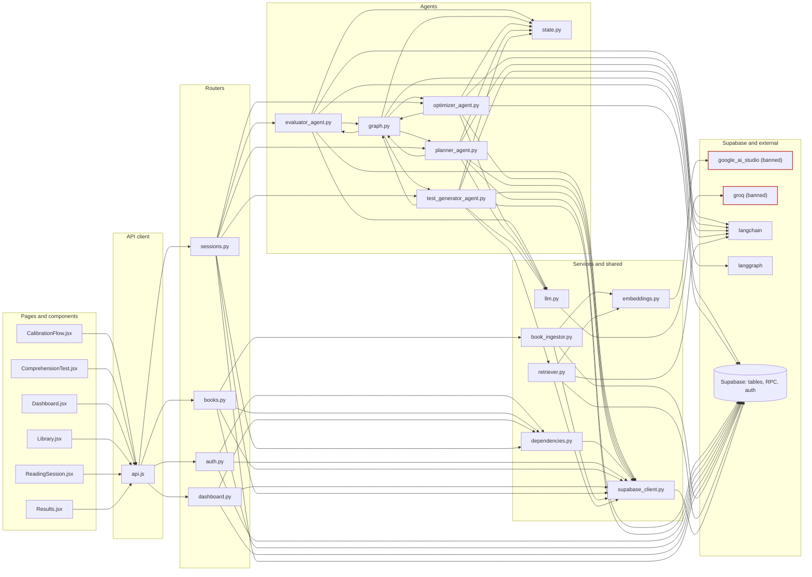
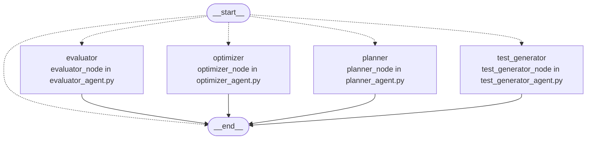

# Repository map

Generated by `tools/repo_graph/render.py` from `inventory.json` and
`graph.json`. Do not edit by hand; regenerate it instead.

133 files inventoried, 11 excluded, 184 graph nodes, 274 edges, 0 unresolved references.

## Layers

How a request travels. An arrow means the left file imports or calls the
right one. Files with no such link are left out.

## LangGraph wiring

Dotted arrows are conditional edges.

## Endpoints

| Endpoint | Handler | Defined in | Frontend callers |
|---|---|---|---|
| `DELETE /books/{book_id}` | `delete_book` | `backend/routers/books.py` | `frontend/src/pages/Library.jsx` |
| `GET /auth/profile` | `get_profile` | `backend/routers/auth.py` | `frontend/src/pages/ReadingSession.jsx` |
| `GET /books` | `get_books` | `backend/routers/books.py` | `frontend/src/pages/Library.jsx` |
| `GET /books/{book_id}` | `get_book_details` | `backend/routers/books.py` | `frontend/src/pages/Results.jsx` |
| `GET /books/{book_id}/status` | `get_book_status` | `backend/routers/books.py` | none |
| `GET /dashboard` | `get_dashboard` | `backend/routers/dashboard.py` | `frontend/src/pages/Dashboard.jsx` |
| `GET /health` | `health_check` | `backend/main.py` | none |
| `GET /sessions/{session_id}` | `get_session` | `backend/routers/sessions.py` | `frontend/src/pages/ComprehensionTest.jsx`, `frontend/src/pages/Results.jsx` |
| `POST /auth/profile/calibrate` | `calibrate_profile` | `backend/routers/auth.py` | `frontend/src/components/CalibrationFlow.jsx` |
| `POST /books/upload` | `upload_book` | `backend/routers/books.py` | `frontend/src/pages/Library.jsx` |
| `POST /sessions/start` | `start_session` | `backend/routers/sessions.py` | `frontend/src/pages/ReadingSession.jsx` |
| `POST /sessions/{session_id}/abandon` | `abandon_session` | `backend/routers/sessions.py` | none |
| `POST /sessions/{session_id}/evaluate-single` | `evaluate_single` | `backend/routers/sessions.py` | `frontend/src/pages/ComprehensionTest.jsx` |
| `POST /sessions/{session_id}/finish-reading` | `finish_reading` | `backend/routers/sessions.py` | `frontend/src/pages/ReadingSession.jsx` |
| `POST /sessions/{session_id}/submit-answers` | `submit_answers` | `backend/routers/sessions.py` | `frontend/src/pages/ComprehensionTest.jsx` |

## Database tables

| Table | Defined in | Altered by | Readers | Writers |
|---|---|---|---|---|
| `books` | `supabase/migrations/001_initial.sql` | none | `backend/routers/books.py`, `backend/routers/dashboard.py` | `backend/routers/books.py`, `backend/services/book_ingestor.py`, `scripts/manual/test_ingest.py` |
| `chunks` | `supabase/migrations/001_initial.sql` | `supabase/migrations/005_local_embeddings.sql` | `backend/agents/evaluator_agent.py`, `backend/agents/planner_agent.py`, `backend/agents/test_generator_agent.py`, `backend/mcp_server.py`, `backend/routers/sessions.py`, `backend/services/retriever.py` | `backend/services/book_ingestor.py` |
| `profiles` | `supabase/migrations/001_initial.sql` | `supabase/migrations/004_add_is_calibrated.sql` | `backend/agents/planner_agent.py`, `backend/routers/auth.py` | `backend/routers/auth.py` |
| `reading_progress` | `supabase/migrations/001_initial.sql` | `supabase/migrations/002_add_pace.sql` | `backend/agents/evaluator_agent.py`, `backend/agents/optimizer_agent.py`, `backend/agents/planner_agent.py`, `backend/routers/books.py`, `backend/routers/dashboard.py` | `backend/agents/evaluator_agent.py`, `backend/agents/optimizer_agent.py`, `backend/agents/planner_agent.py` |
| `sessions` | `supabase/migrations/001_initial.sql` | `supabase/migrations/003_session_questions.sql` | `backend/agents/planner_agent.py`, `backend/routers/dashboard.py`, `backend/routers/sessions.py` | `backend/routers/sessions.py` |
| `test_results` | `supabase/migrations/001_initial.sql` | none | `backend/agents/evaluator_agent.py`, `backend/agents/optimizer_agent.py`, `backend/agents/planner_agent.py`, `backend/agents/test_generator_agent.py`, `backend/mcp_server.py`, `backend/routers/dashboard.py`, `backend/routers/sessions.py` | `backend/agents/evaluator_agent.py` |

## Database functions

| Function | Defined in | Called by |
|---|---|---|
| `handle_new_user` | `supabase/migrations/001_initial.sql` | none |
| `match_chunks` | `supabase/migrations/001_initial.sql` | `backend/services/retriever.py` |
| `match_chunks_local` | `supabase/migrations/005_local_embeddings.sql` | none |

## External services

Each use is the file and line of the first import of that service.

| Service | Banned by CLAUDE.md | Used at |
|---|---|---|
| `google_ai_studio` | yes | `backend/services/embeddings.py:5`, `backend/tests/conftest.py:20` |
| `google_fonts` | no | `frontend/index.html:8` |
| `groq` | yes | `backend/services/llm.py:8`, `backend/tests/conftest.py:21` |
| `langchain` | no | `backend/agents/evaluator_agent.py:3`, `backend/agents/optimizer_agent.py:4`, `backend/agents/planner_agent.py:5`, `backend/agents/test_generator_agent.py:3`, `backend/services/retriever.py:1` |
| `langgraph` | no | `backend/agents/graph.py:1` |
| `mcp` | no | `backend/mcp_server.py:28` |
| `supabase` | no | `backend/mcp_server.py:29`, `backend/services/supabase_client.py:3`, `backend/tests/conftest.py:24`, `frontend/src/lib/supabase.js:1`, `scripts/dev/create_test_users.py:23` |

## Environment variables

| Variable | Declared in | Read by |
|---|---|---|
| `CEREBRAS_API_KEY` | `render.yaml` | none |
| `EMBED_THREADS` | none | `backend/nlp/embedder.py` |
| `ENV` | `.env.example` | `scripts/dev/create_test_users.py` |
| `FASTEMBED_CACHE` | `.env.example` | `backend/nlp/embedder.py` |
| `FRONTEND_URL` | `.env.example`, `render.yaml` | `backend/main.py` |
| `GOOGLE_AI_STUDIO_KEY` | `.env.example`, `render.yaml` | `backend/services/embeddings.py` |
| `GROQ_API_KEY` | `.env.example`, `render.yaml` | `backend/services/llm.py` |
| `SAMBANOVA_API_KEY` | `render.yaml` | none |
| `SUPABASE_ANON_KEY` | `.env.example`, `render.yaml` | `backend/mcp_server.py` |
| `SUPABASE_SERVICE_KEY` | `.env.example`, `render.yaml` | `backend/mcp_server.py`, `backend/services/supabase_client.py`, `scripts/dev/create_test_users.py` |
| `SUPABASE_URL` | `.env.example`, `render.yaml` | `backend/mcp_server.py`, `backend/services/supabase_client.py`, `scripts/dev/create_test_users.py` |
| `VITE_API_URL` | `frontend/.env.example` | `frontend/src/lib/api.js` |
| `VITE_SUPABASE_ANON_KEY` | `frontend/.env.example` | `frontend/src/lib/supabase.js` |
| `VITE_SUPABASE_URL` | `frontend/.env.example` | `frontend/src/lib/supabase.js` |

## Files

### entry (5)

| File | Lines | Purpose |
|---|---|---|
| `backend/main.py` | 48 | FastAPI app: CORS, the five routers and /health. Starts no other process. |
| `backend/mcp_server.py` | 100 | Standalone FastMCP server with three Supabase tools (reading history, comprehension trend, chunk context); not started by the app since C3.4 and not called by any agent; kept for manual use. |
| `frontend/index.html` | 16 | Vite HTML shell: loads the Google Fonts (DM Mono, DM Sans, Lora, Playfair Display) and mounts /src/main.jsx. |
| `frontend/src/App.jsx` | 42 | Route table and AuthGuard: /login, /read/:bookId, /test/:sessionId, and Library, Dashboard and Results inside Layout. |
| `frontend/src/main.jsx` | 10 | React entry: renders App in StrictMode and loads index.css. |

### router (6)

| File | Lines | Purpose |
|---|---|---|
| `backend/routers/__init__.py` | 1 | Package marker for backend.routers. |
| `backend/routers/agent.py` | 3 | Empty APIRouter mounted at /agent; defines no endpoints. |
| `backend/routers/auth.py` | 49 | GET /auth/profile and POST /auth/profile/calibrate: read the profile and save the calibrated reading speed. |
| `backend/routers/books.py` | 125 | Book endpoints: upload to Storage and start ingestion in the background, list, details with progress, status poll, delete. |
| `backend/routers/dashboard.py` | 155 | GET /dashboard: aggregates book progress, scores over time, reading streak, words this week and recent feedback. |
| `backend/routers/sessions.py` | 254 | Session lifecycle endpoints: start (planner), finish-reading (test), evaluate-single (background grade), submit-answers (evaluator and optimizer), abandon, get. |

### agent (7)

| File | Lines | Purpose |
|---|---|---|
| `backend/agents/__init__.py` | 1 | Package marker for backend.agents. |
| `backend/agents/evaluator_agent.py` | 216 | Evaluator node: grades each answer 0-10 with the Groq LLM (full marks on LLM error), inserts test_results, updates the rolling average in reading_progress. |
| `backend/agents/graph.py` | 59 | Builds the LangGraph workflow: routes from __start__ by state status to planner, test_generator, evaluator or optimizer, each ending at END. |
| `backend/agents/optimizer_agent.py` | 120 | Optimizer node: score thresholds set the chunk multiplier and re-read queue; the Groq LLM picks the next focus duration; saves pace_recommendation. |
| `backend/agents/planner_agent.py` | 189 | Planner node: serves the re-read queue first, otherwise asks the Groq LLM how many of the next three chunks to assign; falls back to one chunk for 20 minutes. |
| `backend/agents/state.py` | 17 | AgentState TypedDict shared by all agent nodes. |
| `backend/agents/test_generator_agent.py` | 124 | Test generator node: returns cached questions or asks the Groq LLM for five (3 factual, 1 inference, 1 summary) with RAG context; falls back to generic questions. |

### service (6)

| File | Lines | Purpose |
|---|---|---|
| `backend/services/__init__.py` | 1 | Package marker for backend.services. |
| `backend/services/book_ingestor.py` | 182 | Extracts text from PDF and EPUB, chunks it by paragraph to about 600 words, embeds and inserts each chunk, marks the book ready after five chunks. |
| `backend/services/embeddings.py` | 37 | Google AI Studio embedding client (gemini-embedding-2, 1536 dimensions) with retry; raises at import if the key is missing. Banned provider. |
| `backend/services/llm.py` | 37 | Groq ChatGroq client (llama-3.3-70b-versatile) exported under five agent names; raises at import if the key is missing. Banned provider. |
| `backend/services/retriever.py` | 39 | Similar-chunk lookup through the match_chunks RPC, plus an unused LangChain SupabaseVectorStore retriever. |
| `backend/services/supabase_client.py` | 14 | Creates the shared service-role Supabase client; raises at import if the URL or key is missing. |

### migration (5)

| File | Lines | Purpose |
|---|---|---|
| `supabase/migrations/001_initial.sql` | 165 | Initial schema: pgvector, six tables, the new-user profile trigger, RLS policies, the books bucket, and match_chunks. |
| `supabase/migrations/002_add_pace.sql` | 1 | Adds reading_progress.pace_recommendation (jsonb). |
| `supabase/migrations/003_session_questions.sql` | 1 | Adds sessions.test_questions (jsonb). |
| `supabase/migrations/004_add_is_calibrated.sql` | 1 | Adds profiles.is_calibrated (boolean, default false). |
| `supabase/migrations/005_local_embeddings.sql` | 46 | Adds chunks.embedding_local vector(384) with an HNSW cosine index and match_chunks_local, which runs as the caller so RLS applies; the 1536 column and match_chunks are untouched. |

### page (12)

| File | Lines | Purpose |
|---|---|---|
| `frontend/src/pages/ComprehensionTest.css` | 300 | Styles for the test page: dark timer strip, question dots, slide animations, answer textarea, submitting overlay. |
| `frontend/src/pages/ComprehensionTest.jsx` | 261 | Five-question timed test (5 minutes): grades each answer in the background on navigation, auto-submits at zero, routes to Results. |
| `frontend/src/pages/Dashboard.css` | 265 | Styles for the dashboard: header, stat row, chart frame, book progress cards, feedback quotes, empty states. |
| `frontend/src/pages/Dashboard.jsx` | 245 | Progress page: streak, words this week, a Recharts score line per book, book progress cards, recent feedback. |
| `frontend/src/pages/Library.css` | 227 | Styles for the library: upload zone, book rows, processing sweep, empty state; uses transition: all. |
| `frontend/src/pages/Library.jsx` | 275 | Library page: drag-and-drop upload with a title and author modal, 3-second status polling, book list, delete. |
| `frontend/src/pages/Login.css` | 172 | Styles for the split login page: quote panel, tabs, form fields; single column below 768 px. |
| `frontend/src/pages/Login.jsx` | 145 | Sign in and sign up form with a quote panel; collects a display name that is never sent. |
| `frontend/src/pages/ReadingSession.css` | 297 | Styles for the reading page: chrome bar, sticky timer strip, reason strip, distraction-free mode, reading column with drop cap. |
| `frontend/src/pages/ReadingSession.jsx` | 269 | Reading page: checks calibration, starts a session, shows the timer and pacing bar, distraction-free mode, finish and abandon (abandon does not call the API). |
| `frontend/src/pages/Results.css` | 239 | Styles for the results page: large score, verdict colours, per-question breakdown, next-session and re-read panels. |
| `frontend/src/pages/Results.jsx` | 186 | Results page: animated score, verdict, per-question feedback, next-session or re-read panel; rebuilds from the API after a refresh. |

### component (13)

| File | Lines | Purpose |
|---|---|---|
| `frontend/src/components/CalibrationFlow.jsx` | 87 | First-session reading speed test: times a 200-word passage and posts the WPM to /auth/profile/calibrate. |
| `frontend/src/components/Layout.css` | 140 | Styles for the global nav and main content column; hides nav links below 640 px. |
| `frontend/src/components/Layout.jsx` | 54 | Global nav (wordmark, Library and Dashboard links, email, sign out) wrapped around page content. |
| `frontend/src/components/ui/Button.css` | 86 | Button styles: primary, secondary and danger variants and the loading sweep; uses transition: all. |
| `frontend/src/components/ui/Button.jsx` | 22 | Button with variant and loading props. |
| `frontend/src/components/ui/Card.css` | 11 | Card surface and hover styles. |
| `frontend/src/components/ui/Card.jsx` | 18 | Card container with an optional hover state; not used by any page. |
| `frontend/src/components/ui/Modal.css` | 28 | Modal backdrop (blurred) and panel styles. |
| `frontend/src/components/ui/Modal.jsx` | 40 | Portal modal: closes on Escape and backdrop click, focuses the panel on open, does not trap focus. |
| `frontend/src/components/ui/ScoreBadge.css` | 17 | Score badge dot and text styles. |
| `frontend/src/components/ui/ScoreBadge.jsx` | 26 | Coloured percentage badge (green from 75, amber from 50, red below); imported by Library but not rendered. |
| `frontend/src/components/ui/Skeleton.css` | 15 | Shimmer animation for loading placeholders. |
| `frontend/src/components/ui/Skeleton.jsx` | 12 | Loading placeholder block with width and height props. |

### hook (2)

| File | Lines | Purpose |
|---|---|---|
| `frontend/src/hooks/useAuth.jsx` | 43 | AuthProvider and useAuth: Supabase session state plus signIn, signUp and signOut. |
| `frontend/src/hooks/usePageTransition.js` | 33 | Adds the .visible class on mount and returns navigateTo, which fades the page out before routing. |

### lib (7)

| File | Lines | Purpose |
|---|---|---|
| `backend/__init__.py` | 1 | Package marker for backend. |
| `backend/dependencies.py` | 20 | get_current_user FastAPI dependency: resolves a Supabase JWT to a user id through supabase.auth.get_user; anything else is a 401. |
| `backend/nlp/__init__.py` | 1 | Package marker for backend.nlp, the local NLP building blocks (no API calls). |
| `backend/nlp/embedder.py` | 74 | Local embeddings: one lazily loaded, thread-safe fastembed model (all-MiniLM-L6-v2, 384 dimensions, cache in FASTEMBED_CACHE); embed and embed_one return unit-length float32 vectors. |
| `backend/nlp/text.py` | 133 | Pure text utilities, standard library only: normalize (PDF hyphenation, line breaks, quotes), split_sentences with an abbreviation guard, tokenize, STOPWORDS, content_words, and informativeness, a 0..1 sentence score. |
| `frontend/src/lib/api.js` | 40 | fetchApi: adds the Supabase bearer token, calls VITE_API_URL, signs out on 401, throws on a non-OK response. |
| `frontend/src/lib/supabase.js` | 6 | Creates the browser Supabase client; falls back to a hard-coded project URL and publishable key when the env vars are unset. |

### config (18)

| File | Lines | Purpose |
|---|---|---|
| `.env.example` | 26 | Backend environment template: Supabase keys, FRONTEND_URL, ENV, FASTEMBED_CACHE, the optional EMBED_THREADS, and the two provider keys due for removal in C8. |
| `.github/workflows/ci.yml` | 97 | CI on every push: ruff on backend/, pytest on backend/tests, frontend build, repo graph freshness and tooling tests; triggers the Render deploy hook on main. |
| `.gitignore` | 28 | Root ignore rules: env files, node_modules, Python caches and virtualenvs, .cache/, the Impeccable binary, OS files. |
| `Dockerfile` | 15 | Backend image for Render: python:3.11-slim, installs root requirements.txt, copies backend/, runs uvicorn on port 8000. |
| `Makefile` | 19 | Targets: dev-backend (uvicorn with reload), dev-frontend (Vite), dev (both via concurrently), graph (regenerate docs/repo-graph/). |
| `frontend/.env.example` | 6 | Frontend environment template: VITE_SUPABASE_URL, VITE_SUPABASE_ANON_KEY, VITE_API_URL. |
| `frontend/.gitignore` | 24 | Vite template ignore rules: logs, node_modules, dist, editor files. |
| `frontend/eslint.config.js` | 21 | ESLint flat config: JS recommended, react-hooks and react-refresh rules for .js and .jsx. |
| `frontend/package.json` | 33 | Frontend dependencies and scripts (dev, build, lint, preview); lists Tailwind, which the Vite config does not load. |
| `frontend/vercel.json` | 10 | Vercel config: build command, dist output, and a rewrite of every path to index.html. |
| `frontend/vite.config.js` | 28 | Vite config: React plugin, an /api dev proxy to port 8000, and a single vendor chunk. |
| `package.json` | 5 | Root package with one dev dependency, the Supabase CLI. |
| `pyrightconfig.json` | 5 | Pyright config pointing at .venv with pythonVersion 3.14. |
| `pytest.ini` | 3 | Limits a bare pytest run to backend/tests and tools/repo_graph/tests, so scripts/manual/ is never collected. |
| `render.yaml` | 23 | Render blueprint for the Docker backend; declares Supabase, Groq, Cerebras, Google AI Studio and SambaNova keys. |
| `requirements.txt` | 40 | The only backend dependency list, used by the Dockerfile and CI: every package backend/ imports, pinned, including fastembed and numpy for backend/nlp/; still includes the Groq and Google AI Studio packages until C8. |
| `supabase/.gitignore` | 8 | Ignores Supabase CLI branch and temp folders and local env key files. |
| `supabase/config.toml` | 408 | Supabase CLI local-development config (ports, auth, storage), close to the generated defaults. |

### test (17)

| File | Lines | Purpose |
|---|---|---|
| `backend/tests/__init__.py` | 1 | Package marker for backend.tests. |
| `backend/tests/conftest.py` | 119 | Offline test setup: dummy environment, a fake Supabase client, Groq and Google embedding classes that raise when called, and a guard that blocks non-loopback connections. |
| `backend/tests/test_auth.py` | 73 | Pytest: get_current_user rejects a raw UUID token with 401 and returns the user id for a token Supabase accepts (supabase.auth mocked). |
| `backend/tests/test_bench.py` | 40 | Pytest: percentile, duration formatting, table rows including 'not measurable', and the Baseline section update in scripts/bench.py. |
| `backend/tests/test_embedder.py` | 126 | Pytest: embedder output shape, unit length, batching, lazy single load across threads and env settings on a fake model; similar sentences beat unrelated ones on the real model when it is cached. |
| `backend/tests/test_health.py` | 19 | Pytest: /health returns 200 with status ok and a timestamp. |
| `backend/tests/test_ingestor.py` | 86 | Pytest: chunk_text chunk counts, word bounds, paragraph integrity and content preservation. |
| `backend/tests/test_migrations.py` | 69 | Pytest: no migration has a destructive statement, and 005 adds embedding_local vector(384) with an HNSW cosine index and an RLS-respecting match_chunks_local. |
| `backend/tests/test_offline.py` | 62 | Pytest: the suite uses the dummy environment and the fakes, outbound connections are blocked, loopback works, and a protected endpoint answers 401. |
| `backend/tests/test_requirements.py` | 60 | Pytest: every third-party package imported under backend/ is in requirements.txt, every line is pinned, and backend/ has no second requirements file. |
| `backend/tests/test_startup.py` | 22 | Pytest: starting and stopping the app through TestClient spawns no subprocess. |
| `backend/tests/test_text.py` | 110 | Pytest, table-driven: sentence splitting (abbreviations, quotes, lists, hyphenated line breaks), normalisation, tokens, stopwords, and informativeness rankings. |
| `tools/repo_graph/tests/__init__.py` | 0 | Package marker for tools.repo_graph.tests. |
| `tools/repo_graph/tests/test_build.py` | 241 | Pytest: graph edges on a tiny in-memory fixture repo, and coverage of routers and pages in the real graph. |
| `tools/repo_graph/tests/test_inventory.py` | 87 | Pytest: role, language and exclusion rules, CRLF-safe measuring, purpose checks, and completeness of the real inventory. |
| `tools/repo_graph/tests/test_query.py` | 83 | Pytest: file, endpoint and table queries, path forms, unknown targets, and the importers of llm.py in the real graph. |
| `tools/repo_graph/tests/test_render.py` | 71 | Pytest: diagram links, lookup table rows and the file list of the rendered map, on the fixture repo and the real one. |

### doc (13)

| File | Lines | Purpose |
|---|---|---|
| `.claude/skills/atomic-commit/SKILL.md` | 186 | Project skill: commit size limit, pre-commit checklist, explicit staging, and the commit message format with types and scopes. |
| `.claude/skills/debug-protocol/SKILL.md` | 200 | Project skill: the ten-step failure procedure and the docs/DEBUG_LOG.md entry template. |
| `.claude/skills/design-review/SKILL.md` | 157 | Project skill: the gate for UI changes; chains the three design skills, then a checklist and a before/after commit note. |
| `.claude/skills/free-intelligence/SKILL.md` | 210 | Project skill: banned providers, approved local libraries and free APIs, the memory rule, and the pure decide() agent pattern. |
| `.claude/skills/repo-graph/SKILL.md` | 122 | Project skill: query the repo graph before an edit, regenerate it after a structural change, and what the graph does not see. |
| `CLAUDE.md` | 182 | Project rules for ReadFocus 2.0: goal, hard constraints, working method, stack, branch model, standard checks, commit format, skills. |
| `README.md` | 135 | Product overview and architecture; still describes the pre-2.0 Groq and Google AI Studio setup and an orchestrator node that no longer exists. |
| `docs/BENCHMARKS.md` | 232 | Measured numbers with the command, machine and date for each: backend idle memory before and after C3.4, the C4.1 embedding model memory and latency with Gate G2, and the C3.5 API baseline with its caveats. |
| `docs/DEBUG_LOG.md` | 245 | Debug log rules, entry template, and one entry per failure. |
| `docs/MIGRATION_AUDIT.md` | 364 | Audit from the full read: verdicts on suspected issues, architecture, LLM calls with file:line, schema and RLS, background tasks, dead code, security, risks, files to change. |
| `docs/PROGRESS.md` | 486 | Sprint tracker: open issues, one row per subchunk for C0-C1, and the C2 plan. |
| `frontend/README.md` | 16 | Unedited Vite React template README; says nothing about ReadFocus. |
| `progress.md` | 65 | Pre-2.0 progress tracker, kept for history only. |

### asset (2)

| File | Lines | Purpose |
|---|---|---|
| `frontend/src/App.css` | 184 | Leftover Vite template styles; not imported by any file. |
| `frontend/src/index.css` | 70 | Design tokens (ink, paper and amber colours, four font families, 8 px grid), reset, focus ring, and the .page fade. |

### script (20)

| File | Lines | Purpose |
|---|---|---|
| `scripts/bench.py` | 196 | Signs in as dev test user A and times /health, /books, the upload-to-ready and session flow, and /dashboard against a local backend; prints p50/p95 and can write the Baseline section of docs/BENCHMARKS.md. |
| `scripts/dev/create_test_users.py` | 117 | Creates or resets two confirmed dev test users and writes .env.test; refuses to run unless ENV=development. |
| `scripts/dev/measure_embedder.py` | 86 | Measures the embedding model in a fresh process: psutil RSS before and after import, load and batches, model load time, and the latency of a batch of short and of chunk-sized texts. |
| `scripts/dev/measure_rss.py` | 69 | Starts uvicorn on a spare port, waits for /health, then prints the psutil RSS of the server and every child process. |
| `scripts/manual/README.md` | 47 | Explains that the eight manual scripts are not tests, need live Supabase, Groq and Google AI Studio, and must not be run during the sprint; lists each script's known problems. |
| `scripts/manual/test_evaluator.py` | 57 | Manual script: generates a test then grades canned answers against hard-coded user and book ids. Not a pytest test. |
| `scripts/manual/test_generator.py` | 25 | Manual script: generates questions for a hard-coded book id and prints them. Not a pytest test. |
| `scripts/manual/test_graph.py` | 25 | Manual script: invokes the workflow with an event_type key that the graph no longer reads. Not a pytest test. |
| `scripts/manual/test_ingest.py` | 48 | Manual script that runs at import: creates a user and book, then calls ingest_book on sample.pdf without awaiting it. |
| `scripts/manual/test_optimizer.py` | 46 | Manual script: runs optimize_pace with a 7/50 score against hard-coded ids. Not a pytest test. |
| `scripts/manual/test_orchestrator.py` | 38 | Manual script: imports orchestrator_node from backend.agents.graph, which does not exist, so it fails at import. |
| `scripts/manual/test_planner.py` | 25 | Manual script: runs plan_session against hard-coded ids and prints the plan. Not a pytest test. |
| `scripts/manual/test_sessions_api.py` | 64 | Manual end-to-end script: start, finish-reading and submit-answers through TestClient, authenticating with a raw UUID, which has been rejected with 401 since C3.1. |
| `tools/__init__.py` | 0 | Package marker for tools. |
| `tools/repo_graph/__init__.py` | 0 | Package marker for tools.repo_graph. |
| `tools/repo_graph/build.py` | 383 | Builds docs/repo-graph/graph.json: typed nodes and edges for files, endpoints, tables, functions, env vars, external services and LangGraph nodes. |
| `tools/repo_graph/inventory.py` | 194 | Builds docs/repo-graph/inventory.json: path, language, lines, size, role and purpose for every tracked file, plus the exclusions. |
| `tools/repo_graph/purposes.json` | 135 | Hand-written one-line purpose for every inventoried file, written after reading it. |
| `tools/repo_graph/query.py` | 164 | CLI that prints what a file, endpoint, table or other graph node touches and what touches it, from graph.json. |
| `tools/repo_graph/render.py` | 227 | Renders docs/repo-graph/REPO_MAP.md: Mermaid layer and LangGraph diagrams plus endpoint, table, function, service, env var and file tables. |
